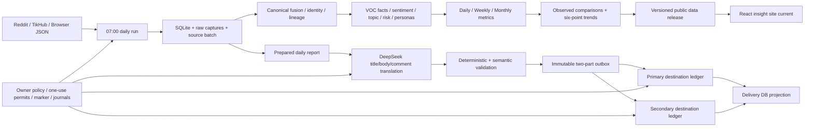

# Reddit VOC 项目状态与继续执行交接

本文档是下一阶段继续执行的状态入口。它只记录已经由当前代码、Git 工作区、测试或回执证明的状态；详细历史设计仍保留在 `docs/`，但若旧文档的“当前状态”与本文冲突，以本文的证据截止时间为准。

证据口径：

- **生产事实**：有生产只读回读或生产动作后的终态回执。
- **本地候选**：代码、fixture、fake transport 或本地 release 已通过，但不等于生产生效。
- **未验证**：没有终态回执，或仅能证明配置就绪、不能证明自然运行结果。
- HTTP 200、账本和数据库闭合只能证明钉钉机器人接受请求，不能证明群成员已阅读。

## 1. 当前目标

当前目标不是继续增加页面或报告类型，而是把已经具备的采集、分析、报告和双机器人能力收敛为一条可重复、可追溯、自动运行的生产链：

1. 每日 07:00 数据采集后，以真实 `data_as_of` 驱动数据源板块和洞察站，不再停留在旧日期。
2. 日报使用 DeepSeek 完成标题、正文和评论中文翻译；任一翻译或语义门禁失败时禁止发送。
3. 同一份 immutable prepared outbox 按 primary、secondary 两个目标独立幂等发送，支持部分送达和未知状态，禁止自动重复发送已成功目标。
4. 日报、周报、月报继续显示同环比和六点趋势；三者是对每日来源数据的周期聚合，不是三套独立采集器。
5. 8 月 15 日、8 月 21 日与 8 月 22 日 exact outbox 的双目标受控补推与终态验收均已完成；生产已有唯一北京时间 08:00 guarded cron。8 月 22 日已修复 `scheduled-cycle` 被误路由到 smoke 的生产根因，当前必须由 8 月 23 日首个自然周期证明自动链路，并在当前年度 authority 到期前完成续期验收。

下一阶段完成标准：2026-08-23 自然 07:00→08:00 周期对同一 immutable outbox 完成 source、DeepSeek translation、prepared、primary/secondary terminal `sent`、DB projection 和 cycle=`send_consumed`；TikHub comments 路由恢复并重新产生非零评论，或由上游正式证据确认持续不可用并保留降级状态；公开洞察站 current 指向包含最新已准入数据的 release；每次变更由 GitHub `main`、生产 version lock 和只读 postflight 共同闭合。

## 2. 当前状态摘要

| 能力面 | 当前状态 | 证据等级 | 继续执行时的边界 |
|---|---|---|---|
| 每日采集 | `daily_collect_20260822_0700` 已存在：12 posts、0 comments，source 状态为 `partial`；comments 路由对 full/bare Reddit ID 均返回 TikHub HTTP 400 | 2026-08-22 生产 source receipt + 有界 live 诊断 | 帖子可用于日报；0 comments 不得伪造，且不能把 TikHub 上游 400 表述为本地已修复 |
| 日报生产 runtime | daily current=`7b177962a7fa36bcc6f873e115f363c53de4d5b7922b8316f21303bc7c5ec181`；`scheduled-cycle` 已进入真实 prepare/send 分支，不再落入 smoke；release manifest=`92c57f71...fadf` | 2026-08-22 G6R6 原子激活 + network-none smoke + 独立生产后检；263/263 self-contained tests | 代码根因已修复，但自动恢复必须由 8 月 23 日自然周期实证，不能用 8 月 22 日补推代替 |
| DeepSeek 翻译与 prepared | 2026-08-22 仅一次 prepare：10 次 DeepSeek request、retry=0、unknown=0；10/10 中文、10/10 semantic accepted、placeholder=0、1/1 outbox part 含中文 | L4 授权 Provider + R2 network-none validation + L3 后检 | prepared version=`20260822T074914983158Z-587dbe1938e642ed155762189fd31dc1` 已消费，不得二次 prepare |
| 双机器人投递 | 8 月 22 日 outbox=`724b4450...763a` 已向 primary、secondary 各发 1 次；两个独立 ledger 的 part 1 均 terminal `sent`，生产 DB 恰好投影 2 条 live/sent | L4 生产发送终态 + L3 独立只读验收；receipt file=`5ce7babf...0a97` | 这是受控补推，不是自然 08:00 成功；HTTP/ledger 不能证明人工阅读，禁止复用 permit 或重发同一 part |
| 自然双目标周期 | 8 月 22 日 08:00 cron 确实运行，但旧 launcher 将 `scheduled-cycle` 误路由到 smoke 并形成假完成，未调用 Provider、未 prepare、未发送 | 2026-08-22 生产 cron/cycle/Provider/prepared/delivery 联合归因 | 下一自然验收日期为 2026-08-23；只有 cycle=`send_consumed`、双 ledger 与 DB projection 全闭合才算自动恢复 |
| 年度 08:00 authority | v3 policy/owner 已生产激活，覆盖 2026-08-22 至 2027-08-21 共 365 个北京时间 08:00 双目标时隙；policy SHA=`974f8ab4...c2df` | 2026-08-22 生产只读回读，`max_slots=365`、expires=`2027-08-21T00:30:00Z` | cron SHA 未变且仍为唯一 08:00 入口；年度 authority 生效不等于任何一天实际送达 |
| 日/周/月报告 | 最新本地数据候选通过同环比/同比/六点趋势审计：日报 5/5/5、周报 9/9/9、月报 10/10/10 | L2 本地候选 | 历史采集完整性没有 Owner 证明，比较口径仍应标为 observed |
| 洞察站 UI | 当前嵌套 UI 测试 229 passed / 46 skipped；真实 Dashboard、报告、搜索、分析、洞察和帖子中文详情能力在本地源码中存在 | L2 本地代码 | 当前生产 site/data current 最后一次只读确认仍是 2026-08-10 线，未包含 2026-08-12 日报补推 |
| 公开生产站 | 最近只读事实：site current=`da9b94b5e0a6e39941765779164303e54b92a338b1754d035dd3fea798052acc`，data current=`reddit_voc_release_20260810_observed_translation_v1` | 2026-08-11 L3 快照 | 本轮没有执行 public current 切换，页面日期不会因补推自动变成今天 |
| Git 可追溯性 | 根仓库已建立 `main`，初始导入 commit=`ebcaede01a57e32a60448746d07d31e8d7989197` 并推送至 `zjgulai/Reddit_VOC`；原嵌套 UI 历史 `d754bc7` 已以完整 bundle 保存在根 `.git/pre-import-backups/`，UI 文件改由根 Git 直接跟踪 | 当前 Git/GitHub 事实 | 每次完成必须满足 clean worktree、`HEAD=origin/main`、GitHub Actions green；本地 backup 不属于 GitHub 或生产制品 |

### 2026-08-22 G6R6：自然周期根因修复与今日双机器人补推终态

本节覆盖所有早于 2026-08-22 的“当前自然周期/年度 authority 尚未激活”描述；旧条目只保留为历史证据。

- **已确认事实——08:00 根因**：cron、stable launcher 和 `scheduled-cycle` 入口均真实运行；但 `scripts/server_daily_report.sh` 的 prepare 分支只接受 `prepare|scheduled-prepare`，遗漏 `scheduled-cycle`。因此自然任务完成 reservation 后落入 smoke 路径，错误形成无 Provider、无 prepared、无 delivery 的“完成”。这解释了“cron 看似成功但钉钉没有消息”，并能预测 Provider ledger、prepared current 和双 destination ledger 全部缺失。
- **已确认事实——生产修复**：launcher 已把 `scheduled-cycle` 纳入真实 prepare/send 分支；self-contained release 263/263 tests 通过。生产原子激活 release=`7b177962a7fa36bcc6f873e115f363c53de4d5b7922b8316f21303bc7c5ec181`、manifest=`92c57f712bb745590b0ef8508789dd1052a4859036939ef243913f1e1e99fadf`；current、policy=`974f8ab4...c2df`、owner=`eb4658b8...3dde`、marker=`c2c93212...1a46`、journal=`be24653d...43e5` 已闭合，cron/periodic current/report-env inode 未变。v3 authority 已生产生效，365 个 slot 覆盖至 2027-08-21。
- **已确认事实——comments 独立故障**：`daily_collect_20260822_0700` 有 12 posts、0 comments，source=`partial`。对 TikHub comments 路由使用 Reddit fullname 与 bare ID 的有界生产诊断均返回 HTTP 400；这排除了单一 `t3_` 归一化或 sort 参数是充分根因。帖子日报可继续构建，但评论覆盖仍不可用。
- **已确认事实——今日翻译与 prepared**：唯一 prepare authorization=`g6r6-prepare-20260822-r1` 已 consumed；DeepSeek `deepseek-v4-flash` 共 10 次 request、retry=0、unknown=0。prepared version=`20260822T074914983158Z-587dbe1938e642ed155762189fd31dc1`、bundle=`dbc97d8c...cb6e`、outbox=`724b4450...763a`；10/10 字段有中文并通过 semantic，placeholder=0、source-equal allowance=0，1/1 outbox part 含中文。
- **失败方案与恢复**：首次 G6R6 validation R1 的 validator 已允许 1–2 parts，但 bootstrap 仍硬编码旧 release=`968845d5...41af`，容器在无 Provider/无发送/无 DB 写入状态下 terminal blocked，receipt=`5d1b126d...341c`。没有重跑 R1；R2 绑定该 blocked terminal evidence，只修正 bootstrap release path，network-none validation 通过，terminal receipt=`310209ed...6aa1`、validation receipt=`7550fb6a...77ec`。
- **已确认事实——今日双机器人补推**：send authorization=`g6r6-dual-send-20260822-r1` 只执行一次。terminal receipt 路径 `/home/ubuntu/.reddit-voc/report-control/diagnostics/g6r6-dual-send-20260822-r1/dual-send-receipt.json`，文件 SHA=`5ce7babfbe96066d6bf0bfee9ccfce60f300e94214606215c25fd65cedef0a97`。primary ledger SHA=`56159ce3...a101`、secondary ledger SHA=`4fff2abd...8505`，两者 part 1 均 terminal `sent`，各 1 次 external attempt；生产 DB 从 `98ba1710...dcd3` 变为 `ed033962...891`，恰好新增 2 条 `mode=live,status=sent,live_send=1` 投影。
- **非干扰后验**：prepared-current、translation manifest、Provider ledger、validation terminal、daily/periodic current、7 项 authority/cron 与 report-env metadata 均未漂移；临时 secret、working SQLite、发送容器均已清除，report network container count=0，`automatic_resend=false`。
- **合理推断（高）**：8 月 23 日自然周期不再会因旧的 `scheduled-cycle` 分支遗漏而落入 smoke。依据是 exact release diff、263/263 tests、生产 current/authority binding 与 network-none smoke。
- **未验证项**：尚无 8 月 23 日自然 source→translation→prepared→双目标 send→DB projection→cycle=`send_consumed` 证据；因此不能宣布“每天 08:00 已自动恢复”。TikHub comments HTTP 400 的上游修复时间也未知。

### 2026-08-20 自然周期 cycle-lease 失败与 2026-08-21 修复

本节覆盖本文中所有较早的“下一自然周期验收”描述；历史补推和旧 release 故障记录继续保留，但不能替代本次的新鲜生产只读证据。

- **生产事实（当前任务只读 SSH 回读）**：08:00 cron 确实以 `ubuntu` 启动 `/opt/reddit-voc-daily-report/control/bin/g6r1_stable_launcher.py scheduled-cycle`。活跃 release 仍是 `968845d5ff79aa029356d79012d01cbc5dc2a285bfb3439e4154116db1b341af`，manifest SHA 为 `b72d4735970339d6f7bb37092190e94b69cd9291b01847e21b63b4bb1a6b827a`，image 是 `sha256:2e8dbc0225c2517ba58eb6151fab95ff271471c28e270515076e1b64e5334cb1`。
- **生产事实（当前任务只读 SSH 回读）**：`/opt/reddit-voc-daily-report/control/locks` 为 `root:root 0755`；08:00 的 `ubuntu` 用户没有在该目录创建文件的权限。当前 launcher 却在该目录创建 `.g6r1-cycle-lease.XXXXXX`，因此 `cron-report.log` 在 2026-08-20 08:00:01 BJT 记录 `reason=cycle_lease_create_failed`。同类失败共观察到 5 次。
- **生产事实（当前任务只读 SSH 回读）**：失败发生在 cycle reservation、DeepSeek、prepared、DingTalk 和数据库投影之前；本次失败记录均为 `provider_call=false`、`report_live_send=false`、`live_send=false`。`scheduled-cycles` 目录尚不存在，最近 prepared/provider/delivery 证据仍停留在 8 月 15 日。这不是 webhook、翻译或采集数据缺失造成的失败。
- **生产事实（当前任务只读 SSH 回读）**：`/home/ubuntu/.reddit-voc/run` 已存在且为 `ubuntu:ubuntu 0700`，但专用子目录 `/home/ubuntu/.reddit-voc/run/cycle-leases` 尚不存在。
- **本地候选（G6R4-A0）**：`scripts/server_daily_report.sh` 已把 lease token 的临时文件从 root-controlled shared lock directory 移至固定的 `/home/ubuntu/.reddit-voc/run/cycle-leases`；该目录必须是 `ubuntu:ubuntu 0700`、真实目录、无 symlink，并在使用前通过 lstat/open/fstat 闭合检查。生产模式拒绝 `REDDIT_VOC_REPORT_CYCLE_LEASE_ROOT` 覆盖；候选不会自动创建该目录，缺失或权限漂移会继续 fail-closed。shared lock 仍保持 root-controlled，未降低其权限。
- **本地候选（G6R4-A0）**：候选 release=`7fb175633e69e78a957b31fd4519ecbe41c265692940ef774a964c7e22a3910d`，manifest=`996b52390b97ece0f10c62c81b85e6df93af7a65f5a6957a60a28b518837def0`，位于 `tmp/reddit-voc-v3/p2e-freshness-automation-20260810/g6r4-a0-cycle-lease-contract-20260820/`。release verify、21-module import closure 和 `repository_fallback=false` 均通过；详见该目录 README。源码 launcher SHA=`794dfbf2dd4252925e613a6e1039b205f9f9984a31038f76fc1cea0b39bee001`，直接测试 SHA=`5aee4c80364ffb3102d168a2c18159e3e22992176adf7740ef54fcafd983e900`。
- **推断（高）**：在新 release 经原子生产安装、且专用 leaf 以精确 owner/mode 创建后，08:00 不会再因为 shared lock parent 的目录写权限失败；这只消除了当前已证实的第一阻断点，不构成任何一次发送或自然周期成功证明。
- **生产事实（G6R4-A1 L4）**：在 shared lock 下已安装 exact 61-entry release=`7fb175633e69e78a957b31fd4519ecbe41c265692940ef774a964c7e22a3910d`、manifest=`996b52390b97ece0f10c62c81b85e6df93af7a65f5a6957a60a28b518837def0`；原子创建 `/home/ubuntu/.reddit-voc/run/cycle-leases` 为 `ubuntu:ubuntu 0700`，重绑 policy=`61616288...da57`、owner=`47afef15...283f`，daily current CAS 到新 release，执行一次 pinned-image network-none smoke，最后写 committed journal=`7049bf23...c649` 和 marker=`1864b2f3...869a`。
- **生产事实（独立 L3 双快照后检）**：current、policy、owner、marker、journal、manifest、stable、cron、report-env inode=`729471`、periodic current 与 lease root 均稳定且精确匹配预期。local orchestration receipt SHA=`e2e8f319cdcc152484d77e42d2a0ef28f67fee2483e84fca361eb16ec18e6fc6`；独立 postflight receipt SHA=`915d84e2b88cfff27e52bc98d48f7e107cc78612107208a5cb61279ccbad990a`。本门禁 Provider、DeepSeek、DingTalk、DB、cron 和 public/periodic current effect 均为 false。
- **推断（高）**：下一自然 08:00 周期不应再因 `cycle_lease_create_failed` 在 reservation 前失败；这是基于 release、lease owner/mode 和 authority binding 的推断，而不是一次自然送达证明。
- **不确定项**：8 月 21 日自然 cycle 尚未完整验收。后续 A5 已为人工恢复链补齐 primary/secondary terminal delivery ledger 与 DB projection，但没有自然 scheduled-cycle 的 `send_consumed`；因此只能表述为“8 月 21 日受控补推已送达”，不能表述为“08:00 自动推送已恢复”。

### 2026-08-21 一次性翻译 prepared：A3-R1 / R2 / R3 / R4 生产终态

- **生产事实（G6R4-A3-R1）**：gate=`8a3790ee...a55d`、executor=`2548e3cf...1f4d` 已按 exact 授权执行；在 permit、prepare 和 Provider 之前以 `database_source_scope_mismatch` fail-closed。R1 `provider_call=false`、`prepare_invocations=0`、`dingtalk_send=false`、`production_database_write=false`；R1/A3 permit、state、Provider ledger、diagnostic、当日 public/private prepared 与 delivery 均不存在。DB=`c9d17e18...8e92`、prepared-current=`7bf1049f...eb6f`、daily current、authority、cron 和 A2 network 前像未变。
- **直接根因（高把握）**：source batch 的 16 个 `post_id` 全部是 Reddit fullname `t3_<bare_id>`，生产 DB 的对应 16 个 `post_id` 全部是 bare ID。原始集合不相等，但只移除单个精确 `t3_` 前缀后形成一一映射且集合完全相等；comments=0、analysis=16 均正确。这是门禁比较了两种 ID 表示法，不是 source/DB 数据缺失。
- **生产事实（G6R4-A3-R2）**：gate=`21605cef...7096`、executor=`11c662e4...c93a` 已按 exact 授权原子安装并只执行一次。`reddit_fullname_t3_or_bare_v1` 前像通过，但 launcher 在 attempt/Provider reserve 前终止；外层只解析 stdout，最终回报 `launcher_result_invalid`。L3 后检确认 R2 permit/state 仅为 `installed`，diagnostic journal=`permit_installed_before_single_prepare`，`attempt_id=null`，Provider root、prepared public/private、delivery 和 terminal receipt 均不存在；DB=`c9d17e18...8e92`、prepared-current=`7bf1049f...eb6f`、daily/periodic current、authority、cron、report-env inode 与 report network 均未漂移。
- **A3-R2 直接根因（高把握、exact launcher 本地复现）**：prepare executor 的 `ubuntu_prefix()` 注入 `REDDIT_VOC_HOST_PYTHON_BIN=/usr/bin/python3`，同一 exact production launcher SHA `794dfbf2...e001` 在 production 模式明确把该变量判为禁止 override，并立即输出 `reason=production_environment_override_forbidden`、exit 1。该预测与“permit 已安装、尚未 reserve、无 attempt ID/Provider/staging”的生产后像完全一致。外层未保留 stderr 原因，才把真实错误掩盖成 `launcher_result_invalid`。
- **本地候选（G6R4-A3-R3，L2）**：新 gate=`896556e1...26fd`、executor=`72e8e709...6ead` 已冻结。它绑定 R2 exact journal/permit/state/audit 和 Provider/prepare=0，在 shared lock 下先把 R2 精确关闭为 `closed_no_attempt`；child `env -i` 不再注入 `REDDIT_VOC_HOST_PYTHON_BIN`，production launcher 仍固定验证 `/usr/bin/python3`，早期 block 会保留安全的真实 reason 并关闭新 permit。R3 focused 13/13、五层组合 53/53、active release 259/259、21-module import closure 且 `repository_fallback=false` 均通过。
- **生产事实（G6R4-A3-R3 L4）**：gate=`896556e1...26fd`、executor=`72e8e709...6ead` 已原子安装并唯一执行一次。R2 permit 已精确关闭为 `closed_no_attempt`；R3 permit 已 consumed，prepare status=`complete`，实际发生 14 次 DeepSeek attempt、unknown=0，并提交 immutable prepared version=`20260821T052746775976Z-0a0a57643c51ac7e3e226f1c96f6b284`、bundle=`edd4c983...a570`、outbox=`2901ca01...af7e`。14/14 translation items accepted，CJK/source-equal/semantic/placeholder failure 均为 0。
- **R3 阻断与直接根因（高把握）**：R3 在 network-none validator 启动前以 `translation_item_source_scope_invalid` 阻断。translation manifest 的 14 个 stable ID 使用 bare Reddit post ID，而 source allowlist 使用 `t3_` fullname；exact ID match=0，但仅去掉单个严格 `t3_` 前缀后 14/14 ID 和 14/14 input SHA 全部匹配。入口 generic exception 错误回报 `provider_call=false`，但 production journal、consumed permit、42-row Provider ledger 和 complete manifest 共同证明实际 Provider call=true。
- **生产事实（G6R4-A3-R4 L4 + 独立 L3）**：gate=`040ceedd...77f7`、executor=`2928f730...ce14` 已 root-owned 原子安装并唯一执行一次，exit 0，terminal status=`complete_translation_validated_no_send`。network-none receipt=`f80c86d8...b066`：14/14 公开字段有中文，semantic accepted=14、placeholder=0、source-equal allowance=0；immutable outbox=`2901ca01...af7e` 为 1 part 且含中文。terminal receipt=`20bf56fd...bab6`，journal=`1822de6f...eae7`。
- **R4 非干扰后验**：R3 Provider ledger=`3b3e59b0...ff0a`、prepared-current=`ba08ac9a...6ff9`、bundle/registry、DB=`c9d17e18...8e92`、daily/periodic current、9 项 authority/cron 与 report-env inode=`729471` 均未漂移；R4 Provider root、8 月 21 日 delivery root和同名容器均不存在。本门禁 Provider/DeepSeek、prepare、prepared mutation、DingTalk、delivery ledger 和 DB write 全部为 0。
- **后续终态**：翻译和 prepared 在 R4 通过 production network-none 验收后，A5 已消费同一 immutable outbox，并对 primary/secondary 分别写入 terminal `sent` ledger 和 2 条 ledger-driven DB projection。R3/R4/A5 都不得重跑；该补推仍不能替代自然 08:00 周期验收。

### 2026-08-21 G6R4-A5 双机器人 send-only 生产终态

- **生产事实（L3 只读）**：2026-08-21T15:30:34–15:30:36 BJT 的双快照一致，daily current=`7fb175633e...10d`、release manifest=`996b5239...def0`、image=`sha256:2e8dbc02...34cb1`、DB=`c9d17e18...8e92`、prepared-current=`ba08ac9a...6ff9`、bundle=`edd4c983...a570`、outbox=`2901ca01...af7e` 均稳定。outbox 只有 1 part，part SHA=`195b48cc...1336`；A5 delivery/permit/diagnostic/container/tmpfs namespace 均为空，shared lock 可用。L3 receipt SHA=`c3348da2c64679b7fb7ed7cff99e4d1831ad57e7bbae605a695315f1bb568af9`。本次只为 DB 前像计算 SHA 做了只读读取；未读 credential 内容、未远端写、未启动容器、未发送。
- **本地候选（L2）**：A5 core=`e2b3dd8460ed968a91e1da0558579101ee36be97ae8ba297077f5fa970ba067a`、executor=`c1ec71373b959233fb1b801c8ce8a988da8e43e086cf501e34b431c855e01965`、permit=`d1571bc2638aa801721bfdbc13ef776f2474f2799415aeb4d7e0e8bbf6058417`、gate=`c2f76d7095cd43e6f8f1f4f71d7e7d3336b5770f6d6677e971a02ab9876d3482`。候选固定同一 outbox、primary/secondary 独立 ledger、每目标仅 1 次 part1 HTTP，总上限 2；只有 terminal `sent` 可投影 DB，总上限 2 行。`unknown`、`rejected`、`sent_unprojected`、容器终态不明或任何前像漂移均停止且 `automatic_resend=false`。
- **生产事实（L4）**：A5 在精确 16:30–16:45 BJT 授权窗口内只执行一次。terminal receipt=`/home/ubuntu/.reddit-voc/report-control/diagnostics/g6r4-a5-dual-send-20260821-r1/dual-send-receipt.json`，文件 SHA=`aa324829a5ba9bcb40ba2417fd9fa792c5dfae65b47f916d11781b4d74831406`。同一 immutable outbox=`2901ca01d84af6e31a87d68f9729639f7890ce4581f3e9369195bef1c852af7e` 的 primary、secondary 各有一个 terminal `sent` part；两个独立 ledger 与生产 DB 2 行 projection 闭合。
- **当前边界**：A5 是一次受控补推，不能证明 08:00 自动周期已经成功；不得复用 A5 permit 或发送同一 part。下一证据必须来自自然 scheduled cycle，而不是再次手工 send。

### 2026-08-21 G6R5 每日 08:00 双机器人年度候选（历史；已由 G6R6 生产激活）

- **生产事实（fresh L3 双快照）**：生产 cron SHA=`f54ff2dd...7251` 已唯一配置 `CRON_TZ=Asia/Shanghai` 和 `0 8 * * *`；daily current=`7fb175633e...10d`，policy=`61616288...da57`、owner=`47afef15...283f`、marker=`1864b2f3...869a`、journal=`7049bf23...c649`。cycle-lease root 为 `ubuntu:ubuntu 0700`，scheduled-cycles 尚未创建，在途 report 进程为 0。report env 仅做 metadata lstat，inode=`729471`，未读取 credential 内容。L3 receipt file SHA=`83c82073ce01f2930e2bfe755a8f8fbc820753bce166f16c82e99cdeccf6055e`。
- **生产事实**：当前 v2 authority 只有 20 个时隙，覆盖 2026-08-12 至 2026-08-31。8 月 22 日仍在有效范围内；8 月 31 日之后若不续期会按设计 fail-closed。
- **本地候选（L2）**：G6R5 release=`915e2190ee4aa63bb950ef654635f5272f463650effb04f2ad33e762ea02efd4`、manifest=`6de4cfe3b08a99b694359f172eacd61010f986817333edb10b0af054faf134ed`、annual parent policy=`98cbdd40b6b7ce06b15c5fd73d6f9a9329c22fc8f78cf6df114fcff3764c3cb4`。authority 精确枚举 2026-08-22 至 2027-08-21 的 365 个 08:00 BJT 时隙，固定 `HighValueAssetDual`、primary/secondary 独立 ledger、每周期 Provider cap=100、全周期 cap=36,500、`automatic_resend=false`、`cross_process_retry=false`。
- **本地验证（L2）**：冻结 release 262/262 tests 通过；manifest/file-set/mode/SHA 通过；全新副本 21 modules 自包含导入，`repository_fallback=false`；导入后 manifest 再验证通过；冻结 release `.pyc/.pyo=0`。local receipt file SHA=`12d03c7f21bd7644161b2d0f3bb04bb5124a73f5886ad1555a5033242855bfcd`。
- **当前边界（已更新）**：以上是 8 月 21 日的历史候选/前像。G6R6 已在 8 月 22 日原子激活 successor release，并把 annual parent 绑定为 v3 policy/owner；生产只读回读确认 max_slots=365、覆盖至 2027-08-21。旧 L3 preimage 与旧 activation 设想不得复用。

### 2026-08-15 自然周期失败与受控补推终态：最新结论

本节是当前最高优先级状态；若后文历史条目与本节冲突，以本节为准。

- **生产事实（L3 只读）**：`daily_collect_20260815_0700` source run 存在，source manifest SHA `3b8af9150eeb952b638b430235b282cef42dbdc6c7c51abfa3a983a48f9b4a30`；10 posts、44 comments、31 raw objects、4 unresolved，状态 `partial`。今天未推送不是“没有采到数据”。
- **生产事实（L3 只读，08:00 时点）**：08:00 运行在 cycle reservation、DeepSeek、prepared 和两个机器人发送之前以 `host_binary_invalid` fail-closed；Provider、prepared、primary/secondary delivery、容器和在途进程证据均为零。当时 active release 为 `19ff718d...537c`。
- **直接根因**：active 19ff launcher 对 Ubuntu 常规 root-owned `/usr/bin/python3 -> python3.10` 软链接自身的 `0777` mode 错误执行 group/world-writable 拒绝，尚未解析到安全的 root-owned regular target 就阻断。
- **系统根因**：A3-R2 至 R11 的修复长期存在于一次性 gate/overlay 路径，没有合并回 active immutable release；因此补推阶段逐步越过的修复并未改善次日自然 08:00 主线。R11 还暴露了 host commit 同时要求 legacy v1 文件与正式 Provider v2 ledger 的合同漂移。
- **G6R3-R0 本地收敛结果（L2）**：上述兼容修复已合并进单一 self-contained release `968845d5ff79aa029356d79012d01cbc5dc2a285bfb3439e4154116db1b341af`，manifest `b72d4735970339d6f7bb37092190e94b69cd9291b01847e21b63b4bb1a6b827a`，绑定生产 image `sha256:2e8dbc02...34cb1`。工作树 256/256、仓库外 immutable release 256/256 通过；21 modules 无 repository fallback，post-test manifest 一致，`.pyc=0`、symlink=0、非测试 hotfix dependency=0、unsafe secret literal=0。
- **G6R3-R1 本地激活候选（L2）**：原子事务候选已绑定 R0 exact release/manifest/image 和当前 19ff authority 前像；只允许 policy、owner、daily current、terminal journal、marker-last 的本地 fake-root 变化。11/11 激活测试和 successor release 256/256 复验通过；覆盖 6 个 marker 前硬崩恢复、marker 后幂等复入、smoke 失败 exact rollback、preimage/payload/terminal evidence 漂移 fail-closed，以及 stable/report/credential/disposition/cron/report-env/periodic 非干扰。
- **G6R3-R2 生产前像准入（L3 只读）**：2026-08-15T13:39:34+08:00 的双快照逐字节一致。active release=`19ff718d...537c`、manifest=`aa4200ae...50d4`、61 entries、image=`sha256:2e8dbc02...34cb1`；stable/marker/policy/owner/report-env receipt/credential receipt/disposition/A1 journal、cron 和 periodic current 均与 R1 前像一致。report env 只做 metadata lstat，仍为 device `64514`、inode `729471`、uid/gid `1000:1000`、mode `0600`；shared lock 可立即独占；候选 release/transaction 均不存在，相关进程和 one-off 容器为零。receipt file SHA `3edd7b45ead8ef1c1928310641ff681711c0ee1478efd256e08d37b0f31dc119`，blockers=[]。
- **G6R3-R3 生产激活（L4 授权写 + L3 postflight）**：绑定 R2 receipt 的 production gate `957b294d...1fba3`、executor `b9bdbd6a...57928` 在 shared lock 下安装 exact 61-entry release、重绑 policy=`bf5f6b33...1a4b` 和 owner=`e5126c46...fb0`、将 daily current CAS 到 `releases/968845d5...41af`，运行一次 network-none smoke，写 committed journal=`78f49da5...295e` 并 marker-last=`30a20cfa...a8f4`。独立双快照 postflight 证明 cron、periodic current/inode、stable、report/credential receipts、disposition 和 report-env inode `729471` 未变，smoke 容器和相关进程均无残留。final receipt file SHA `b7b569217f3c3b6b5754d1705711168cb0c25396e378e1f05b8be82b1535281d`。
- **G6R3-R4 恢复前像冻结（L3 只读）**：双快照逐字节一致，active release/manifest/image、policy/owner/marker/journal、08-15 slot、report-env inode `729471`、cron 和 periodic current 全部与 R3 后像一致；shared lock 可用，相关进程为零。`daily_collect_20260815_0700` 为 `partial`，10 posts、44 comments、31 raw objects、4 unresolved，freshness end=`2026-08-14T23:00:00Z`，manifest SHA `918578d6...5b64`、成员 SHA 全通过；DB 只读 SHA `373f34c6...e8c7`。当日 public/private prepared 目录均为空，Provider matching files=0、cycle events=0、permit=0、primary/secondary delivery ledger=0；现有 prepared-current 是 8 月 14 日旧 tuple，不能复用。路由因此精确判定为 `prepare_only`，blockers=[]。observer `af66d9a2...ec21d`、gate `878a9b35...2a6f`、receipt file SHA `149fb2324648665261b0f7e4bcfe664fb8567fe92dc3f41bdec486480815bb8f`。
- **边界**：R4 只读取并哈希 source、DB、prepared/Provider/cycle/permit/delivery 与 authority 前像；未读取 credential 内容，未调用 Provider/DeepSeek，未发送钉钉，未写生产数据库或任一远端状态，也未执行容器操作。它只证明下一步可另开一次性 prepare-only 门禁，不授权外呼或补发。
- **G6R3-R5 prepare-only 本地候选（L2）**：已冻结 gate `5b7b905b...e8e48`、executor `5a239984...23fd`、active launcher `38cf0193...76c`、network-none validator `b5fc0902...3473`。候选固定最多 64 个 Reddit 标题/正文/评论公开文本字段、最多 100 次 DeepSeek attempt、单次 prepare、同一 prepare/Provider authorization、unknown/blocked 不跨进程重试，并明确禁止 `send`、delivery ledger、生产 DB 写、cron/current/authority/credential 变更。candidate 11/11、successor DeepSeek/Provider/translation/prepared/launcher 116/116、release manifest/import closure 均通过；本轮没有上传、Provider、容器、生产读取或写入。外部调用前仍须用户以 gate/executor/launcher exact SHA 在北京时间 22:00–23:30 窗口内独立授权。
- **G6R3-R5-R3 生产 prepared 事实（L4 + L3）**：12/12 Provider attempt terminal success，retry=0、unknown=0；translation manifest complete，39/39 中文、39/39 semantic accepted、critical=0；prepared version=`20260815T151001851670Z-230bcf3a7b9c522ee962cfcfd14341b5`、bundle=`586d4104...fa8ce`、outbox=`8abbe673...631c` 已提交。后置 validator 因误用 full release identity 阻断，R5-R3 已消费且不得重跑。
- **G6R3-R5-R4 validation-only 生产终态（L4 + L3）**：gate `74aae3e0...faed1`、executor `bfafaf47...47d4` 在 shared lock 下唯一运行一次 pinned-image network-none 验收，使用正确 Provider runtime closure `f293a91b...8821`，exit 0、status=`complete_translation_validated_no_send`。验收确认 39/39 public fields 有中文、39/39 semantic accepted、placeholder=0、source-equal allowance=0；同一 immutable outbox 两段均有中文、placeholder=0。validation receipt=`3cf45d38...ddec`，terminal receipt=`6a4f0b6d...340d`，journal=`f44f0c23...e824`。独立 L3 后检确认 Provider/prepare/send/delivery/DB write 均为 0，DB、prepared-current、daily current、authority、cron 未漂移，无容器或进程残留。
- **G6R3-R6/R6-R1 发送前像（L3 只读）**：首个 R6 observer 因错误要求 `validation-report.json` 顶层包含 `status=passed` 而安全阻断；实际通过状态存在于 R5-R4 network-none receipt。保留 blocked receipt 后，R6-R1 只移除该错误字段要求并重新执行一次。最终双快照一致，authority/prepared/release/DB 精确匹配，delivery run/ledger/permit/process/container 为空，shared lock 可用；R6-R1 receipt file SHA=`167cf3a8...f3b17`、document SHA=`5c40f764...e18bf`。本门禁无 secret 内容读取、Provider、发送、DB 写或远端写。
- **G6R3-R7 双目标 send-only 候选（L2）**：绑定 8 月 15 日 exact version/bundle/outbox、R5-R4 两份验收收据、Provider v2 ledger、R6-R1 receipt、active release/image、完整 authority/cron/disposition 与 DB 前像。候选只允许同一两段 outbox、primary/secondary 独立 ledger、最多 4 次 DingTalk HTTP、一个临时容器、disposable SQLite 和最多 4 行 ledger-driven host DB projection；`unknown`、`rejected`、`sent_unprojected` 禁止自动重发。候选 25/25、active release delivery 回归 46/46 通过；gate SHA=`52995754...72167`、core=`481426d9...625ec`、executor=`853273f6...4747`。
- **G6R3-R7-R3 生产部分送达（L4）**：primary、secondary 的 part 1 各获得 terminal `sent`/HTTP 200；容器随后因单文件 SQLite bind 无法创建 journal/sidecar 而停止，part 2 均未尝试。两个 ledger 各保持 `part1=sent, part2=unattempted`，生产 DB 只投影 2 行。不得重发 part 1。
- **G6R3-R7-R4 安全阻断（L4 + L3）**：可写 DB 父目录修复生效，但 release duplicate guard 把“已有 sent + 剩余 unattempted”错误路由到 rejected-only resend，报 `resend_without_rejected_history`；外部 attempt=0、DB insert=0，两个 ledger 与 DB 前像未变。receipt SHA=`41bd5927...aad3`，journal SHA=`58bbd869...c3b6`。
- **G6R3-R7-R5 受控补推终态（L4 + L3）**：只读 attempt-scoped overlay 仅允许同一 immutable outbox 的完整未尝试余集，part 1 replay 继续禁止。唯一临时容器向 primary、secondary 各发送一次 part 2，执行器 terminal status=`sent`；两个 ledger 均为 `part1=sent, part2=sent`，本门禁新增 2 次外部 attempt，生产 DB 精确补投影 2 行后总计 4 行。生产 receipt SHA=`6651ea2d...e469`；独立 postflight receipt file SHA=`131a3d9d...6109`，final receipt file SHA=`09296727...4f79`。prepared-current、Provider ledger 和 active release bytes 未变，overlay 未持久安装，临时 secret/工作目录已清理，`automatic_resend=false`。
- **当前发送边界**：8 月 15 日受控补推已完整闭合，但它不证明自然 08:00 调度已恢复，也不能证明群成员已阅读。下一门禁应只做下一自然周期只读验收，不得再次消费 8 月 15 日 outbox。

### 2026-08-14 连续第二天未推送：历史结论

本节覆盖后文中与 2026-08-14 自然周期冲突的旧状态。

- **生产事实（L3 只读）**：07:00 采集 cron 和 08:00 日报 cron 均实际启动。`daily_collect_20260814_0700` source batch 已存在并通过成员 SHA 核验：15 posts、54 comments、31 raw objects、6 unresolved，状态 `partial`；因此“没有采到数据”不是今天未推送的原因。
- **生产事实（L3 只读）**：08:00 stable 在 cycle reservation、DeepSeek、prepared 和发送之前以 `report_env_identity_invalid` 熔断；`provider_call=false`、`http_send=false`。scheduled-cycle ledger、2026-08-14 prepared、send permit 和两个 destination delivery evidence 均不存在，prepared current 仍是 2026-08-13 R7 tuple。
- **直接根因**：双机器人 report-env identity receipt 绑定 inode `728184`，当前 `/home/ubuntu/.reddit-voc/secrets/reddit-voc-report.env` inode 为 `729471`，其余 device、uid/gid、mode 均一致。当前文件的 ctime/mtime 与 2026-08-13 R7 gate restore 完全重合。
- **系统根因**：正常 prepare 先用 `set-gates` 原子替换“credential + gates”混合文件，再用 `restore-gates` 第二次替换；stable 又把该文件 inode 当成长期不变的 credential authority。也就是说，每次成功翻译都会使次日 stable 必然拒绝启动；单纯重绑 identity 只能暂时放行一天，不能根治。
- **本地修复候选**：`server_daily_report.sh` 的日常路径不再调用 `set-gates`、`restore-gates` 或自动 `recover-gates`；基础文件必须保持 all-off 且没有 active gate journal。DeepSeek 权限由 exact provider permit + provider-attempt binding 直接物化到一次性 env，钉钉凭据被清空，使用后只删除一次性 env。旧 gate recovery 保留为独立人工门禁，不能由 cron 静默修改基础 credential inode。
- **本地候选证据**：核心 launcher/ops/wrapper 61/61；DeepSeek、prepared、ledger、delivery 等聚焦 162/162；新建 self-contained release `f6056a73eda1288bdb1e7f7fe58422b2a3f48994959816639d176c69eb441462`，manifest `e9f05180032734c8693b40dc4a12d0909a5bd21e7178879a3ff7f8eb8be044f0`，21 modules 无仓库 fallback，release 内 253/253 tests passed。全部为本地/no-network 证据，未部署、未调用 Provider、未发送、未写生产数据库。
- **G6R2-A0 冻结门禁**：生产只读双快照一致；release manifest 与 Docker image inspect 共同绑定真实 image ID `sha256:2e8dbc02...34cb1`。stable/marker/policy/owner/report-env receipt/credential receipt/cron SHA 均冻结，report env 只读 metadata 为 inode `729471`、uid/gid `1000:1000`、mode `0600`，未打开凭据内容。使用真实 image ID 在仓库外隔离目录重建 release `19ff718d...537c`，manifest `aa4200ae...50d4`；候选目录 `0555`，imports 无 repository fallback，253/253 tests passed。A0 L3 receipt SHA `4634ad9c...2583a`。
- **G6R2-A1 生产事实**：fresh preflight 再次确认旧 authority/current/cron/periodic/report-env inode 前像、候选 release 与 transaction 不存在且无活跃日报进程。A1 executor `1e3a6c68...a65c`、gate file `8692149c...b86f` 的本地成功/失败/8 个硬崩溃恢复矩阵全绿。生产随后在 shared lock 下安装 exact release、用当前 inode `729471` 生成 dual metadata-only v1 receipt、重建 policy/owner、切换 daily current、执行一次 network-none smoke、写 committed journal 并 marker-last。终态 execution receipt SHA `6724fd3d...1162`，独立双快照 postflight SHA `4e250bb6...5a3e`，final receipt SHA `29588ee9...4312`；cron SHA、periodic target/inode、report-env metadata 均未改变，smoke container 已不存在。
- **G6R2-A2 生产只读事实**：A2 双快照一致，source manifest 文件 SHA `a7e4b0ed...463c`、文档 SHA `b5efe49a...a2a4`、DB SHA `523ebc58...f3b`、prepared-current 前像 SHA `b6de7115...a52c`。8 月 14 日没有 prepared public/private 目录、Provider 尝试、cycle 事件或 primary/secondary delivery ledger；authority、active release 和 shared lock 均通过核验。A2 收据文件 SHA `a72376d5...97a9`，本门禁没有 Provider、发送、生产写或容器动作。
- **G6R2-A3-R1 生产事实**：用户按 exact gate `76f99808...760a`、executor `a8ae1c6a...83f7`、launcher `ccb1dafe...ed7d` 授权后执行了一次。冻结 bundle 已安装，但 launcher 在 Provider permit reserve、DeepSeek、prepared 和发送前以 `host_binary_invalid` fail-closed；Provider root 与当日 prepared/delivery 均不存在，DB 与 prepared-current 未变。execution journal SHA `e54c05d...6c42`，旧 permit 随后在 shared lock 下终态化为 `closed_no_attempt`，permit-state SHA `4907760f...e08d`；不得重跑 A3-R1。
- **A3-R1 直接根因**：active launcher 对 root-owned `/usr/bin/python3` 软链接自身应用 `mode & 0022 == 0`；Linux 软链接通常显示 `0777`，因此在解析到安全的 root-owned `python3.10` 前即拒绝。`/usr/bin/docker` 为 root-owned 0755 regular file；失败不是凭据、数据、DeepSeek 或 Docker 服务问题。
- **G6R2-A3-R2 生产事实**：按 exact gate `e832e522...c152`、executor `bff6ee57...9f3d`、patcher `ec9538e6...afc`、generated launcher `5d8013ee...b896` 执行唯一一次。host-binary 修复已越过，但 launcher 在 Provider permit reserve 前因 active release mode=`0555`、旧准入仅允许 `0755/0700` 而以 `release_mode_invalid` 阻断。journal SHA `41cfa506...cfbd`；Provider root、8 月 14 日 prepared/delivery 均不存在，DB/prepared-current 未变。permit 已关闭为 `closed_no_attempt`，terminal state SHA `544d4e90...8225`；不得重跑 A3-R2。
- **G6R2-A3-R3 生产事实**：按 exact gate `39f3f8f8...9676`、executor `afb8474e...96cc`、patcher `684ac62c...3f03`、generated launcher `9c9a892d...2788` 执行唯一一次。`0555` release 准入已越过，但 public outputs 根为网站读取所需的 `uid/gid=1000:1000, mode=0755`，通用目录检查错误要求所有根均为 `0700`，因此以 `report_directory_mode_invalid` 阻断。journal SHA `f0636251...bf31`，permit 已终态 `blocked`，state SHA `5bec9e02...9240`；Provider root、prepared/delivery 均不存在，DB/prepared-current 未变。不得重跑 A3-R3。
- **G6R2-A3-R4 生产事实**：按 exact gate `f87430b7...6458`、executor `d4c90b5a...eece`、patcher `b6765cc6...f2ad`、generated launcher `dea59b48...3046` 执行唯一一次。public outputs `0755` 准入已越过，但 active admin 在 `bind-provider-attempt` 收到 `attempt_id` 时要求同时收到同名 public/private staging roots；launcher 未传这两个参数，admin 使用默认 `recovery-unused` 并确定性触发 `production_staging_path_invalid`。launcher 对外只报告 `provider_attempt_bind_failed`。journal SHA `bad1c4dd...6171`，permit-state SHA `1c7b2210...8b3f`，R4 已 terminal `blocked`；Provider root/ledger、prepared public/private、delivery 和 one-off container 均不存在，DB/prepared-current 未变。execution receipt SHA `2b10fd8c...7f55`，L3 diagnostic receipt SHA `e0354af8...bfa`，final postflight SHA `b9198191...4249`；不得重跑 R4。
- **G6R2-A3-R5 生产事实**：按 exact gate `c32ce029...7d66`、executor `86736ce...ad6b`、patcher `eb2997bc...b7e7`、generated launcher `9673c792...99c0` 执行唯一一次。staging bind 修复已越过，但 attempt runtime env 物化在外部请求前以 `runtime_env_required_name_missing` 阻断；journal SHA `9f36bb8c...8463`，permit-state SHA `f72e6507...b3e3`，Provider 目录只有 `binding.json`，无 attempt ledger/event。8 月 14 日 prepared、delivery、one-off container 均不存在；DB SHA 仍为 `523ebc58...f3b`，prepared-current 仍为 `b6de7115...a52c`。production execution receipt SHA `431dafd0...0be9`，最终 L3 postflight SHA `e8d01e52...264c`；不得重跑 A3-R5。
- **A3-R5 确定性根因**：active `report_control.py` 在 `_replace_env_values` 前删除了旧运行时“若缺失则先追加空占位”的兼容闭包，但 immutable base env 按设计不应持久保存 `REDDIT_VOC_RUN_ID`、`REDDIT_VOC_ATTEMPT_ID`、`REDDIT_VOC_ARTIFACT_VERSION_ID`。因此 attempt-scoped identity 在 runtime env 物化时必然缺失。安全 stderr 候选哈希与 production journal 记录精确匹配，且未读取任何 credential 内容。
- **G6R2-A3-R6 生产事实**：按 exact gate `21772a52...c56`、executor `1b95e251...04e6`、launcher patcher `4c96fca2...fd7`、report-control patcher `f100ecf9...471`、runtime updater `51145447...f5a` 执行唯一一次。attempt identity 物化修复已越过，但新建 prepare 容器在 gate permit 发布和 Provider 外呼前以 `report_container_metadata_mismatch` 阻断。journal SHA `18799524...e4bf`、permit-state SHA `6ad4eaf8...55f`；Provider 目录仅有 binding，runtime env 已清除，prepared/delivery/container 均不存在，DB/prepared-current 未变。execution receipt SHA `146990d0...6f0b`，最终 postflight SHA `d3a44d57...a4a0`；不得重跑 A3-R6。
- **A3-R6 确定性根因**：metadata 检查先证明 container env 与 pinned image env 完全相等，随后又无条件拒绝所有 `REDDIT_VOC_*` 名称。生产 image `sha256:2e8dbc02...34cb1` 自带 8 个非敏感 path/web 配置名，因此必然被误判；DeepSeek/DingTalk env 不在镜像中，失败不是 credential 或 Provider 问题。
- **G6R2-A3-R7 生产事实**：按 exact gate `1874b778...aee`、executor `323885e4...139`、launcher patcher `a0b8cfaf...67d`、generated launcher `cce25af5...dc6` 执行唯一一次。pinned-image 环境准入已越过，但报告 preflight 在任何 Provider 请求前以 `artifact_base_url_invalid` 终止。journal SHA `37734fe1...1c60`、permit-state SHA `a428ac9a...34d3`、blocked manifest SHA `247c2d56...fc8`；Provider 目录仅有 `binding.json`，request/retry count 均为 0。runtime env 已清除，8 月 14 日 prepared/delivery/container 均不存在；DB SHA 仍为 `523ebc58...f3b`，prepared-current 仍为 `b6de7115...a52c`。production execution receipt SHA `27a36c3c...f7b6`，最终 L3 postflight SHA `717b658b...0154`；不得重跑 A3-R7。
- **A3-R7 确定性根因**：持久 report env 中的非敏感配置仍为旧 origin `https://reddit.brand.lute-tlz-dddd.top/artifacts`，而 release 只接受 canonical `https://reddit.lute-tlz-dddd.top/artifacts`。这是配置兼容性问题，不是 credential、数据、DeepSeek 或容器网络问题。
- **G6R2-A3-R8 生产事实**：按 exact gate `f2787370...1ec9`、executor `058a7cf7...37ed`、report-control patcher `6ee0a86f...a7f4` 执行唯一一次。R8 runtime 中确已安装 exact report-control `6b1d4138...dba9`，但 generated launcher `cce25af5...dc6` 仍硬编码 R6 updater 路径，实际 materialize 使用旧 R6 report-control `ddc0b5fe...0199`；R8 规范化代码未进入执行路径，blocked manifest 再次为 `artifact_base_url_invalid`。journal SHA `e760e701...5c08`、permit-state SHA `21f4984a...4e33`、blocked manifest SHA `398e9581...6ee0`；request/retry=0，Provider 目录只有 binding，无 ledger event。runtime env 已清除，prepared/delivery/container 均不存在，DB/prepared-current 未变；最终 L3 postflight SHA `b92bdc48...45add`，不得重跑 A3-R8。
- **A3-R8 确定性根因**：release overlay 安装正确但 launcher/updater 路由漂移。launcher 绑定 `g6r2-a3-r6.../server_update_daily_report_runtime_env.sh`，该 updater 又相对解析同目录 R6 `report_control.py`；因此 R8 report-control 是“已安装但不可达”的死配置。
- **G6R2-A3-R9 生产事实**：按 exact gate `b298a185...2b96f`、executor `82dd1175...7a85`、launcher patcher `12c0cb79...8488`、generated launcher `aa601586...f71f` 执行唯一一次。same-runtime updater 与 R8 artifact normalization 均已进入实际路径，但 prepared runtime 在任何 Provider 请求前以 `directory_mode_invalid` 阻断。journal SHA `434f63bd...9109`、permit-state SHA `6a044a6e...d7e`、blocked manifest SHA `05168958...39c`；Provider 目录只有 binding，request/retry=0，DB/prepared-current 均保持前像，无 prepared/delivery/container。R9 不得重跑。
- **A3-R9 确定性根因**：`src/reddit_voc/prepared_report.py::_require_root_directories` 把 public、private、staging、state、blocked、handoff 七个根目录全部要求为 `0700`。fresh L3 metadata 证明 public outputs 按网站读取合同为 `uid/gid=1000:1000, mode=0755`，其余六个目录均为 `0700`；因此这是 prepared runtime 内重复且冲突的目录合同，不是 credential、DeepSeek、数据或容器网络问题。
- **G6R2-A3-R10 生产事实**：按 exact gate `619deef9...527f`、executor `d053d48e...4003`、generated launcher `858e6547...cf6` 执行唯一一次。public-root overlay 字节与 mode 均正确，且已由生产 runner 安装为 `1000:1000/0444`；R10 launcher 却只接受 `0:0:0444`，因此在 permit、Provider 和 prepared 之前以 `prepared_report_overlay_install_mismatch` 阻断。execution receipt SHA `57cce003...12ce`，只读 postflight SHA `1e39d091...7f5d`；无 execution journal、permit state、provider-attempt root、prepared artifact、delivery 或 one-off container，DB/prepared-current/daily/periodic current 均未变。R10 不得重跑。
- **G6R2-A3-R11 历史候选冻结事实**：R11 只将 overlay owner 判定改为 `$REPORT_UID:$REPORT_GID:0444`，生产值精确为 `1000:1000/0444`；overlay bytes、public `0755`、六个敏感根 `0700`、84 字段/100 attempts 上限及全部 no-send/no-DB/no-retry 边界不变。gate SHA `9b4688bb...5def`、executor SHA `564f0c8c...232a`、generated launcher SHA `e73af64a...c8dc`；组合 65/65、bindings 36/36、pyc=0。该候选后来已按独立授权执行一次，生产终态见下条。
- **Sentry 状态**：当前本机没有 `SENTRY_AUTH_TOKEN`、`SENTRY_ORG`、`SENTRY_PROJECT`、`SENTRY_BASE_URL`，仓库也没有 Sentry SDK/DSN 接入；因此当前故障不能从 Sentry 查询或告警。需要先注入只读 API 认证用于历史排查，再为 stable/cycle/provider/destination/projection 增加不含 secret/source text 的结构化事件。
- **G6R2-A3-R11 生产事实**：按 exact gate `9b4688bb...5def`、executor `564f0c8c...232a`、generated launcher `e73af64a...c8dc` 执行唯一一次。DeepSeek 阶段完成 18 个 reservation、18 个 start、18 个 terminal success，unknown=0；exact staging tuple 为 attempt `attempt-20260814T130320103587Z-314465884d37c922`、version `20260814T130320103587Z-c8099def64e88e169bca7a4d082954ff`、bundle `5b0ed439...87c6`、outbox `f36e36b4...3452`。随后 host commit 以 `host_prepared_commit_failed` 阻断；final public/private absent，prepared-current 与 DB 保持前像，无钉钉、delivery ledger 或 one-off container。R11 journal SHA `949492f4...d5be`、v2 ledger SHA `52f47913...b1d7`、L3 postflight SHA `d2fbbd21...f4dc`；不得重跑 R11。外层 `production-execution.json` 因错误地硬编码失败分支而写成 `provider_call=false`，不能覆盖 v2 ledger 的 L3 事实。
- **A3-R11 确定性根因**：host `report_control.py::_require_provider_attempt_evidence` 仍强制读取 authorization 根下的 legacy `provider-attempts.jsonl`；现行 CLI 的 `_ProviderAttemptReservationSink` 只有定义、没有调用点，实际只写 attempt-scoped `provider-attempts-v2.jsonl`。这是翻译完成后的 v1/v2 证据合同漂移，不是 DeepSeek、翻译质量、数据或 credential 失败。
- **G6R2-A3-R12 生产事实**：用户按 exact gate `aa5ec180...a47a`、executor `11ddb400...4353`、bootstrap `c84fbcce...1170` 授权后，经唯一入口执行一次并以 `passed_exact_staged_commit_no_send` 结束。R12 未补造 legacy v1 账本、未再次调用 DeepSeek；它验证 R11 v2 closure，执行一次 pinned-image `network=none` 翻译验收，并提交 exact attempt `attempt-20260814T130320103587Z-314465884d37c922`、version `20260814T130320103587Z-c8099def64e88e169bca7a4d082954ff`、bundle `5b0ed439...87c6`、outbox `f36e36b4...3452` 到 prepared public/private、prepared-current、projections 与 registry。execution status=`complete_translation_validated_no_send`；bundle-install receipt SHA `d3345b36...2ca7`、execution wrapper SHA `d870e659...490d`、prepare receipt SHA `422ad74b...540a`、journal SHA `2fd9a39e...d0b9`、postflight SHA `8a6e1c10...4c45`。postflight 明确 `provider_call=false`、`dingtalk_send=false`、`database_write=false`、`delivery_absent=true`、`authority_unchanged=true`、`credential_content_opened=false`、`automatic_retry=false`、`automatic_resend=false`，R11 v2 ledger 未改变且 one-off container 已不存在。
- **G6R2-A4 双机器人 send-only L3 前像**：新观察器绑定 R12 exact prepared tuple、A1 双 credential metadata authority、DB SHA 和两个 destination 空 ledger。首个 receipt 因观察器错误要求 `prepared-current.json` 含 `attempt_id` 而安全阻断，文件 SHA `68bf5c78...9146`；该字段本就不属于 current schema，生产前像未漂移。修正后 v2 双快照以 `passed_a4_readonly_send_preflight` 通过：`authority_exact=true`、`prepared_exact=true`、`delivery_preimage_empty=true`、`database_exact=true`、`release_exact=true`、shared lock 可用，无活动 send permit/process/container。observer SHA `a9ea038c...b949`、gate SHA `3eab5caa...091d`、v2 receipt 文件 SHA `872ab87e...d1de`。本门禁只读取生产 DB 文件用于 SHA，未读取 credential 内容、未调用 Provider、未发送、未写 delivery/DB，也未修改 cron/current/authority/container。
- **G6R2-A5 双机器人发送本地候选**：已冻结只消费 R12 exact outbox 的 transport-free core 和 fail-closed executor candidate。primary/secondary 各有独立 hash-chain ledger，每目标两段；`attempting→sent/rejected/unknown`、unknown/rejected 停止该目标后续 part、临时 SQLite、ledger-driven host projection、投影事务回滚/幂等、`sent_unprojected` 不重发、A4/authority/15 分钟 permit 绑定均有本地测试。TDD RED 为实现文件不存在，GREEN 14/14；core SHA `0f0583c4...d1b8`、executor SHA `9dfa96b0...4e70`、gate manifest SHA `37d68535...2ea9`。本候选默认及显式 execute 均无 live adapter，因此没有读取生产 secret、没有 Provider/钉钉/生产 DB/容器/远端动作。
- **仍待独立门禁**：A5 是 L2 行为与许可合同，不是 production send permit 或发送回执。下一步必须 fresh L3 重验 A4 前像并冻结不超过 15 分钟的 exact live adapter/permit；随后仍需用户独立授权 primary/secondary 最多 4 个 HTTP attempts 和最多 4 行 ledger-driven DB projection。不得复用 R11/R12/A4/A5 authorization；当前仍没有 8 月 14 日 delivery 证据，不能表述为已推送。

### 2026-08-13 自然周期失败断点

- cron 在 08:00 确实启动 `/opt/reddit-voc-daily-report/control/bin/g6r1_stable_launcher.py scheduled-cycle`；`cron-report.log` 的终态是 `activation_marker_invalid`，`provider_call=false`、`http_send=false`。
- 稳定启动器 SHA `545b8258...1396` 只接受 `reddit-voc-g6r1-terminal-activation-v1`；生产 marker 已是 `reddit-voc-g6r1-terminal-activation-v2`，并绑定两个 destination。这是今天未推送的直接根因。
- 08:35 只读自然周期 observer 结论为 `blocked_first_natural_cycle_observation`：prepared current 仍是 2026-08-12 tuple，2026-08-13 translation/provider/cycle/send evidence 均不存在，primary/secondary 均为 `missing`，未触发自动重发。
- R2R1 已完成生产原子热修并通过只读 postflight：stable `e7dcd4bd...34a6`、policy `74aa681a...4fb`、owner permit `5526723b...60b`、journal `d417bdaa...fb9`、marker `42bcd419...712`；终态为 `passed_terminal_read_only_stable_verification`。该门禁未调用 Provider、未发送、未读写数据库，也未修改 cron/current/credential。
- 旧 supplemental prepare 草案 `8a99b39c...d73f` 仍绑定 R2R1 前的 authority，已判定 stale，不得执行。R3 fresh preflight 已绑定 source manifest `25e057c2...8c0`、DB preimage `0d1f4ea5...142f`、R2R1 authority 和 prepared-current preimage `2fb85198...693`；只读 receipt 文件 SHA 为 `af84bda2...e957`。
- R3 原 gate `5fe5b455...434` 在授权前过期；R3-R1 在 source `root:root 0600` 权限处、R3-R3 在 runtime gate journal 命名空间冲突处先后 fail-closed，旧 authorization 均永久禁用。R5-R1 gate `19cb7ee6...c17b` 于 17:00 获明确数据外发授权并执行唯一一次 prepare：Provider ledger SHA `56f2e6c2...69356` 含两条确定终态请求，一条 `success`、一条 `invalid_json_content`；journal SHA `fd15c34f...5962` 为 `blocked_no_automatic_retry`，permit-state SHA `dbe146cc...9f06` 为 `blocked`。数据库 SHA 仍为 `0d1f4ea5...142f`，prepared-current 仍为 `2fb85198...693`，今日 translation validation、prepare receipt 和 delivery 均不存在。不得重跑 R5-R1。
- R5-R2 已按 exact authorization 执行一次：gate `cd4ff088...7c68`、executor `a07611bd...0cb`、launcher `d484d4e7...f9f`、DeepSeek runtime `fcd57c2e...f76`。执行器终态为 `blocked_no_automatic_retry`；journal SHA `276782fd...ff10`，permit-state SHA `5c32d44c...d0ec`，provider ledger SHA `914ce076...b177`。ledger 含 7 reservation、7 start、7 terminal success、0 unknown、0 retry；`invalid_json_content` 已不再出现。
- R5-R2 blocked manifest SHA `f3aea4cb...c9ed`：6 posts、44 items、7 translation requests、0 semantic requests；唯一 blocked item 是 `comment:t1_p37zslb:body`，错误为 `source_equal_translation`。数据库 SHA 仍为 `0d1f4ea5...142f`，prepared-current SHA 仍为 `2fb85198...693`，delivery evidence 与 container identity 均不存在。不得重跑 R5-R2。
- R6 已在 18:00 窗口内执行唯一一次：journal SHA `a0e91a23...6512`、permit-state SHA `2e0e2db3...70b9`、provider ledger SHA `044f17e7...b458`、blocked manifest SHA `322c3599...1342`。ledger 仍为 7 reservation、7 start、7 terminal success、0 unknown、0 retry；唯一 blocked item 仍为 `comment:t1_p37zslb:body`。R6 未产生 prepared、semantic、delivery 或发送证据，且 DB、prepared-current、daily/periodic current 与 authority SHA 均未改变。不得重跑 R6。
- 对 root-owned source batch 的只读定位确认该评论完整 body 只有 `Ubbi`。Ubbi 官方页面确认它是婴童用品品牌；保持原拼写是正确的专名保护，不应强制伪造中文译名。已本地冻结 R7，只允许 exact stable ID `comment:t1_p37zslb:body`、source SHA `33364991...3045` 以 `official_brand_proper_name` 原样通过；普通英文单词的 source-equal 门禁不变。
- R7 已在 18:20–18:35 窗口内执行成功，status=`complete_translation_validated_no_send`。prepare receipt SHA `d1df76d1...5edc9`、journal SHA `696ab79e...5197`、translation validation SHA `8b98f70f...289b`、provider ledger SHA `984d3425...5054`。
- R7 prepared tuple：version `20260813T103132663297Z-38a7331183580dcdb38b84049ab579f7`、bundle SHA `26d0a449...a9d7`、outbox SHA `238aebed...d265`、prepared-current SHA `b6de7115...a52c`、translation manifest SHA `aec6d3a4...e3ea`。两段 outbox 均含中文，placeholder parts=0。
- R7 translation manifest 为 6 posts / 44 items：6 titles、6 bodies、32 comments，44 accepted；deterministic_validated=44、semantic_accepted=44、CJK required and present=43、source_equal_allowed=1，唯一例外是 input SHA `33364991...3045` 的 `Ubbi`。Provider ledger 共 15 次外部尝试：2 次 `invalid_json_content` 后在同一进程恢复，13 次 success，unknown=0。
- R7 后置只读证明 DB pre/post SHA 都为 `0d1f4ea5...142f`，daily/periodic current、cron/authority 均未变，delivery rows/live rows=0、delivery path absent、container identity absent，未发送钉钉。下一步必须冻结 exact prepared tuple 的双机器人 send gate，不能把 R7 表述为已送达。
- R8-B0 已在本地冻结双机器人补发与 DB 投影候选，gate SHA `6d007e4f...f86a`。候选固定只消费 R7 exact bundle/outbox：发送容器使用 disposable SQLite，生产 DB 不进容器；host broker 只从两个 destination terminal `sent` ledger 原子投影最多 4 行。候选测试 24/24、既有 delivery/DingTalk 回归 33/33 通过；未读取生产 secret、未 SSH、未调用 Provider、未启动容器、未发送、未读写生产 DB。
- candidate-v10 曾因对冻结目录运行 `py_compile` 产生未入清单的 `__pycache__`，已判定不可执行；candidate-v11 从空目录重建并以 AST 校验替代写字节码，目录恰好只有 gate 加 7 个绑定 payload。
- 当前环境没有 `dws` CLI，也没有可调用 DWS MCP。按钉钉工具契约，不能用 curl、直接 HTTP 或浏览器绕过；因此实际钉钉补发必须在 prepared outbox 冻结并完成参数复核后，通过可用的 DWS 通道单独执行。

## 3. 当前能力图谱

### 能力边界

- **采集与来源治理**：支持每日采集、历史回填、浏览器 JSON、TikHub、source batch、canonical identity、父子关联、manifest、SHA 和 receipt。当前 run 可以是可消费的 `partial`，但不能改写为完整采集。
- **分析与数据产品**：支持情感、主题、痛点、严重度、品牌健康、竞品、风险、画像、casebook、日报/周报/月报和多格式导出。周期报告依赖同一每日来源，不应再创建“周采集器”或“月采集器”。
- **中文翻译**：prepared path 使用 `deepseek-v4-flash`，翻译标题、正文、评论，并执行 CJK、原文相等、占位符、受保护实体、确定性和五维语义门禁。
- **报告投递**：prepare 只构建一次；send 只消费冻结 bytes，不重新翻译或渲染。两个机器人共享 outbox，但拥有独立锁、ledger、数据库 identity 和终态。
- **洞察站**：React 只读站消费 versioned public release；每日采集和日报补推不会自动改变 site/data current。页面日期应来自 release 的 `data_as_of` 或报告 period，不得用浏览器当天日期伪造新鲜度。
- **运营面**：Python webapp、CLI 和控制脚本负责采集/报告运行；React 负责只读洞察。两者不能互相替代 artifact source。

## 4. 本阶段已完成

### 4.1 数据、报告和洞察候选

- 修复了此前生产 UI 的 Tailwind/PostCSS 失效和真实产品路由断开问题；本地 UI 恢复版本化 Dashboard、日报/周报/月报、搜索、分析、洞察、工作台、案例和帖子详情中文展示。
- 构建并验收 2026-08-10 G5 本地 public candidate；日/周/月报告的同环比、同比和六点趋势均有非零、可审计输出。
- 明确 freshness 合同：公开页面显示数据 release 的业务日期和 `partial` 边界，不能仅通过修改前端标签把旧数据伪装为今天。

### 4.2 Prepared DeepSeek 日报

- 将日报拆成 `prepare-daily-report` 和 `send-prepared-daily-report[-dual]`：prepare 负责只读数据库快照、翻译、语义校验、渲染和 immutable bundle；send 不导入翻译/renderer 代码。
- 增加 provider attempt v2 append-only hash-chain ledger，区分 reserved、started、terminal、unknown；unknown 禁止自动重试。
- 补齐标题、正文、评论三类翻译和完整 translation manifest；发送前必须验证 `translation_status=complete`。
- 2026-08-12 最终 prepared artifact：
  - run：`daily_collect_20260812_0700`
  - version：`20260812T035612127153Z-90bbba3cc1d70adaa5aff140fc38a97f`
  - bundle SHA：`b9e786def054bb95f4a041037104c557270ed43325a19c0ccc7962a6026c7824`
  - outbox SHA：`9df32014fbd7369cb99f69ac5e3adfbbf8026a29a00be4c6e5bc37807d01ecab`
  - translation manifest SHA：`92e9e3e7717ac109476700db77fd9bab03ebd50f0714f4f0b38290c232739831`
  - provider ledger SHA：`66996eba082a12ae6cccf1d7a066505758c3453ac2e744de889fd7d60bf2793d`
  - pre-send translation receipt SHA：`14737dfecdcd30d761b12f41d5cf5ab6d136ba0ef8c030f4cfdf4ee0845bd91e`

### 4.3 双机器人与调度

- 保留并重新注入现有两个机器人 credential；持久化证据只记录非敏感 epoch、alias 和文件 identity，不记录 webhook 值、长度、hash 或 fingerprint。
- 双目标 runtime 使用同一 prepared outbox、两个独立 destination ledger、逐目标幂等和 `partially_sent` / `partial_unknown_delivery_state` 等聚合状态。
- 历史上曾激活 daily release `f67fb0...911` 并完成首版双目标闭包；该 release 已于 2026-08-14 被 A1 的 `19ff718d...537c` 原子替换，periodic current 始终未随 daily release 改变。
- 旧 08:10 secondary forward cron 和脚本已退休；新的唯一日程是 guarded 08:00 主入口。
- 2026-08-12 受控补推最终完成：两目标各 part 1 + part 2，数据库 4 条 `sent` 投影，part 1 未重发，补全阶段只发出两次此前未尝试的 part 2 请求。
- 2026-08-15 受控补推最终完成：R7-R3 先送达两个 part 1，R7-R5 只续送两个此前未尝试的 part 2；两个 destination ledger 均完整 `sent`，数据库最终精确 4 行，overlay 未持久安装。
- 2026-08-21 受控补推最终完成：同一 immutable outbox 的 1 个 part 分别向 primary、secondary 各执行一次并 terminal `sent`，两个独立 ledger 与数据库 2 行 projection 闭合，未发生重发。
- 构建 G6R5 年度 08:00 双目标本地候选：365 个 exact BJT 时隙、v3 policy/owner、按 policy SHA 计数、跨 policy 同日防重复和 `automatic_resend=false` 已进入 self-contained release；尚未生产激活。
- 最终生产只读回执：`/home/ubuntu/.reddit-voc/report-control/diagnostics/b5br5-20260812-final-verification/final-verification.json`，SHA `4c4ddb38bcb566b61d01e5f32614829f2741dc3f537a22e7b3b3e79aacd0b915`。

### 4.4 安全与可恢复性

- DingTalk URL 固定为 canonical `https://oapi.dingtalk.com/robot/send?access_token=...`，禁 redirect、禁环境代理、禁任意 HTTPS 目标。
- DeepSeek 和 DingTalk credential 由受限文件读取，不从普通环境变量回退；不在日志或 receipt 中保存 secret 派生值。
- daily report 与 periodic report 使用不同 namespace/current；激活事务使用 shared lock、CAS、journal、marker-last 和安全单调恢复。
- 发送成功、rejected、unknown 和数据库投影失败保留不同证据；已成功或 unknown 的目标不自动重发。
- 根 Git 只提交源码、合同、公开测试投影和不可变 manifest；credential、生产数据库、运行态输出与生产数据 current 均继续留在 Git 外。`scripts/verify_version_consistency.py` 负责 local/GitHub/production 三方只读核验。

## 5. 关键技术决策

1. **prepared once, send frozen bytes**：翻译和渲染只能发生在 prepare；投递不得为每个机器人重建内容。
2. **翻译 fail-closed**：不再回退英文正文、LibreTranslate 或“暂未生成”。标题、正文、评论任一必填项不合格，整份日报不得发送。
3. **Provider 与 delivery 分账**：采集 Provider、翻译 Provider 和钉钉发送各自记录独立 attempt；`provider_call=true` 不能再由采集调用掩盖翻译未调用。
4. **逐目标幂等**：primary 与 secondary 独立锁、独立 ledger、独立数据库 channel。一个目标成功不授权重发另一个目标，更不授权重发成功目标。
5. **unknown 是终态**：网络边界后结果不确定时必须人工审计，不允许自动 resend。
6. **周报/月报不是独立采集**：它们从 daily/canonical 数据按周期聚合。同环比和趋势必须有观察值，但在历史覆盖未被 Owner 证明前使用 observed 口径。
7. **日期由数据决定**：洞察站日期来自 current release 的 `data_as_of`，日报日期来自 source run/report period；不得用系统当天日期覆盖旧 release。
8. **公开站和日报 runtime 分离**：daily current 的激活不会切换 site current/data current；两条发布链必须各自有 receipt。
9. **生产 claim 以回执为准**：本地测试、candidate SHA、HTTP 200、container exit 0 都不是完整生产证明。
10. **CI 按证据依赖分 lane**：GitHub 默认运行全部 repository-contained tests；新测试默认进入该 lane。依赖 `add_data`、`data/processed`、`output` 或历史 archive 的 38 个模块必须显式登记为 `local-artifact`，本地全量继续执行，不能用缺制品的 GitHub runner制造假失败或假通过。

## 6. 修改过的核心文件

根 Git 已于 2026-08-22 建立初始可追溯基线。下表同时记录当前生产职责面和本次 GitHub 一致性治理入口；历史代码在初始导入前的逐文件演进仍只能由旧 UI bundle 与既有回执追溯。

| 文件/目录 | 作用 | 当前注意事项 |
|---|---|---|
| `src/reddit_voc/cli.py` | prepare、单目标/双目标 send 命令和 credential 文件入口 | 根源码 SHA `f41b6595...`，与 active release 对齐 |
| `src/reddit_voc/prepared_report.py` | source preflight、根目录准入、标题/正文/评论翻译、manifest、bundle staging | 主线 SHA `bfca97f5...aaab`，public root `0755`、敏感根 `0700` 合同已直接进入 successor release，不再依赖 overlay |
| `src/reddit_voc/translation_pipeline.py` | DeepSeek 批处理、受保护实体、确定性/语义验证、受控 repair | 根源码 SHA `713e5bcc...`；R7 candidate 使用基于生产 v12 的 overlay `215260d8...`，尚未合并成 immutable release |
| `src/reddit_voc/provider_attempt_ledger.py` | Provider v2 reservation/start/terminal/unknown hash-chain | 根源码 SHA `539caad5...` |
| `src/reddit_voc/prepared_bundle.py` | immutable public/private bundle、current 和 commit receipt | 根源码 SHA `53bd6cea...` |
| `src/reddit_voc/daily_report_delivery.py` | prepared outbox 校验、双目标 ledger、幂等和 DB projection | 根源码 SHA `367d212f...` |
| `src/reddit_voc/dingtalk.py` | canonical webhook、签名、direct no-proxy/no-redirect transport | 根源码 SHA `c8225da3...` |
| `scripts/server_daily_report.sh` | 宿主调度、容器 mount/network、prepare→commit→derive→send | G6R6 生产 launcher SHA `6dcdddc2...7284`；根仓库源码已同步 `scheduled-cycle` prepare 分支修复，active release=`7b177962...c181` |
| `scripts/run_daily_report.sh` | 容器内 prepare/send/smoke wrapper | SHA `4fce8dc3...` |
| `scripts/report_control.py` | policy、permit、cycle ledger、authority、prepared commit、激活/恢复 | 主线 SHA `69b8be5e...9358`；attempt env 会规范化 artifact origin，并以 formal Provider v2 hash-chain/manifest closure 完成 host commit；生产 19ff 尚未包含这些字节 |
| `tests/test_daily_report_launcher.py` | daily launcher 调度与安全回归 | 新增 `scheduled-cycle` 必须进入 prepare 分支且先于 smoke fallback 的原始故障回归 |
| `tests/test_storage_dingtalk.py` | DingTalk storage/transport 单测 | 业务 `errcode != 0` fixture 已改用合法的假钉钉 URL，并适配有界 `read(size)`；未放宽生产 webhook 校验 |
| `scripts/verify_version_consistency.py`、`config/production-version-lock.json` | 重建 daily release，并可选核验 GitHub HEAD 与生产 current/manifest/cron/report-env metadata | 生产检查只读，禁止读取 credential 内容、数据库和容器 |
| `scripts/frontend_test_data.py`、`test-fixtures/public-data-20260723/` | 从 public manifests 构建、验签并物化 81 文件的前端合同夹具 | 历史公开投影，仅供 clean clone 测试，不是 production current；含公开 Reddit ID/permalink，不含 author/credential |
| `scripts/run_backend_test_lane.py`、`config/ci/test-lanes.json` | fail-closed 划分 repository 与 local-artifact backend tests | 38 个制品依赖模块保留本地全量门禁，新模块默认进入 GitHub lane |
| `.github/workflows/ci.yml` | GitHub `main`/PR 的 backend、frontend tests、lint、build 与 version lock 门禁 | CI 不执行 Provider、发送、生产写入或部署 |
| `config/schemas/daily-translation-*.schema.json` | complete/blocked translation 证据 schema | manifest SHA `11845b8e...`，attempt SHA `ec823a77...` |
| `ref/UI/momcozy-reddit-workbench/` | React 洞察站、真实 routes、日期/freshness、报告与帖子详情 | 嵌套 Git 有 95 条 dirty/untracked 状态；不能直接把工作树当 release |
| `docs/superpowers/specs/2026-08-11-g6r1-b2-dual-destination-design.md` | 双目标数据、ledger、幂等与聚合状态设计 | 当前双目标设计基线 |
| `docs/superpowers/specs/2026-08-11-g6r1-b4-owner-dual-reinjection-design.md` | 双 credential 原子重注入设计 | 不含 credential 值 |
| `tmp/reddit-voc-v3/p2e-freshness-automation-20260810/g6r1-b5br5-supplemental-dual-send-20260812/` | r14 热修、翻译验收、补推与恢复执行证据 | 这是 gate/evidence 工作区，不是可直接发布的源码树 |
| `tmp/reddit-voc-v3/p2e-freshness-automation-20260810/g6r1-b5br4a-r8-b0-dual-send-candidate-20260813/` | R7-bound 双目标 ledger 状态机、临时 DB、host 投影和 inert 生产适配器 | L2 本地候选；gate `6d007e4f...f86a`，不含生产 permit，不能直接表述为已发送 |
| `tmp/reddit-voc-v3/p2e-freshness-automation-20260810/g6r2-a5-dual-send-candidate-20260814/` | R12/A4-bound 双目标状态机、短时效许可合同、临时 DB 与 host 投影候选 | L2 本地候选；core `0f0583c4...d1b8`、executor `9dfa96b0...4e70`、gate `37d68535...2ea9`；live adapter 故意缺席，不能直接发送 |
| `tmp/reddit-voc-v3/p2e-freshness-automation-20260810/g6r3-r1-production-activation-candidate-20260815/` | successor release 原子安装、policy/owner 重绑、daily current CAS、journal/marker-last、回滚和硬崩恢复候选 | L2 本地冻结；executor `dad817e0...e736`、gate file `0ae286dd...5008`、receipt file `3a3e0313...e308`；生产执行硬关闭 |
| `tmp/reddit-voc-v3/p2e-freshness-automation-20260810/g6r3-r6-dual-send-preflight-20260815/` | 8 月 15 日 exact prepared、双机器人 authority、DB 与空 delivery 前像的生产只读双快照 | R6 blocked receipt 被保留；R6-R1 passed receipt file `167cf3a8...f3b17`，无发送或生产写 |
| `tmp/reddit-voc-v3/p2e-freshness-automation-20260810/g6r3-r7-dual-send-candidate-20260815/` | 8 月 15 日 exact outbox 的双目标 ledger、一次性容器与 host DB projection 候选 | L2 本地冻结；gate `52995754...72167`、core `481426d9...625ec`、executor `853273f6...4747`；无 production permit，不能直接表述为已发送 |
| `tmp/reddit-voc-v3/p2e-freshness-automation-20260810/g6r3-r7-r5-part2-runtime-hotfix-candidate-20260816/` | R7-R3 部分送达后的 exact unattempted part2 continuation、attempt-scoped guard overlay 与终态证据 | gate `5957fae4...d43a`；27/27 本地测试；生产 final receipt file `09296727...4f79`，两个目标完整 sent、DB 4 行 |
| `tmp/reddit-voc-v3/p2e-freshness-automation-20260810/g6r5-daily-dual-schedule-20260821/` | 2026-08-22 至 2027-08-21 的 365-slot 08:00 BJT 双目标 authority 基线 | annual parent=`98cbdd40...3cb4` 已被 G6R6 v3 policy/owner 生产绑定；当前 policy=`974f8ab4...c2df`、max_slots=365 |
| `tmp/reddit-voc-v3/p2e-freshness-automation-20260810/g6r6-scheduled-cycle-comments-resend-20260822/` | 08:00 scheduled-cycle 根因修复、原子激活、今日 prepare、one-part validation 恢复、双机器人 send-only 与 DB projection | 当前最新生产证据入口；release、activation、prepare、validation R1/R2、send 全部独立 namespace，已消费 authorization 不得重跑 |

## 7. 测试与验证结果

### 2026-08-22 G6R6 当前工作树与生产终态复核

| 范围 | 命令/结果 | 结论 |
|---|---|---|
| 迁移前根仓库全量 Python（含本地冻结制品） | `PYTHONDONTWRITEBYTECODE=1 uv run --frozen pytest -q`：2019 passed、989 subtests passed | 初始导入前全绿；本次新增 lane/fixture tests 由下列当前证据覆盖 |
| clean clone 前端 | 81 文件夹具物化后：46 files passed、1 skipped；229 passed、46 skipped；lint 0 error/15 warning；Vite 2,666 modules build passed | 前端测试不再隐式依赖本机 `public/data` |
| clean archive backend repository lane | 144 modules：1642 passed、1 skipped、862 subtests passed | 使用真实 `npm ci` 和公开夹具，全绿且不依赖 Git 外本地制品 |
| 当前本地 backend artifact lane | 38 modules：379 passed、127 subtests passed | 与 repository lane 合计覆盖当前 182 个 backend test modules：2021 passed、1 skipped；未删除或弱化制品测试 |
| GitHub Actions 第二轮 Ubuntu backend | 1636 passed、1 skipped、862 subtests，6 failed | 4 项暴露 GNU `stat -f` 成功但返回文件系统信息的真实兼容缺陷；2 项是锁定测试对 BSD/GNU `readlink -f` 错误分类的差异，不是锁/lease 功能失败 |
| 跨平台定向修复 | rollback + 两个 launcher 边界共 22 passed；本地 production version lock passed | rollback 权限检查改用 Python `lstat`；未修改 production release 内的 launcher/test bytes，GitHub backend 改在 `macos-latest` 运行以保持三方版本闭包 |
| 原始故障与 DingTalk fixture 定向回归 | `uv run --frozen pytest -q ...`：20 passed | 19 个 launcher 测试与 1 个 HTTP 200/业务拒绝测试通过 |
| 冻结生产 release | bundled Python + `PYTHONPATH=.:src`：263/263 | exact release 自包含回归通过；系统 Python 缺 Pillow/openpyxl 的失败调用已识别为错误测试入口 |
| G6R6 gate | activation 12/12、validation R2 5/5、dual send 26/26 | 原子激活、network-none 验收、双 ledger/DB 投影候选合同通过 |
| 生产终态只读复核 | 28/28 checks passed | current、manifest、launcher、7 项 authority/cron、prepared/provider/translation/validation、双 ledger、DB 两行、临时文件清理和明日 slot 均闭合；未再次发送 |

### 2026-08-12 当前工作树复核

| 范围 | 命令/结果 | 结论 |
|---|---|---|
| Python 翻译、prepared、Provider ledger、delivery、dual、launcher/ops/wrapper/release | `.venv/bin/python -m pytest ...`：220 passed、168 subtests、2 failed | 两个失败均使用已过期的 2026-08-12 08:30 send-permit fixture；必须修为冻结 clock/相对日期。不能宣称全绿 |
| B5BR5 补推执行器与校验器 | `.venv/bin/python -m pytest -q .../test_*.py`：34 passed、14 subtests | 本地 fake/no-network 回归通过 |
| React UI | `npm test -- --run`：46 files passed、1 skipped；229 tests passed、46 skipped | 当前 UI 单测通过 |
| React lint | `npm run lint`：0 error、15 warnings | 仍有 Hook dependency、cleanup ref 和 fast-refresh warning |

本次 GitHub 迁移已重新物化前端测试数据、运行完整前端 unit/lint/build，并分别运行 clean repository 与本地 artifact backend lane。未重跑 Playwright 浏览器矩阵，也未部署 UI；历史 Playwright 桌面/移动各 15/15 只证明当时本地候选，不证明今天的公开 current。

### 冻结与生产证据

- B2 双目标本地 release：245/245 self-contained tests passed，release `a89088bb...`。
- B3 集成候选：focused 72、release gate 7、self-contained release 249，均通过；其后曾激活 hotfix `f67fb0...911`，现已由 A1 release 替代。
- B4 credential 只读验证：`status=verified_dual_credentials_no_send`，两个 destination identity 与 receipt chain 一致。
- B5BR3 激活：terminal observation、bundle audit、schedule readiness 均通过；periodic current 未变。
- B5BR5 最终验证：92/92 翻译、25 Provider attempts、0 retry/unknown、两目标各两段 sent、DB 4 行、report network 0 members、one-off container absent。
- B5BR4A-R2R1：stable-v2 与双目标 authority 原子重绑完成；生产只读 postflight 通过，未调用 Provider/发送/数据库/容器，也未变更 cron/current/credential。
- B5BR4A-R3 本地准入：fresh L3 preflight 通过；prepare-only candidate 7/7，连同既有翻译/runtime 回归合计 29/29 通过。该证据只证明候选机制，不证明 2026-08-13 翻译已成功。
- R5-R2 JSON 恢复候选：DeepSeek/Provider ledger/translation/prepared/delivery 聚焦回归 132/132 通过；candidate 门禁与 DeepSeek 定向回归合计 29/29 通过。随后生产执行确认 7/7 Provider 请求终态成功，但被一个 source-equal 字段阻断，证明 JSON 修复有效但不足以完成 prepared。
- R6 source-equal 定向 repair 候选：candidate tests 10/10，根链路聚焦 tests 122/122，实际 v12 overlay translation tests 34/34；生产执行后仍由同一字段阻断，说明强迫模型翻译品牌名的方向错误。
- R7 Ubbi 品牌专名候选：candidate 10/10、根 translation 34/34、实际 v12 overlay 34/34、聚焦链路 122/122；生产执行和 postflight 随后证实 44/44 字段完整准入，prepared/current/receipt 闭合且 no-send。
- R8-B0 双目标/DB 投影候选：24/24 本地测试通过，覆盖 sent、rejected、dangling attempting→unknown、partial unknown、sent_unprojected、发送器/容器失败、DB 漂移、投影事务回滚、已有 attempt 禁止再调 sender、prepared tree/outbox/manifest 篡改、短时 permit 和 secret/container mount 边界；另有既有 delivery/DingTalk 33/33 通过。全部为本地 fake/no-network 证据。
- G6R3-R7 双目标/DB 投影候选：25/25 本地测试通过；新增 R6 receipt、Provider ledger、validation report、release manifest、全 authority/cron/disposition 与 report-env inode 绑定。active release 的 daily delivery、DingTalk transport、dual destination 和 authority integration 46/46 通过；真实 HTTP 全部 mocked/disabled。
- G6R3-R7-R5 continuation：冻结候选 27/27 通过，四个授权 SHA 与 manifest 11/11 精确；唯一生产执行返回 `sent`。独立 postflight 确认两个 ledger 各 4 个事件、part1/part2 均 `sent`，本门禁新增 2 次 HTTP attempt，DB 精确 4 行，active release/Provider ledger/prepared-current 未漂移。
- 两次 active release 回归的错误尝试已保留为测试环境问题：系统 Python 第一次缺 `PYTHONPATH=src`，第二次缺 Pillow；正确入口固定为项目 `.venv` + `PYTHONPATH=src`，不得把测试收集失败误报为业务回归。
- G6R4-A5 双目标 send-only 候选：26/26 candidate tests 通过，覆盖双 ledger、两行投影、unknown/rejected/sent_unprojected、容器失败、DB 漂移、已有 attempt 禁止复入、短时 permit、双 credential 合同和 one-part prepared closure；active release dual-destination integration 13/13 通过。前两次 integration invocation 分别因缺 `PYTHONPATH=src`、系统 Python 缺 Pillow 在测试导入前失败，最终以仓库 `.venv` + `PYTHONPATH=src` 从头通过；未执行真实 HTTP、容器或 DB 写。
- G6R4-A5 生产执行：terminal receipt file SHA `aa324829...1406`；同一 outbox 的 primary/secondary 各一个 part terminal `sent`，两个 destination ledger 与 DB 2 行 projection 闭合；没有自动重发。
- G6R5 年度调度候选：冻结 release 262/262 tests 通过；release=`915e2190...efd4`、manifest=`6de4cfe3...34ed`；21 modules 自包含导入且 `repository_fallback=false`，导入后 manifest/file-set 再验证通过，冻结 release `.pyc/.pyo=0`。年度 fixture SHA=`98cbdd40...3cb4`，365 个唯一 report date/run ID、首末边界、到期拒绝、v3 owner/policy、按 policy cap 与跨 policy 同日防重复均有回归。
- G6R5 fresh L3 激活前像：双快照稳定，receipt file SHA `83c82073...055e`；current release/manifest/launcher、policy/owner/marker/journal、cron/stable/disposition、report-env metadata、lease root、periodic current 与候选/annual parent absent 均已冻结。全程 credential content/Provider/send/DB/remote write=false。
- G6R6 release：正确工作目录与 `PYTHONPATH=.:src` 下 self-contained `Ran 263 tests ... OK`；激活执行器 12/12 通过，覆盖 marker-last、6 个故障点回滚、幂等、tamper 与 metadata-only；生产 network-none smoke 和独立 postflight 通过。
- G6R6 validation：R1 5/5 本地合同测试通过但生产因 stale bootstrap terminal blocked；R2 当前冻结测试 5/5 通过并复现旧 release pin，production network-none 回执验证 10/10 中文、10/10 semantic、placeholder=0、one-part outbox、Provider unknown=0。
- G6R6 dual send：core + executor 26/26 通过，覆盖 sent/rejected/unknown、已有 attempt、容器不明、DB 漂移、sent_unprojected、幂等投影、短时 permit 和 secret/tmpfs 边界。生产执行后独立只读验证双 ledger 各 2 events/1 external attempt/part1 sent，DB 2 行，临时资源清空。
- G6R2-A0：真实 production image ID 绑定的仓库外 release 重建后 253/253 通过，测试后 manifest/file-set 再核验通过；L3 双快照 receipt SHA `4634ad9c...2583a`。
- G6R2-A1：本地 5 个测试用例全绿，其中包含 8 个 hard-crash failpoint、smoke failure、archive tamper 和 metadata-only no-open；生产 network-none smoke 通过。execution receipt SHA `6724fd3d...1162`；独立 postflight 双快照、61-entry manifest、journal/marker/current/cron/periodic/report-env identity 全闭合，receipt SHA `4e250bb6...5a3e`。
- G6R2-A3-R10：获授权后只执行一次，在 permit/Provider 前以 `prepared_report_overlay_install_mismatch` 阻断；production execution receipt SHA `57cce003...12ce`，只读 postflight SHA `1e39d091...7f5d`。DB SHA、prepared-current、daily/periodic current 均未变；没有 execution journal、permit state、provider-attempt root、prepared artifact 或 one-off container。
- G6R2-A3-R11：本地 owner-contract candidate 5/5、组合 65/65；生产唯一执行随后证明 18 个 Provider attempt 全部 terminal success，但 host commit 因 v1/v2 ledger 合同漂移阻断。L3 postflight SHA `d2fbbd21...f4dc` 证明 staging/v2 ledger 完整且 prepared-current/DB/delivery 未变。
- G6R2-A3-R12：commit-only candidate 8/8，provider ledger/prepared/delivery 核心回归 68/68，R10/R11 兼容 7/7+5/5；flat bounded archive、canonical gate、no-ack、pre-current rollback、post-current forward recovery 均通过。随后生产唯一入口返回 `passed_exact_staged_commit_no_send`，L3 postflight SHA `8a6e1c10...4c45`；该生产证据只证明 prepared commit 与 no-send 边界，不证明钉钉送达。
- G6R3-R0 successor release：工作树 release 范围 256/256；仓库外 mode `0555` 自包含 release 256/256；21 个模块无仓库 fallback；测试后 manifest/file-set 复验一致；`.pyc=0`、symlink=0。release `968845d5...41af`、manifest `b72d4735...827a`、61 entries。首次把可写 release 直接跑全套测试产生 3 个未入清单 `.pyc` 并被判失败；从空目录重建并先只读化后复验通过。全部为 L2 no-network/no-production 证据。
- G6R3-R1 activation candidate：11/11 本地事务测试通过；successor release 再次自包含 256/256；exact tar 安装态 manifest/mode/file-set 通过，post-test manifest 不变，candidate `.pyc=0`、symlink=0。覆盖 marker-last、smoke 失败回滚、6 个 marker 前硬崩恢复、marker 后幂等复入、nested preimage binding、terminal evidence/stable/disposition 漂移拒绝和非目标 inode/字节不变。gate file `0ae286dd...5008`、executor `dad817e0...e736`、local receipt file `3a3e0313...e308`；全部为 local fake/no-network/no-production 证据。

## 8. 已知问题

### P0：下一次自然周期前必须处理

1. **首个修复后的自然完整周期仍未证明**：8 月 22 日补推是手工 exact send-only，不是 cron 触发。8 月 23 日只有 source、Provider/translation、prepared、primary/secondary terminal `sent`、DB projection 与 cycle=`send_consumed` 全部闭合，才能说每天 08:00 自动日推恢复。
2. **TikHub 评论采集仍不可用**：8 月 22 日 source 为 12 posts、0 comments；full/bare Reddit ID 的有界 live 请求都返回 HTTP 400。继续前先冻结原始 status/response metadata，与 TikHub 当前正式路由合同核对；禁止靠伪造评论、降级为帖子正文或无界重试掩盖。
3. **公开洞察站没有跟随最新日报**：最近生产 data current 仍为 `reddit_voc_release_20260810_observed_translation_v1`。日报补推只消费 prepared outbox，不会自动发布站点 data current，因此页面日期仍可能早于今天。
4. **历史自然周期缺口仍存在**：08-13、08-14、08-15、08-21、08-22 均没有自然完整送达；其中 08-15、08-21、08-22 已受控补推。任何历史补推必须逐日期绑定自己的 source/prepared/outbox/ledger，禁止混用 authorization。
5. **公开站仍不是 exact source rebuild**：daily runtime 的 62 文件可以由 `main` 精确重建，但旧 production site dist 目前只能由 artifact manifest 锁定；较新的 UI 源码不能被表述为旧 production dist 的逐字节来源。下次站点发布必须把 source commit、build inputs、dist manifest 和 public current 一次闭合。

### P1：下一迭代处理

1. 两个日期耦合测试已经随 08:30 窗口过期；将 wall clock 注入并用冻结 clock 测试，避免每日失效。
2. UI 已纳入根 Git，原嵌套历史另存完整 bundle；仍有 15 条 lint warning，需要按 Hook dependency、cleanup ref 和 fast-refresh 三类逐项修复，不能在本次迁移中顺手大改。
3. `tmp/` 当前约 40 GB、`output/` 约 1.7 GB；只能在建立精确保留清单和 receipt 后清理，禁止直接递归删除。B5BR5 gate 目录当前还能看到 18 个 `pyc`，不得把该目录直接当不可变 release。
4. source batch 仍为 `partial`；同环比和趋势可展示观察值，但不能宣称历史全量、完整率或严格统计总体。
5. 最终投递只能证明机器人接受，不能证明人工阅读；如业务需要阅读确认，必须设计独立回执，不得从 HTTP 200 推断。
6. `npm ci` 对当前锁文件报告 2 个 high severity dependency finding；本轮未执行会引入 breaking change 的 `npm audit fix --force`。下一迭代应先取得 `npm audit --json` 的依赖路径和可修复版本，再单独升级和回归。
7. GitHub backend 当前使用 `macos-latest`，因为现役 production daily release 的哈希身份包含 BSD `readlink -f` 错误分类断言。它不证明锁定 shell 在 GNU/Linux 上的原生错误标签一致；要恢复 Ubuntu 全量 CI，必须把双平台测试合同与 successor production release 作为同一版本变更晋升。

## 9. 尝试过但失败的方案

| 尝试 | 失败原因 | 已采取的正确方向 |
|---|---|---|
| GitHub 首次直接运行全量 backend/frontend | clean clone 没有安全排除的 `public/data`、`add_data`、`data/processed`、`output`、历史 archive；backend 也未安装 UI lockfile，导致首次 Actions 失败 | 提交经 SHA/隐私合同验证的最小公开前端夹具；新测试默认进入 repository lane，38 个本地制品模块显式登记并继续由本地全量门禁覆盖，不提交私有/运行态制品 |
| GitHub 第二次在 Ubuntu 运行完整 backend | 4 个 rollback 测试命中 BSD/GNU `stat` 探测缺陷；2 个 production-locked launcher 测试把等价 fail-closed 结果限定为 BSD `release_pointer_invalid`，而 GNU 返回 `release_path_invalid` | rollback 改为 Python `lstat` 并以禁用外部 `stat` 的测试验证；锁定 launcher/test bytes 不单改，backend 暂与本地 BSD userland 对齐，双平台合同留待 successor production release 一次晋升 |
| 旧日报 launcher 仅传 `translation_mode=deepseek` | host 有 key，但 one-off 容器没有显式 secret 注入，结果为 `provider_missing_config`；中文槽实际是英文/占位 | 使用受限 secret file mount；发送前验证完整 translation manifest |
| 直接把 2026-08-10 G6 candidate 提升为最新站点 | 2026-08-11 source 已出现，候选 freshness 已过期 | fail-closed，要求 fresh candidate forward-port |
| 默认 Docker bridge 创建 | 默认 IPAM 池耗尽/重叠 | 只在独立授权下创建无重叠 `192.168.243.0/28` report network，并验证为空 |
| B5BR4A 使用旧 `report_control.py` SHA | 授权绑定 stale SHA，fresh admission 在 Provider 前停止 | 重新冻结 correction-only binding；旧授权保持未消费 |
| DeepSeek 返回必须严格使用原 opaque ID 和 `zh` | 实际响应有少量 ID 改写及 `body` alias，r9-r12 在 Provider 成功后仍 schema blocked | 只在 cardinality/order/唯一性严格成立时受控恢复；允许一个明确翻译值 alias；后续全部 CJK/实体/语义门禁不放宽 |
| 92 字段整批反复重跑 | r13 已有 91/92 合格，仅一项 `non_chinese_translation` | r14 只 repair 失败项，再与 91 项确定性合并 |
| 双目标初始 send 直接由 UID 1000 容器写生产 SQLite | 两目标 part 1 已 HTTP 200，但 SQLite journal/权限失败，part 2 未尝试 | 禁止重发 part 1；用独立授权完成账本/DB reconciliation 和仅 part 2 发送 |
| R7-R4 把 part2 continuation 当 rejected resend | 正式 guard 只接受 rejected history；`part1=sent, part2=unattempted` 在 HTTP 前报 `resend_without_rejected_history` | R7-R5 只读 attempt-scoped overlay 增加 exact unattempted remainder 合同，仍禁止 sent/unknown replay；生产只续送两个 part 2 |
| 第一次 completion recovery | 错误假设 delivery ledger 含 `part_total`，在 HTTP 前阻断 | 删除错误假设，按正式 ledger contract 验证 |
| 第二次 completion recovery | 即使挂载数据目录，root-owned 0644 DB 仍不可由 UID 1000 写 | root host broker 只做 DB projection；UID 1000 sender 只发送未尝试 part 2；最终只读闭合 |
| 2026-08-13 R5-R1 prepared 构建 | 两个并发 translation 批次中一个成功、一个由 DeepSeek 返回 `invalid_json_content`；旧客户端将其作为不可重试终态，整体 prepared 未提交 | 保留两个 terminal ledger；封闭旧 authorization；下一候选只允许同进程、同预算内对该确定性错误受控重试，仍禁止跨进程自动重跑 |
| 2026-08-13 R5-R2 prepared 构建 | JSON 重试修复生效，7 次 Provider 请求全部成功；但 v12 repair 请求仍复用了首次提示，唯一失败评论再次原样返回，触发 `source_equal_translation` | 保留完整 terminal ledger 和 blocked manifest；封闭 R5-R2；R6 只为失败 ID 增加明确 repair context，所有确定性与语义门禁继续 fail-closed |
| 2026-08-13 R6 prepared 构建 | 明确 repair context 仍返回 `Ubbi`；只读回到 source 才确认它是完整评论正文而且是官方品牌专名，模型保持原文是正确行为 | 封闭 R6；R7 以 stable ID + source SHA + 官方品牌类型做精确例外，不放宽普通英文 source-equal 规则 |
| 2026-08-14 A3-R1 prepared 构建 | launcher 把安全的 root-owned `/usr/bin/python3` 软链接 inode `0777` 当成可写普通文件，在 Provider reserve 前报 `host_binary_invalid` | 将 R1 permit 终态化为 `closed_no_attempt`；A3-R2 仅修复 symlink/regular 分支并绑定 R1 终态，新授权前不重跑 |
| 2026-08-14 A3-R2 prepared 构建 | host-binary 修复生效，但 active immutable release 是 root-owned `0555`，launcher 只接受 `0755/0700`，在 Provider reserve 前报 `release_mode_invalid` | 将 R2 permit 终态化为 `closed_no_attempt`；A3-R3 只增加更严格的 `0555` 准入并绑定 R2 终态，新授权前不重跑 |
| 2026-08-14 A3-R3 prepared 构建 | `0555` release 修复生效，但 public outputs 根必须为网站可读 `0755`，通用目录检查误要求 `0700`，在 Provider 外呼前报 `report_directory_mode_invalid` | 保留 R3 blocked terminal state；A3-R4 仅对 public root 使用 exact owner/mode 契约，所有敏感目录继续 `0700` |
| 2026-08-14 A3-R4 prepared 构建 | public-root 修复生效，但 production admin 的 staging 准入要求 `attempt_id` 与显式 public/private staging root 末级名一致；launcher 只传 attempt ID，默认 `recovery-unused` 导致 Provider binding 在外呼前失败 | 保留 R4 terminal blocked 状态；A3-R5 只补齐两个 exact staging-root 参数，并新增生产分支契约回归，不重跑旧 authorization |
| 2026-08-14 A3-R5 prepared 构建 | staging bind 修复生效，但 active materializer 要求 replacement target 预先存在；immutable base env 按设计不含三个 attempt identity key，因而在 Provider 外呼前报 `runtime_env_required_name_missing` | 保留 R5 terminal blocked 状态；A3-R6 仅恢复三个 attempt-scoped identity placeholder 的按需追加，不修改 persistent base env，也不重跑旧 authorization |
| 2026-08-14 A3-R6 prepared 构建 | attempt identity 修复生效，但 metadata validator 在证明 container env 等于 pinned image env 后，仍拒绝镜像内 8 个固定、非敏感的 `REDDIT_VOC_*` path/web 名称 | 保留 R6 terminal blocked 状态；A3-R7 只准入 8 个 exact baked-in 名称，继续拒绝 DeepSeek/DingTalk 和任何新增 Reddit VOC env，不重跑旧 authorization |
| 2026-08-14 A3-R7 prepared 构建 | pinned-image env 修复生效，但持久 report env 仍保存旧 artifact origin，release 的 prepared preflight 只接受 canonical origin，因而在 Provider 外呼前报 `artifact_base_url_invalid` | 保留 R7 terminal blocked 状态；A3-R8 只在 attempt env 中把唯一已知旧值规范化为 canonical 值，第三种值继续拒绝，不修改持久 env，也不重跑旧 authorization |
| 2026-08-14 A3-R8 prepared 构建 | R8 report-control overlay 安装及 SHA 正确，但 launcher 的 updater 常量仍指向 R6 runtime，导致实际执行旧 R6 materializer；R8 URL normalization 完全未被调用 | 保留 R8 terminal blocked 状态；A3-R9 只改 launcher 的同版本 updater 路由并做 exact path/SHA 回归，不修改持久 env，也不重跑旧 authorization |
| 2026-08-14 A3-R9 prepared 构建 | same-runtime updater 与 artifact origin normalization 已生效，但 prepared runtime 再次把合法 public outputs `0755` 当成敏感目录 `0700`，在 Provider 外呼前报 `directory_mode_invalid` | 保留 R9 terminal blocked 状态；A3-R10 只为 active release 的 exact `prepared_report.py` 安装 runner-owned `0444` 单文件 overlay，public root=`0755`、其余六根=`0700`，不重跑旧 authorization |
| 2026-08-14 A3-R10 prepared 构建 | public-root overlay 已按生产 runner 身份安装为 `1000:1000/0444`，但 R10 launcher 错误要求 `0:0:0444`，在 permit 和 Provider 前报 `prepared_report_overlay_install_mismatch` | R10 永久禁止重跑；R11 只把 launcher owner 校验改为既有 `$REPORT_UID:$REPORT_GID:0444` 并换新 namespace，overlay bytes、mode、外发预算和所有禁止项不变 |
| 2026-08-14 A3-R11 prepared 构建 | overlay owner 修复生效，18 次 translation/semantic Provider attempt 全部 terminal success；host commit 随后因 legacy v1 log 缺失而报 `host_prepared_commit_failed`，v2 ledger 和 exact staging 均完整 | R11 永久禁止重跑；R12 只验证既有 v2 closure 并提交 exact staging，不补造 v1、不再调用 Provider，成功后另开 send-only 门禁 |
| 在仓库 `tmp/` 内直接执行 `verify-imports --forbidden-root <repo>` | candidate 自身位于 forbidden root 下，合法 release import 也会被识别为 repository fallback | 在仓库外重建同一 content-addressed release，再执行 import closure；release SHA/manifest SHA 必须与 workspace candidate 完全相同 |
| 在可写 release 上直接运行 self-contained tests | 测试子进程生成 3 个未入 manifest 的 `.pyc`，功能测试虽运行但 exact file-set 复验失败 | 丢弃污染副本；从空目录重建、先将所有 release 目录设为 `0555`，再跑 256 tests 和 post-test manifest 复验，最终 `.pyc=0` |
| G6R3-R1 verifier 首次使用系统 Python | 系统运行时缺少项目 Pillow 依赖，只运行到 137 tests 并报 6 个 import error | 固定使用仓库 `.venv/bin/python`，从头运行完整 256 项 release 测试 |
| G6R3-R1 verifier 直接按安装态检查 R0 源冻结树 | 源冻结树 manifest 为构建态 `0644`，而生产安装态要求 `0444`，对象层级不一致 | 从 exact `release.tar` 安装到新临时根，再验证安装态 mode/manifest/file-set；未修改或放宽 R0 源树 |
| G6R3-R5 8 月 15 日 prepare-only | permit 安装后，执行器向 production launcher 注入 `REDDIT_VOC_HOST_PYTHON_BIN`；launcher 按安全合同在 attempt/Provider 前拒绝该 override，而外层只解析 stdout，最终掩盖为 `launcher_result_invalid` | R5 不得重跑；L3 已确认 Provider attempt=0、prepared/delivery absent、DB/current 未变。R5-R1 先在 shared lock 内把旧 permit 关闭为 `closed_no_attempt`，再以无 override 的 `env -i` 启动一次新 prepare；早期 block 必须保留真实原因并关闭新 permit |
| G6R4-A3-R2 8 月 21 日 prepare-only | R2 修复了 Reddit fullname/bare ID，但复用了同一有冲突的 `ubuntu_prefix()`：它注入 `REDDIT_VOC_HOST_PYTHON_BIN`，exact production launcher 按合同拒绝该 override；外层再次把 stderr 真因折叠成 `launcher_result_invalid` | R2 不得重跑；L3 已确认 permit 仅 installed、attempt/provider/prepared/delivery 均为 0。下一门禁关闭 R2 为 `closed_no_attempt`，只移除该单个注入并保留 production 防护，同时修复早期 stderr 原因传递 |
| G6R4-A3-R3 8 月 21 日 prepared 后验收 | R3 已完成 14 次 Provider attempt 与 prepared commit；后置 source allowlist 再次把 manifest bare ID 与 source `t3_` fullname直接比较，并且旧 validator/bootstrap 仍绑定 8 月 15 日 release 与 2-part outbox | R3 不得重跑。R4 只做 exact ID+input SHA 闭合和一个 attempt-scoped network-none validator overlay；不得再调用 Provider、prepare 或发送 |
| G6R3-R5-R1 生产前像 | immutable `report-prepare-permit-v1` 按正式合同不含 `status`；状态只在独立 `report-permit-state-v1` 中。R5-R1 错误要求两处都为 `installed`，且混淆 permit file SHA 与 canonical document SHA | 在任何上传/写入/Provider 前停止 R5-R1；R5-R2 严格区分 permit file SHA `c068...`、document SHA `00186...` 和 state file SHA `eba3...`，只替换前像合同并复用已测 R5-R1 状态机 |
| G6R3-R5-R2 生产执行 | 旧 R5 permit 已真实转换为 `closed_no_attempt`，但 R5-R1 adapter 把 production admin 的正式 `key=value` 成功输出误按 JSON 子串解析，报 `previous_permit_terminalization_failed` | R5-R2 不得重跑；L3 已确认旧 state `7c9d6b...9594`、audit sequence 103/entry `d13863...3371` 与 R2 journal `d24247...e5a7`，且 R2 permit/Provider/prepared/delivery 均不存在。R5-R3 从该终态继续，禁止再次 terminalize 旧 permit，只修复 exact admin response contract |
| G6R3-R5-R3 生产执行 | admin response 修复生效，12/12 DeepSeek attempt terminal success、39/39 字段和语义门禁通过，prepared tuple 已提交；后置 validator 却把 full daily release id `968845...41af` 当成 Provider runtime closure id，而 ledger 正确绑定 `f293a9...8821`，因此 `network_none_validation_failed` | R5-R3 不得重跑；R5-R4 已用正确 runtime fingerprint 完成唯一一次 network-none validation，Provider/prepare/send/DB/prepared write 全部为 0。后续直接进入独立 send-only 门禁，不再触碰翻译或 prepared |
| 2026-08-22 自然 `scheduled-cycle` | shell 顶层接受该命令，但真实 prepare 分支只匹配 `prepare|scheduled-prepare`，导致 cron 运行落入 smoke 并假完成 | G6R6 将 `scheduled-cycle` 纳入真实 prepare/send 分支，完成 263/263 self-contained 回归和生产原子激活；以 8 月 23 日自然周期做最终验收 |
| G6R6 validation R1 | validator 已修复 one-part 准入，但 bootstrap 仍硬编码旧 release `968845...41af`，container exit 1；宿主机同一验证逻辑已通过 | R1 terminal blocked 且不得重跑；R2 绑定 R1 receipt/journal，仅修正 bootstrap release path，network-none validation 已通过，无第二次 Provider/prepare/send/DB 写入 |

这些失败都不能通过“重跑同一命令”解决。任何后续恢复必须绑定现有 terminal ledger，明确允许的剩余目标/part，并保持 `unknown` 与已 sent 目标不可重试。

## 10. 下一步开发顺序

### 2026-08-22 当前执行优先级（覆盖下方历史清单）

1. **G6R6 生产修复、年度 authority 与今日补推均已完成**：不得重跑 prepare、validation R1/R2 或 send permit。生产 current=`7b177962...c181`，v3 authority 覆盖至 2027-08-21；今日补推 receipt=`5ce7babf...0a97`，双 ledger terminal `sent`、DB 2 行投影闭合。
2. **2026-08-23 07:00–08:00 自然周期只读验收**：观察 source manifest、scheduled-cycle hash chain、Provider v2 ledger、translation manifest、prepared current/bundle/outbox、primary/secondary ledger、DB projection 与 cycle status。任何 `running/waiting/blocked/partial/unknown` 只按事实报告，不自动补采、prepare 或重发。
3. **若 8 月 23 日仍失败，按最早阻断层归因**：reservation/authority → source → Provider → translation validation → prepared commit → sender/container → destination ledger → DB projection。一次只修一个被终态证据证明的根因，不再叠加跨层 overlay。
4. **TikHub comments 单独推进**：先对照正式接口合同冻结 route、query、HTTP status、非敏感 response metadata；只有上游路由/参数已确认后才构建采集器修复。帖子链路和日报发送不得因评论故障被误判为完全不可用，但报告必须明确 comments=0/partial。
5. **公开数据发布链单独推进**：从最新 source/DB 只读构建 site data candidate，审计日期、同环比/趋势与帖子中文详情，再通过独立 public current gate 提升；钉钉补推不等于站点发布日期更新。
6. **建立 Git 基线**：先盘点根仓库全部 untracked 与嵌套 UI dirty 文件，区分源码、数据、收据、generated 和 secret boundary；在用户确认保留清单前不批量清理、不 commit。

### 2026-08-21 当前执行优先级（覆盖下方历史清单）

1. **G6R4-A0 / A1 已完成**：release=`7fb175633e69e78a957b31fd4519ecbe41c265692940ef774a964c7e22a3910d`、manifest=`996b52390b97ece0f10c62c81b85e6df93af7a65f5a6957a60a28b518837def0` 已生产安装；专用 lease leaf 是 `ubuntu:ubuntu 0700`，shared lock 仍为 root-controlled，authority 与 marker 已绑定新 release/launcher。
2. **G6R4-A3-R1/R2/R3/R4 已全部终态且不得重跑**：R1/R2 在 Provider 前 fail-closed；R3 完成 14 次 Provider attempt 与 prepared；R4 完成 14/14 中文和语义 network-none 验收。
3. **G6R4-A5 已完成且不得重跑**：terminal receipt file=`aa324829...1406`；同一 outbox 的 primary/secondary 各一个 part terminal `sent`，两个独立 ledger 与 DB 2 行投影闭合。
4. **2026-08-22 08:00 先做自然周期只读验收**：当前 v2 authority 已覆盖该日，且 report network/lease/authority 的已知前置阻断均已修复。现有 heartbeat `reddit-voc-8-21` 已复用为北京时间 2026-08-22 08:35 单次只读验收；不自动补采、prepare 或重发，只有双目标全部 terminal `sent`、DB projection 闭合且 cycle=`send_consumed` 才判通过。
5. **G6R5 年度 candidate 已冻结**：release=`915e2190...efd4`、manifest=`6de4cfe3...34ed`、parent policy=`98cbdd40...3cb4`、262/262 tests、21-module self-contained imports、`.pyc=0`。它覆盖 2026-08-22 至 2027-08-21 共 365 个 BJT 08:00 slots。
6. **G6R5 pre-natural L3 preimage 已完成**：receipt file=`83c82073...055e`；候选 release 与 annual parent 仍 absent，当前 policy/owner/marker/journal/current/cron/report-env metadata 稳定，在途 report process=0。该证据没有生产写或 external call；自然 cycle 写入 scheduled ledger 后必须 fresh recapture，不能把本快照直接升级为 activation permit。
7. **自然周期通过后冻结 exact activation gate**：在 shared lock 下安装 exact release + annual parent，canonical 构建 v3 child/owner，daily current CAS、一次 network-none smoke、committed journal、marker-last；失败恢复全部旧前像。禁止 credential content、Provider/send/DB、cron、periodic/public current 变更。
8. **在 2026-08-31 前完成年度激活与独立 postflight**：不要等到 authority 到期日；建议在自然周期通过后立即安排。激活仍不等于送达，随后继续以自然周期 terminal evidence 验收。

### 2026-08-15 当前执行优先级（覆盖下方历史清单）

1. **G6R3-R3 生产激活与 L3 postflight 已通过**：daily current=`968845d5...41af`，journal/marker/policy/owner/release 逐项闭合；final receipt file SHA `b7b56921...281d`。本门禁 no Provider/no send/no DB，不能视为当天送达。
2. **G6R3-R4 8 月 15 日 fresh 恢复前像已通过**：source/DB/authority 双快照稳定；今天 prepared/Provider/cycle/permit/delivery 全为空，旧 prepared-current 属于 8 月 14 日。receipt file SHA `149fb232...bb8f`，精确路由=`prepare_only`，无任何发送授权。
3. **G6R3-R5 已唯一执行并在 Provider 前阻断，不得重跑**：生产证据为 journal `8d8239e7...dbfc`、permit-state=`installed`、Provider root absent、attempt=0、prepared/delivery absent、DB/prepared-current/daily current 未变。直接根因为 executor 注入 launcher 禁止的 host-Python override。
4. **G6R3-R5-R1 已在 L3 前像阶段停止，未上传/未执行**：正式 permit 文档无 `status` 且 state 绑定 document SHA；已授权 R5-R1 gate/executor 不得修改或执行。
5. **G6R3-R5-R2 已执行一次并在 Provider 前阻断，不得重跑**：旧 R5 permit 的 `closed_no_attempt` 转换实际成功；执行器因把正式 `key=value` 回执误当 JSON 而误报失败。R2 permit/state/provider/terminal receipt 与当天 prepared/delivery 均不存在，DB/prepared-current/daily current 未变。
6. **G6R3-R5-R3 已唯一执行并在后置 network-none 验收阻断，不得重跑**：Provider ledger 12 reservation/start/terminal success，unknown=0、retry=0；translation manifest complete，39/39 accepted、critical=0、semantic failure=0；prepared version=`20260815T151001851670Z-230bcf3a7b9c522ee962cfcfd14341b5`、bundle=`586d4104...fa8ce`、outbox=`8abbe673...631c`。无发送、delivery 或 DB 写入。
7. **G6R3-R5-R4 validation-only 已通过**：唯一 production execution exit 0；validation receipt `3cf45d38...ddec`、terminal receipt `6a4f0b6d...340d`、journal `f44f0c23...e824`。39/39 中文和语义、两个 outbox parts、Provider v2 closure 全部通过；no Provider/no prepare/no send/no DB write，生产前像保持一致。
8. **G6R3-R7-R5 8 月 15 日补推已完整闭合**：R7-R3 已发送的两个 part 1 未重发；R7-R5 只新增 primary/secondary 各一次 part 2，两个 ledger 全部 `sent`，DB 精确 4 行。final receipt file=`09296727...4f79`。
9. **下一自然周期只读验收（下一门禁）**：受控补推终态不能代替自动周期。只读核验下一次 source、Provider v2、translation、prepared、primary/secondary terminal `sent`、DB projection 和 cycle=`send_consumed`；任一缺失只报告阻断，不自动补采、重建或重发。
10. **统一修复回主 release**：R7-R5 的 continuation guard 当前只以 attempt-scoped overlay 生效；在未来再次需要部分续送前，先将 exact-unattempted-remainder 合同合并到 successor release 并执行 self-contained 回归，禁止长期依赖一次性 overlay。

### N0：冻结真实前像并建立开发基线

- [x] 只读回读 active daily release、stable launcher、cron、v2 authority、两个 credential receipt、2026-08-13 source/DB preimage，并锁定 `activation_marker_invalid` 根因。
- [x] 完成 R2R1 stable-v2 与双目标 authority 原子热修并 L3 回读；稳定启动器、policy、owner、journal、marker 与 completion receipt 闭合，且未调用 Provider/发送/数据库/容器。
- [ ] 把根工作区、嵌套 UI、生成物和证据目录分类；创建可追溯 Git 基线，不删除或覆盖用户现有 dirty work。
- [ ] 固定本轮四个 overlay 与 active release 的逐文件 diff，禁止从 `tmp/` 整目录复制。

### N1：构建统一的日报 hotfix release

- [x] 将当前根源码的 prepared、translation、dual delivery、provider ledger、report control 与 launcher 收敛为 A0 exact release `19ff...537c`。
- [x] 以 production image ID 重建并运行 self-contained 253/253、manifest/file-set 复核与 secret scan，manifest 为 `aa4200ae...50d4`。
- [x] 将日常 gate 权限改为 attempt-scoped 物化，避免通过替换持久 credential 文件改变 inode。
- [x] 将双目标 DB projection 实现收敛进 active release；失败状态仍保持 `sent_unprojected`/unknown 不可自动重发。
- [ ] 用首个自然周期证明上述实现不仅在本地测试和 network-none smoke 中成立。

### N2：受控激活新 release

- [x] G6R2-A1 在 shared lock 下安装 exact release，完成 network-none smoke、daily current CAS、authority 重绑、journal committed 与 marker-last。
- [x] 独立 L3 双快照核验 61-entry manifest、root ownership、daily current、cron SHA、periodic current target/inode、report-env metadata 和 smoke container absent。
- [x] A1 未调用 Provider、未发送钉钉、未访问/写生产数据库、未修改 cron/periodic/public current 或 credential 内容。

### N3：验收首个自然周期

- [x] 完成 G6R2-A0 真实 image/preimage 冻结与 G6R2-A1 生产原子激活；旧 `f67...` daily current 已被 `19ff...` 替换。
- [x] 完成 G6R2-A2 8 月 14 日补发前像只读冻结；确认数据已采集，但当日 Provider/prepared/cycle/双目标 delivery evidence 全部缺失，不能直接跳到发送。
- [x] A3-R1 获 exact 授权后执行一次，但在 Provider 前因 `/usr/bin/python3` symlink mode 误判阻断；确认 Provider/发送/DB 写均未发生，并将旧 permit 原子关闭为 `closed_no_attempt`。
- [x] A3-R2 获 exact 授权后执行一次；host-binary 修复通过，但 release `0555` 准入缺失，在 Provider 前阻断。确认 Provider/发送/DB 写均未发生，并将 R2 permit 关闭为 `closed_no_attempt`。
- [x] A3-R3 获 exact 授权后执行一次；release `0555` 修复通过，但 public outputs `0755` 被通用 `0700` 检查阻断。确认无 Provider evidence、prepared、发送或 DB 写，permit 已 terminal `blocked`。
- [x] A3-R4 获 exact 授权后执行一次；public-root 修复通过，但 Provider binding 因 staging-root 参数缺失在外呼前 fail-closed。确认无 Provider、prepared、发送或 DB 写，R4 permit 已 terminal `blocked`，不得重跑。
- [x] A3-R5 获 exact 授权后执行一次；staging bind 修复通过，但 runtime env 因三个 attempt identity key 缺失在 Provider 外呼前 fail-closed。确认 Provider 目录仅有 binding、prepared/delivery/container absent、DB/prepared-current 未变；R5 permit 已 terminal `blocked`，不得重跑。
- [x] A3-R6 获 exact 授权后执行一次；attempt identity 修复通过，但 pinned image 的 8 个 benign `REDDIT_VOC_*` env 名被 metadata validator 误判，在 gate permit 与 Provider 外呼前阻断。确认 Provider 目录仅有 binding、prepared/delivery/container absent、DB/prepared-current 未变；R6 permit 已 terminal `blocked`，不得重跑。
- [x] A3-R7 获 exact 授权后执行唯一一次；pinned image env 修复通过，但旧 artifact origin 在 Provider 前触发 `artifact_base_url_invalid`。确认 request/retry=0、prepared/delivery/container absent、DB/prepared-current 未变；R7 terminal `blocked`，不得重跑。
- [x] A3-R8 获 exact 授权后执行唯一一次；R8 report-control 已安装，但 launcher 错误调用 R6 updater，在 Provider 前重复触发 `artifact_base_url_invalid`。确认 request/retry=0、Provider 只有 binding、prepared/delivery/container absent、DB/prepared-current 未变；R8 terminal `blocked`，不得重跑。
- [x] A3-R9 获 exact 授权后执行唯一一次；same-runtime updater 修复通过，但 active prepared runtime 的重复目录合同在 Provider 前以 `directory_mode_invalid` 阻断。确认 request/retry=0、Provider 只有 binding、prepared/delivery/container absent、DB/prepared-current 未变；R9 terminal `blocked`，不得重跑。
- [x] A3-R10 获 exact 授权后执行唯一一次；overlay 安装成功但 launcher owner 契约错误，在 permit/Provider 前阻断。确认无 Provider、prepared、发送或 DB 写，DB/prepared-current/current 均未变；R10 不得重跑。
- [x] A3-R11 获 exact 授权后执行唯一一次；18 个外部 attempt 全部 terminal success，v2 ledger、manifest、public/private staging 与 commit request 已冻结。host commit 因 legacy v1 log 合同漂移阻断；prepared-current/DB/delivery 未变，R11 不得重跑。
- [x] 冻结 A3-R12 commit-only 本地候选：gate `aa5ec180fc2cad455d458a010d59d7010b24104774f3fe6b2a83cbebba96a47a`、executor `11ddb400fbc951aee985fd690b6492cebcab363c680d8aeab2a31b7f08a34353`、bootstrap `c84fbcce189c4bcce2d0f8b286ab909d8809ac71ffd6881bce7fdf809e721170`；只验证 v2 closure、运行一次 network-none 验收并提交 exact staging，0 Provider/0 send/0 DB write，candidate receipt SHA `a84e46be68553711c20f76c2c74ad519f3cb5a3eb169c13add36e7804f7663c2`。
- [x] A3-R12 获 exact 授权后通过唯一入口执行一次；R11 exact staged tuple 已提交到 prepared final/current/projections/registry，network-none 翻译验收通过，L3 postflight 同时证明 Provider=0、send=0、DB write=0、authority 不变、delivery absent、credential 内容未打开和容器清理完成。
- [x] 完成 A4 双机器人 send-only L3 只读前像：R12 exact prepared/outbox、A1 双 credential metadata、primary/secondary ledger 空前像、DB SHA、release/authority、无 send permit/process/container 与 shared lock 全部通过；未发送或写数据库。
- [x] 完成 G6R2-A5 本地候选冻结：绑定 A4 v2 receipt、R12 tuple、A1 authority，冻结 core `0f0583c4...d1b8`、executor `9dfa96b0...4e70`、最大 4 次请求/4 行投影和 15 分钟许可合同；14/14 tests passed，gate manifest SHA `37d68535...2ea9`，无 live adapter/发送/生产 DB 写。
- [ ] fresh L3 重验 A4 前像并冻结 exact live adapter 与不超过 15 分钟的 canonical production permit；该许可必须使用新的 authorization，且执行前两个 destination ledger 仍为空。
- [ ] 仅在 fresh preflight 通过并获得新的独立授权后，按同一 immutable outbox 对 primary/secondary 逐 destination、逐 part 幂等发送，并由 delivery ledger 驱动最多约定行数的 DB projection；partial/unknown/sent_unprojected 均不得自动重发。

- [x] 2026-08-13 08:35 运行现有只读 observer；结论为 blocked，未误触发补采/补发。
- [x] 判定旧 supplemental draft `8a99b39c...d73f` authority 绑定 stale；完成 R3 fresh preflight 与 prepare-only 本地候选测试，未触发 Provider/发送/生产写。
- [x] R5-R2 在 exact 15 分钟窗口内执行一次有界 DeepSeek prepare；7 次请求全部 terminal success，但在 `source_equal_translation` 确定性门禁处阻断，未生成 outbox、未发送。
- [x] R6 在 exact 15 分钟窗口内执行一次；7 次请求全部 terminal success，但 `Ubbi` 品牌专名被本地门禁误判，未生成 outbox、未发送。
- [x] R7 在 exact 15 分钟窗口内完成一次 prepared 构建；44/44 deterministic 和 semantic accepted，两个 outbox parts 中文完整、placeholder=0，未发送。
- [x] 冻结只消费 R7 exact outbox 的 R8-B0 双机器人 send/DB 投影本地候选；逐 destination 独立 ledger，disposable SQLite，最多 2 destinations × 2 parts=4 次请求、最多 4 行 host 投影，sent/unknown/rejected 均终态，禁止自动重发。
- [x] 完成 8 月 15 日 G6R3-R6-R1 fresh L3 双快照：exact R5-R4 prepared、Provider ledger、active release/image、完整 dual authority/cron/disposition、DB SHA、空 delivery/permit/process/container 与 shared lock 全部通过。
- [x] 冻结 G6R3-R7 exact send-only 候选：同一 immutable outbox、两个 destination 独立 ledger、一个临时容器、disposable SQLite、最多 4 次 HTTP 与 4 行 host DB projection；25/25 candidate + 46/46 release regressions 通过。
- [x] 通过 R7-R3/R7-R4/R7-R5 的独立一次性 authorization 完成 8 月 15 日双目标补推；最终两个 destination 的 part1/part2 均 terminal `sent`，DB 4 行，且 part1 未重发。
- [ ] 执行 R8-B1 fresh L3 只读 preflight：复算 R7 prepared tree、active release/authority、两个 credential metadata receipt、DB SHA、delivery/journal/container/network 空前像；不得读取 credential 内容、发送或写 DB。
- [ ] 仅在 B1 通过后冻结不超过 15 分钟的 exact R8 production permit，并由用户独立授权最多 4 次钉钉请求、临时容器和最多 4 行 ledger-driven DB 投影。
- [x] 对 8 月 15 日 exact prepared tuple 复核翻译完整性和同一 outbox，并按两个 destination 分别写 terminal ledger；R7-R5 终态为完整 sent。
- [x] 8 月 15 日标题/正文/评论 39/39 中文和 semantic accepted、placeholder=0；同一 outbox 两段完成双目标送达。
- [ ] 在 A1 后第一个自然 07:00→08:00 周期运行只读 observer；只有两个 destination 对同一 outbox 均完整 `sent` 且 cycle=`send_consumed` 才可表述自然推送成功。

### N4：推进最新公开数据和洞察站

- [ ] 用最新已验收 source batch 构建新的 canonical/data/report/insights candidate；不得从日报 outbox 反向拼 public data。
- [ ] 重新验证日报/周报/月报同环比、同比、六点趋势，以及帖子详情标题/正文/评论中文完整性。
- [ ] 确认所有页面读取同一个 current release，日期来自 `data_as_of`/period；运行 build、229+ UI tests、lint、桌面/移动 route/DOM/截图和 export 验收。
- [ ] 单独授权后才切换 site/data current，并进行公网回读；daily current 激活不能替代此步骤。

### N5：工程收口

- [ ] 修复 15 条 UI lint warning。
- [ ] 建立 `tmp`/`output` 证据保留清单和可恢复清理流程。
- [ ] 将本文保持为唯一当前状态入口；新门禁只更新已验证事实、测试结果、阻断项和下一步，不复制长篇运行日志。

## 11. 继续执行所需证据入口

- 当前 MECE/UI 根因审计：`docs/reddit-voc-current-state-mece-audit-20260809.md`
- G5 本地 public candidate 状态：`.kiro/plan/progress.md` 的 “P2E G5 local public-candidate admission”
- 双目标设计：`docs/superpowers/specs/2026-08-11-g6r1-b2-dual-destination-design.md`
- 双 credential 设计：`docs/superpowers/specs/2026-08-11-g6r1-b4-owner-dual-reinjection-design.md`
- B2 本地准入：`tmp/reddit-voc-v3/p2e-freshness-automation-20260810/g6r1-b2-dual-destination-candidate-20260811/local-admission-receipt.json`
- B3 本地准入：`tmp/reddit-voc-v3/p2e-freshness-automation-20260810/g6r1-b3-dual-destination-integration-20260811/local-admission-receipt.json`
- B4 credential 生产验证：`tmp/reddit-voc-v3/p2e-freshness-automation-20260810/g6r1-b4-owner-dual-secret-reinjection-20260811/production-verification-receipt.json`
- B5BR3 激活终态：`tmp/reddit-voc-v3/p2e-freshness-automation-20260810/g6r1-b5br3-production-activation-verify-20260812/production-terminal-observation-receipt.json`
- Schedule readiness：`tmp/reddit-voc-v3/p2e-freshness-automation-20260810/g6r1-b5br3-production-activation-verify-20260812/production-schedule-readiness-receipt.json`
- 首个自然周期 observer：`tmp/reddit-voc-v3/p2e-freshness-automation-20260810/g6r1-b5br4-first-natural-cycle-observer-20260812/b5br4_natural_cycle_observer.py`
- R2R1 stable/authority 生产热修与 postflight：`tmp/reddit-voc-v3/p2e-freshness-automation-20260810/g6r1-b5br4a-r2r1-release-digest-hotfix-20260813/`
- R3 fresh preflight 与 prepare-only candidate：`tmp/reddit-voc-v3/p2e-freshness-automation-20260810/g6r1-b5br4a-r3-supplemental-admission-20260813/`
- 2026-08-12 补推 gate、hotfix 与 verifier：`tmp/reddit-voc-v3/p2e-freshness-automation-20260810/g6r1-b5br5-supplemental-dual-send-20260812/`
- G6R2-A0 production image/authority 前像冻结：`tmp/reddit-voc-v3/p2e-freshness-automation-20260810/g6r2-a0-production-image-authority-freeze-20260814/`
- G6R2-A1 exact release 激活、回滚测试与生产 postflight：`tmp/reddit-voc-v3/p2e-freshness-automation-20260810/g6r2-a1-production-activation-20260814/`；最终 receipt SHA `29588ee9c630728b6b875a7695c02f3894f3fd8cb707f6437d313e6843464312`
- G6R2-A2 8 月 14 日补发前像只读冻结：`tmp/reddit-voc-v3/p2e-freshness-automation-20260810/g6r2-a2-supplement-preflight-20260814/`；生产 preflight receipt 文件 SHA `a72376d55b9aa27e5e0d1c8a8918329339400ac63cb6df18f87d72ae851797a9`
- G6R2-A3 prepare-only 外发授权包与执行器：`tmp/reddit-voc-v3/p2e-freshness-automation-20260810/g6r2-a3-supplemental-prepare-20260814/`；gate SHA `76f9980870ec5bf697afa26c85bd39929827dd72a485f4df84835f7c9ed8760a`
- G6R2-A3-R2 host-binary 修复与新 prepare 候选：`tmp/reddit-voc-v3/p2e-freshness-automation-20260810/g6r2-a3-r2-host-binary-hotfix-prepare-20260814/`；gate SHA `e832e5223105c4fc7a7b32e95ee2e8981109b9fd6b6fff63044f48418c87c152`
- G6R2-A3-R3 immutable release mode 修复与新 prepare 候选：`tmp/reddit-voc-v3/p2e-freshness-automation-20260810/g6r2-a3-r3-release-mode-hotfix-prepare-20260814/`；gate SHA `39f3f8f8eec20c8f960d3a96a370ddcd2ef58e91c94327b87c92991ec8fc9676`
- G6R2-A3-R4 public output root mode 修复与新 prepare 候选：`tmp/reddit-voc-v3/p2e-freshness-automation-20260810/g6r2-a3-r4-public-root-mode-hotfix-prepare-20260814/`；gate SHA `f87430b7bd2767964a838016323914ab6601ba1468f57342e738e76ebc5d6458`
- G6R2-A3-R5 production staging bind 修复与新 prepare 候选：`tmp/reddit-voc-v3/p2e-freshness-automation-20260810/g6r2-a3-r5-staging-bind-hotfix-prepare-20260814/`；gate SHA `c32ce0292400cbf1941851a996e375527def290764c3c0cf0b37c07112dc7d66`
- G6R2-A3-R5 生产终态：`tmp/reddit-voc-v3/p2e-freshness-automation-20260810/g6r2-a3-r5-staging-bind-hotfix-prepare-20260814/receipts/production-execution.json`，SHA `431dafd08b88a45a4348ae89a2657e7a3c0b4f332cc532a26043ec4c119d0be9`；最终 postflight SHA `e8d01e526b299a5d3af7108b06a76efeafa5c487d4a667e43c00ac08495d264c`
- G6R2-A3-R6 attempt identity runtime overlay 与新 prepare 候选：`tmp/reddit-voc-v3/p2e-freshness-automation-20260810/g6r2-a3-r6-runtime-identity-hotfix-prepare-20260814/`；gate SHA `21772a527c37ae26d4ac8dbb9605d4d8f5523a079683658629f928bce21dec56`
- G6R2-A3-R6 生产终态：`tmp/reddit-voc-v3/p2e-freshness-automation-20260810/g6r2-a3-r6-runtime-identity-hotfix-prepare-20260814/receipts/production-execution.json`，SHA `146990d0626ba94d5a5bdf35c66b3c8ed8385607f439c671d200519334696f0b`；最终 postflight SHA `d3a44d5750e54e3b028aa8d0b5f4593ba6d3c3b005dc14fe696eef952d89a4a0`
- G6R2-A3-R7 pinned image env metadata 修复与新 prepare 候选：`tmp/reddit-voc-v3/p2e-freshness-automation-20260810/g6r2-a3-r7-image-env-metadata-hotfix-prepare-20260814/`；gate SHA `1874b7786ab96980668db006f7de8a2ee75b8c407b003378e9706a15b7602aee`
- G6R2-A3-R7 生产终态：`tmp/reddit-voc-v3/p2e-freshness-automation-20260810/g6r2-a3-r7-image-env-metadata-hotfix-prepare-20260814/receipts/production-execution.json`，SHA `27a36c3cd0eb284ba6690fc8dde6f0d2fb85f035865c3e7e45e3443a4cd8f7b6`；最终 postflight SHA `717b658b9d4103b892b857de80cba8427d6b171392844e9440dfd2dda2e40154`
- G6R2-A3-R8 attempt-scoped artifact origin 规范化候选：`tmp/reddit-voc-v3/p2e-freshness-automation-20260810/g6r2-a3-r8-artifact-origin-hotfix-prepare-20260814/`；gate SHA `f27873706bd4ec4f87488b477fa635b4a2dfa9dd85f0dc5381904c27e4a61ec9`
- G6R2-A3-R8 生产终态：`tmp/reddit-voc-v3/p2e-freshness-automation-20260810/g6r2-a3-r8-artifact-origin-hotfix-prepare-20260814/receipts/production-execution.json`；最终 postflight SHA `b92bdc48568f314b6c655a6e94c35bcec7c62e3e52b8c15a74d97d9416145add`
- G6R2-A3-R9 same-runtime updater binding 候选：`tmp/reddit-voc-v3/p2e-freshness-automation-20260810/g6r2-a3-r9-updater-binding-hotfix-prepare-20260814/`；gate SHA `b298a185f1a8d32d84c473ca3b1f7dd6474b2831df5415f901fdd1c089b2b96f`
- G6R2-A3-R9 生产终态：`tmp/reddit-voc-v3/p2e-freshness-automation-20260810/g6r2-a3-r9-updater-binding-hotfix-prepare-20260814/receipts/a3-r9-final-postflight.json`，SHA `4ad3ede2c2770e6d9ae116225913a26c54dae4c2dccb34148b510131cc9addef`；root metadata SHA `5c0ed63fa546a3e4270cf38eeaafd7c6426be7564b1bfcd7e68abe6ceec88a55`
- G6R2-A3-R10 public-root runtime overlay 候选：`tmp/reddit-voc-v3/p2e-freshness-automation-20260810/g6r2-a3-r10-public-root-runtime-hotfix-prepare-20260814/`；gate SHA `619deef95c7cd3d763e038ae697401cd630e7e812d0b560ee33271e9cb4b527f`
- G6R2-A3-R10 生产阻断回执：`tmp/reddit-voc-v3/p2e-freshness-automation-20260810/g6r2-a3-r10-public-root-runtime-hotfix-prepare-20260814/receipts/production-execution.json`，SHA `57cce0036098de343fdfa21097a81416d536331445fe8278d0bffaaeddbe12ce`；只读 postflight SHA `1e39d0916ae168a27109b8c86890850f656be00f6298d6db4ed988a3a6fc7f5d`
- G6R2-A3-R11 overlay-owner correction 本地候选：`tmp/reddit-voc-v3/p2e-freshness-automation-20260810/g6r2-a3-r11-overlay-owner-hotfix-prepare-20260814/`；gate SHA `9b4688bb3e0127245ed7cbaee7a6800a9a259112881c5de620628c5523635def`，candidate-freeze receipt 见其 `receipts/candidate-freeze.json`
- G6R2-A3-R11 生产阻断与 v2 ledger/staging 只读终态：`tmp/reddit-voc-v3/p2e-freshness-automation-20260810/g6r2-a3-r11-overlay-owner-hotfix-prepare-20260814/receipts/production-execution.json`，SHA `18637e0ae60a1c53ff291b384a5236b674ab4af2df8c74921d762f11e9d66353`；L3 postflight `receipts/a3-r11-readonly-postflight.json`，SHA `d2fbbd2190cf60e55dd62089306f8bf79c80f0b1220ac9ef87070994bf29f4dc`
- G6R2-A3-R12 staged commit-only 生产终态：`tmp/reddit-voc-v3/p2e-freshness-automation-20260810/g6r2-a3-r12-staged-commit-recovery-20260814/`；gate SHA `aa5ec180fc2cad455d458a010d59d7010b24104774f3fe6b2a83cbebba96a47a`、executor SHA `11ddb400fbc951aee985fd690b6492cebcab363c680d8aeab2a31b7f08a34353`、bootstrap SHA `c84fbcce189c4bcce2d0f8b286ab909d8809ac71ffd6881bce7fdf809e721170`；`receipts/bundle-install.json` SHA `d3345b36ba11d3edb8893ebb09e637ac3563f31c4ee172fbd1b03e5e80fd2ca7`、`receipts/production-execution.json` SHA `d870e659f6ffaeb71a3302f51e1f9c8b5abcaa14b5230a6a48d44eb71043490d`、`receipts/production-postflight.json` SHA `8a6e1c10e5b271db5dfb80ec39026a6b28706754029e7f15fa4e6a8da4554c45`
- G6R2-A4 双机器人 send-only L3 前像：`tmp/reddit-voc-v3/p2e-freshness-automation-20260810/g6r2-a4-dual-send-preflight-20260814/`；最终 observer SHA `a9ea038c29b3109c83a2d0859b99c8cc5363a743dcac73dd0d51ca4c285bb949`、gate SHA `3eab5caab23efab53aa82d282700da0b9a14b2c5e3582c81a742d48b622c091d`、blocked-v1 receipt SHA `68bf5c78837a3490e85a921915200ff709ffa0c26c47ec3652e2de8a9cce9146`、passed-v2 receipt SHA `872ab87ed4d6288211c3966ad41b8050185411f501ac2055bc44c883f558d1de`
- G6R5 年度 08:00 双目标 local candidate：`tmp/reddit-voc-v3/p2e-freshness-automation-20260810/g6r5-daily-dual-schedule-20260821/`；release `915e2190ee4aa63bb950ef654635f5272f463650effb04f2ad33e762ea02efd4`、manifest `6de4cfe3b08a99b694359f172eacd61010f986817333edb10b0af054faf134ed`、parent policy `98cbdd40b6b7ce06b15c5fd73d6f9a9329c22fc8f78cf6df114fcff3764c3cb4`、local receipt file SHA `12d03c7f21bd7644161b2d0f3bb04bb5124a73f5886ad1555a5033242855bfcd`
- G6R5 production activation fresh L3 前像：`tmp/reddit-voc-v3/p2e-freshness-automation-20260810/g6r5-production-activation-20260821/fresh-production-preflight.json`；observer SHA `2e1f0b919c6191386a53a1e3b2ad9ad95258eaf227b6e3a09e6a783f09384f04`、receipt file SHA `83c82073ce01f2930e2bfe755a8f8fbc820753bce166f16c82e99cdeccf6055e`
- G6R2-A5 双机器人发送 L2 候选：`tmp/reddit-voc-v3/p2e-freshness-automation-20260810/g6r2-a5-dual-send-candidate-20260814/`；core SHA `0f0583c4f7e0ea9c5e155c40b69b9406d5242618a652482326f07df2fbadd1b8`、executor SHA `9dfa96b0377e0bcef08360615f9dd7c155d73e3047f8213fbf8d58e848a64e70`、gate manifest SHA `37d68535463769a6f625c114a6418c13fd25bb565fb7f11ab0b6a316bf272ea9`；14/14 tests passed；L2/no-live-adapter/no-send/no-production-write
- G6R3-R0 successor release 本地冻结：`tmp/reddit-voc-v3/p2e-freshness-automation-20260810/g6r3-r0-successor-release-20260815/`；release `968845d5ff79aa029356d79012d01cbc5dc2a285bfb3439e4154116db1b341af`、manifest `b72d4735970339d6f7bb37092190e94b69cd9291b01847e21b63b4bb1a6b827a`；gate manifest SHA `d819f7321e7d1106da3896dfeff1976d2851181dcbcae121de95fc61fc2532fa`，local freeze receipt SHA `aa77492f0418e46122085e3a39898c989244ff31b26f64e8673ccaf0f4f11c11`；记录 256/256 + 256/256、21 modules、post-test exact file-set 和 no-side-effect 边界
- G6R3-R1 production-shape activation 本地冻结：`tmp/reddit-voc-v3/p2e-freshness-automation-20260810/g6r3-r1-production-activation-candidate-20260815/`；release `968845d5...41af`、executor `dad817e03628f2d06da4436ee040c323dd295733f6eaf609c4b7cffeeedae736`、gate manifest file SHA `0ae286dd26dc0edfb154efd271f509833b8894b3f4d463431b5e728e5c475008`、local freeze receipt file SHA `3a3e031307b91d2743c3266a774e46affd4b8639613c1b6010f9e4870e48e308`；11/11 activation + 256/256 release，`production_execution_enabled=false`
- G6R3-R2 fresh production preflight：`tmp/reddit-voc-v3/p2e-freshness-automation-20260810/g6r3-r2-activation-preflight-20260815/`；observer SHA `084099a2bf6d936d531ae828bee1ebe2b6b3431a5c2be058923314702cb132d4`、gate file SHA `5a75fad3cd7c4da80efaea8a74196db1780c8a03f0dedb9aaba94b97ebdc7404`、receipt file SHA `3edd7b45ead8ef1c1928310641ff681711c0ee1478efd256e08d37b0f31dc119`；6/6 本地门禁测试，L3 双快照 blockers=[]，`live_activation_authorized=false`
- G6R3-R3 successor production activation：`tmp/reddit-voc-v3/p2e-freshness-automation-20260810/g6r3-r3-production-activation-20260815/`；executor SHA `b9bdbd6a59c5365085059521cdc685a4d795afad32b018796d323f1ff4257928`、gate file SHA `957b294d9bfa3b2a9da1f700ed823c2573c2d3de0a0333f06a02c66db271fba3`、runner SHA `9a42f7e84b635c5a315646b382bd273ea06f84287c250545e71d7716c76b5e6d`；17/17 本地事务/回滚/postflight 测试。生产 bundle install receipt SHA `471301f2...ff50`、execution receipt SHA `f57d958a...6766`、L3 postflight receipt SHA `b7226a4f...d98e`、final receipt file SHA `b7b569217f3c3b6b5754d1705711168cb0c25396e378e1f05b8be82b1535281d`
- G6R3-R4 8 月 15 日恢复前像：`tmp/reddit-voc-v3/p2e-freshness-automation-20260810/g6r3-r4-recovery-preimage-freeze-20260815/`；observer SHA `af66d9a2d5e5eb12d7a05b45f0b8bcfeef93fa4421901ebc4e256f12387ec21d`、gate file SHA `878a9b359add764105c655cc640119a725a7d582158279a7896e616752562a6f`、9/9 本地安全/路由测试；L3 receipt SHA `8c1a00e2...430c`、receipt file SHA `149fb2324648665261b0f7e4bcfe664fb8567fe92dc3f41bdec486480815bb8f`，route=`prepare_only`、blockers=[]、no Provider/no send/no production write
- G6R3-R5 生产阻断与 R5-R1 本地修复候选：R5 journal `8d8239e79a94c54d92bd229cbb485029bc199d0c13ac800b98ae91e21327dbfc`、permit `c06801e34d0b1c1f54db24e42c75f91ca517972f3746c16c3762e127ca3c4dc9`、permit-state `eba3e984a3626479a67c735cd4d80a4d0f3d4528188edcdda9840837a4babbcb`；R5-R1 目录 `tmp/reddit-voc-v3/p2e-freshness-automation-20260810/g6r3-r5-r1-launcher-env-hotfix-20260815/`，gate `864c16a5e63afb820f58451e614c70266b054af3c7b3bd6ac069858b98508f52`、executor `5a37d18b49b0eb176af020d71f0d04a9a2cd4181981ee7f48a7afa5d439d1ef7`、10/10 focused + 21/21 combined；L2 only，未获 R5-R1 生产授权
- G6R3-R5-R1 L3 前像阻断与 R5-R2 合同修复：R5-R1 获授权后只读发现 immutable permit 无 `status`，因此在 upload/execute 前停止；R5-R2 目录 `tmp/reddit-voc-v3/p2e-freshness-automation-20260810/g6r3-r5-r2-permit-contract-hotfix-20260815/`，gate `da492f7f16397547db3bcf6cb68920b85cdff3e08f7e6f83013444809f6f5b0d`、executor `7c89361d312a90c8e4a58f0b27a36fd44cc3e030a3a633899b344a2e7877bcc1`、6/6 focused + 27/27 combined
- G6R3-R5-R2 生产阻断与 R5-R3 admin-response 修复候选冻结：R5-R2 unique execution 在 Provider 前阻断；旧 R5 state 已为 `closed_no_attempt`，state SHA `7c9d6beaf71b743c82851a1e8d140072c056b52f230f040cc2ed6364e37f9594`，audit seq 103 entry SHA `d138636380b400b52e512cbe6fa7bb083370b6d62184acb9adb6c875a8c03371`，R2 journal SHA `d242472a1408053ac8fa28c1ada7aa866bfb637e56aaa5bc74dc3856dd95e5a7`；R3 目录 `tmp/reddit-voc-v3/p2e-freshness-automation-20260810/g6r3-r5-r3-admin-response-hotfix-20260815/`，gate `6ca66a9f529ff5184cea7ebf43c92712372d4de456f7b665994cc11c1b6b5ad1`、executor `2fd617049474428b22272ba2a7b430d0fc4aa9f793c15f33cf6e53542dadd698`、local receipt `8cb715b0280213e6ef3f3e533e63a1aa4931af076bea19a1a0062441148b8577`；冻结时 9/9 focused + 36/36 combined，后续生产结果见下一条
- G6R3-R5-R3 生产终态与 R5-R4 validation-only 生产验收：R3 production postflight `tmp/reddit-voc-v3/p2e-freshness-automation-20260810/g6r3-r5-r3-admin-response-hotfix-20260815/production-execution-postflight.json` SHA `8c3284bd64c66f4f746e1f75cf73728f6ddad6cb8992a7bef3133774054d9252`；journal `28184f8e...98de`、permit-state consumed、Provider ledger `e2a1f42c...9984`、12/12 terminal success、prepared tuple complete。R4 目录 `tmp/reddit-voc-v3/p2e-freshness-automation-20260810/g6r3-r5-r4-validator-release-identity-recovery-20260815/`，gate `74aae3e05b5269169f85c47e208b33fc65c4b327f75a0ca5e903f0cbf6bfaed1`、executor `bfafaf477abc588a254e4d61f5aa55a89dc289f1896b1c645adc27f7df5447d4`、local L2 receipt `492f1010ca1371c78e4f1a92743005cbe8941a5e93b0f90924d3d324de57dad0`；production validation receipt `3cf45d384e2faba057d6ac62fa38492fe12d0f9d137d10e2e1d118f703c7ddec`、terminal receipt `6a4f0b6dbf91706efb3798111f3f6b9017d72115a16805f434f2aa149fc9340d`、journal `f44f0c236dbca1049b5262b71232e4735ba7280113d959767c1d6ffff305e824`；本地 production postflight `production-execution-postflight.json` SHA `7a5939339659a60c3552e4a2d112fa4f6534a2c1c656750f74132abf004e086f`
- G6R3-R6/R6-R1 生产只读发送前检：`tmp/reddit-voc-v3/p2e-freshness-automation-20260810/g6r3-r6-dual-send-preflight-20260815/`；R6 observer `ba03b3bc...9427f`、blocked receipt file `9fbb8040...fec1`；R6-R1 observer `b69cb201...afa5`、gate `8a29fd12...d813`、passed receipt file `167cf3a8d6a786e6a34df3069b70e6077aedcbcd4f2b78b7b71820820bff3b17`、document `5c40f7648486a0bd02e2f0a251703d1755607bee63a1dd3149e462471e5e18bf`
- G6R3-R7 8 月 15 日双机器人 send-only 本地候选：`tmp/reddit-voc-v3/p2e-freshness-automation-20260810/g6r3-r7-dual-send-candidate-20260815/`；gate `52995754d3bb74ceadcecad5bd192e8a87cfbb9cae989a4fe0d2dd3374972167`、core `481426d966b18ac0b40b382b8e160857ed6bc3a7d9418ebfb12e5c9524f625ec`、executor `853273f63ac55a897950a827bf242720732e7bb6900e114ce2372203df284747`；25/25 candidate、46/46 release delivery regression；L2/no secret/no HTTP/no production DB write
- G6R3-R7-R5 8 月 15 日 part2 continuation 生产终态：`tmp/reddit-voc-v3/p2e-freshness-automation-20260810/g6r3-r7-r5-part2-runtime-hotfix-candidate-20260816/`；gate `5957fae48124503a0d6c88326f29dd421b6c37feefdd25046f2a63f120d2d43a`、executor `298e602030af2d0d0491ec85fe32ad6c6cf112d54cc39a01d4e29d9e94f08f75`、core `eafe06d4d3933efa252ce28ee9eaba12f598ec4b9415c178f5d839445a4c5dd9`、overlay `01d1a407a3c529ced7cec788a2c23d4c9e2cc6ee4492d0fa669b4ad6a3f4021d`；production receipt `6651ea2d7fe5076f172c5da6fcb02cf96049653edcacdb280d92342fb17fe469`、postflight receipt file `131a3d9dd1782eab7dc739ea34d4ca877494777e1b7d3b9c8a2f64dbd2486109`、final receipt file `092967279bfed7e5dd2584aa943765a408429921658df891f90be41d922b4f79`
- G6R4-A3-R2 8 月 21 日一次性翻译 prepared 生产阻断：`tmp/reddit-voc-v3/p2e-freshness-automation-20260810/g6r4-a3-r2-prepare-20260821/`；gate `21605cefcda6807b96a6a9eb03624c8e11f91457320998d06ecaf84c6b517096`、executor `11c662e457e99d9747192c28099fd7e1999fc179efe84a7e28d6644d3604c93a`、launcher `794dfbf2dd4252925e613a6e1039b205f9f9984a31038f76fc1cea0b39bee001`；execution receipt `0d78dce681e558a8df29171dd49151038f043db72c589fa858b8366844082550`、independent postflight `c0a91f068689595a68c33dd34de9ad868895bae42633dced615a335e187eabe1`；唯一执行在 attempt/Provider 前 blocked，无 prepared、无 send、无 DB 写
- G6R4-A3-R3 launcher-env 恢复候选冻结记录：`tmp/reddit-voc-v3/p2e-freshness-automation-20260810/g6r4-a3-r3-launcher-env-recovery-20260821/`；gate `896556e1c48698f116864ba0891ec55a6286de22299ccc12ef6453a3d3bd26fd`、executor `72e8e709425951e7be13d6e07caea926331fa349c878b994f26527d67b8d6ead`、launcher `794dfbf2dd4252925e613a6e1039b205f9f9984a31038f76fc1cea0b39bee001`；冻结时 13/13 focused、53/53 combined、release 259/259、import closure 21/21；后续生产终态见下一条
- G6R4-A3-R3 8 月 21 日生产终态：同目录 production execution/postflight receipt；unique execution 完成 14 次 DeepSeek attempt 并提交 prepared version `20260821T052746775976Z-0a0a57643c51ac7e3e226f1c96f6b284`，随后因 bare ID/`t3_` fullname 验收合同漂移在 network-none 前 blocked；无 send、无 DB 写，R3 不得重跑
- G6R4-A3-R4 validation-only 生产终态：`tmp/reddit-voc-v3/p2e-freshness-automation-20260810/g6r4-a3-r4-validation-only-20260821/`；gate `040ceedd96d68366a26d1f011d7b6835203e2388d63b46b1a65788f0ed3877f7`、executor `2928f730e8754be89bc4363c948b7e0113ea77f5e1b9c5475feb9a69d6d2ce14`、production execution receipt SHA `849835c06ef0e10c8a0718f0f65837398a6a9bbe89766e3234e3300675d950b0`、independent postflight receipt SHA `bc432ba7c503a49ec5cf6bd5d84287dd380f1cd648b670cc8bc529dba952f7ef`；remote terminal=`20bf56fd...bab6`、validation=`f80c86d8...b066`；L4 validation + L3 postflight passed，no Provider/prepare/send/delivery/DB write
- G6R4-A5 8 月 21 日双机器人 send-only 生产终态：`tmp/reddit-voc-v3/p2e-freshness-automation-20260810/g6r4-a5-dual-send-20260821/`；gate `c2f76d7095cd43e6f8f1f4f71d7e7d3336b5770f6d6677e971a02ab9876d3482`、executor `c1ec71373b959233fb1b801c8ce8a988da8e43e086cf501e34b431c855e01965`、core `e2b3dd8460ed968a91e1da0558579101ee36be97ae8ba297077f5fa970ba067a`、permit `d1571bc2638aa801721bfdbc13ef776f2474f2799415aeb4d7e0e8bbf6058417`、L3 preflight `c3348da2c64679b7fb7ed7cff99e4d1831ad57e7bbae605a695315f1bb568af9`；terminal receipt file SHA `aa324829a5ba9bcb40ba2417fd9fa792c5dfae65b47f916d11781b4d74831406`，两个 destination terminal `sent`、DB 2 行 projection 闭合
- G6R6 8 月 22 日自然根因修复、翻译与双机器人补推：`tmp/reddit-voc-v3/p2e-freshness-automation-20260810/g6r6-scheduled-cycle-comments-resend-20260822/`；release=`7b177962...c181`、manifest=`92c57f71...fadf`、activation executor=`2c3304a4...8a29`；prepare version=`20260822T074914983158Z-587dbe1938e642ed155762189fd31dc1`、bundle=`dbc97d8c...cb6e`、outbox=`724b4450...763a`；validation R2 gate=`87c76639...16ab`、terminal=`310209ed...6aa1`；send gate=`1bb94065...7629`、executor=`0a8b371d...1b32`、core=`35a0808f...bd20`、permit=`d3d06f34...8e24`、L3 preflight=`6f1a0048...6794`；production terminal receipt file=`5ce7babf...0a97`，primary/secondary terminal `sent`、DB 2 行 projection 闭合、no automatic resend

不要从 receipt、日志或文档中复制 webhook；两个机器人继续使用现有 credential authority，任何变更都必须经过独立 Owner gate。
