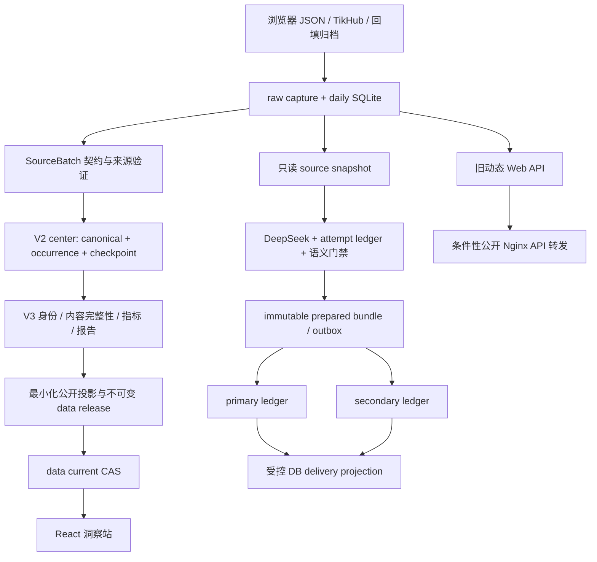

# Reddit_VOC 深度审查报告

审查日期：2026-10-14。审查根目录：`/Users/pray/project/Reddit_VOC`。对象为当前工作区，包含用户尚未提交的改动。报告只新增审查材料，没有修复业务代码、提交、推送或部署。

配套文档：[执行 todo](todo.md)、[验证与证据说明](verification.md)、[本地复现结果](reproductions.json)、[安全复现脚本](reproduce.py)。

## 1. 结论与证据边界

项目已经具备较完整的来源契约、历史回填、V2 融合中心、V3 指标、公开投影、不可变报告、Provider attempt 账本和双目标投递能力。主要问题是这些能力尚未在所有入口上形成一致的数据、安全与运行合同。尤其是 daily SQLite 仍沿用可覆盖的实体表，旧 API 仍能绕过公开投影，部分状态推导把采集失败掩盖为正常空结果。

本次最需要优先处理的五项是：

1. **F01：原始 API 和任意根内附件可绕过公开投影**。一旦连接到公开入口，匿名访问者可以取得未最小化的数据和未登记文件。函数级复现已确认；生产是否使用该拓扑未验证。
2. **F02：同帖再观察覆盖旧批次归属**。临时数据库中旧 run 的帖子、评论、分析分别从 1/2/3 变为 0，直接破坏按批次重建的日报和审计。已生成的不可变 bundle 不因此自动改变。
3. **F04：TikHub 重跑先删旧数据，再请求上游**。失败重跑可把已有可用结果变成空的 failed run，缺少原子替换和最后可用版本保护。
4. **F05：部分失败被标记 empty_success**。存在采集错误、但已发现非相关帖子时，状态函数仍返回 empty，下游允许发送正常空日报并不允许失败告警。
5. **F11：源码、版本锁及文档当前状态不一致**。本地版本检查明确失败；生产的最新 SHA 和自然周期终态需要新鲜只读证据，不能从旧交接摘要推定。

优先级用于后续实施排序：P0 是数据损失、错误业务结论或条件性重大暴露的止血项；P1 是生产可靠性与安全基线；P2 是功能闭环与维护性。P0 不表示本次已经证明生产发生了数据泄露。

证据分为：**已证实**（当前源码、离线复现或本次检查）；**合理风险**（明确触发条件，但未对生产或真实上游验证）；**待验证**（部署状态、运营事实或证据不足）。本次采用有重点的深度抽样和链路检查，未逐行审完约 20 万行后端及脚本代码，也未开展渗透测试。

## 2. 仓库、约束与运行目标

### 2.1 工作区基线

- Git HEAD：`15b286a2`（完整值见 `verification-summary.json`）；分支与当前 HEAD 信息均由本地 Git 读取，没有 fetch 或联系 GitHub。
- 开始时有 **17 个 tracked 修改文件、3 个未跟踪计划文档**。涉及报告控制、launcher、双目标 delivery、DeepSeek client、canonical export、公开翻译候选及其测试。它们全部保留，不能当作本次审查产生的修改。
- 适用指令为 `/Users/pray/AGENTS.md`：禁止硬编码密钥、校验边界输入、避免目录穿越、参数化 SQL、输出转义。当前项目及审查过的子树未发现额外 `AGENTS.md`；仓库不存在 `.agents/skills`。参考 `.codex/context-pack.md` 了解背景，事实重新以源码验证；未读取密钥文件或本地 secret 配置。
- 统计：`src/reddit_voc` 93 个 Python 文件 / 82,948 行；`scripts` 183 个代码文件 / 121,443 行；顶层 `tests/test_*.py` 182 个；UI 源树 218 个代码文件 / 52,126 行。统计为当前 Git tracked 文件口径。
- 系统 `python3` 为 3.9.6，不满足项目 `>=3.11`；可用 Homebrew Python 3.12。后者有 openpyxl，但缺 pytest、Pillow。本次没有下载依赖或修改全局环境。

### 2.2 项目目标与实际技术栈

目标是 Momcozy / 可穿戴吸奶器 Reddit VOC：北京时间 07:00 采集前一滚动 24 小时，08:00 生成经过中文翻译与语义门禁的日报，按 primary / secondary 独立投递；日、周、月报告和公开站从经过准入的数据生成。历史覆盖、未关联评论和未完成水合需要明确呈现，不能宣称 Reddit 全量。

运行栈是 Python 标准库网络/SQLite/CLI + Pillow/openpyxl，React 19 / TypeScript / Vite 前端，Nginx 静态发布与独立 data current，以及 cron、Bash、Docker 运维脚本。`webapp/app.py` 是另一个 Python `ThreadingHTTPServer` 动态控制台。没有证据支持为了本轮修复引入微服务、消息中间件或立即改用 PostgreSQL。

`pyproject.toml:5–11` 声明 Python/Pillow/openpyxl；前端脚本位于 `ref/UI/momcozy-reddit-workbench/package.json:6–14`。标准开发验收包括锁定依赖安装、repository backend lane、前端 test/lint/build；正式发布必须走既有 build/audit/promotion，而不是把 `npm run build` 的 dist 直接部署。父级 AGENTS 的通用 npm quick start 不适用于根目录的 Python 工程。

## 3. 架构与数据链路

两条 current 链必须分清：日报 runtime/prepared/delivery 成功不会自动刷新洞察站的 site/data current；静态 UI release 与数据 release 也可独立提升。F01 的旧动态 API 是绕开 `F` 节点的数据旁路。F02/F04 的损失发生于 `B` 节点，V2 occurrence 模型不能自动替 daily SQLite 补回所有旧 run 的关联。

已经做得较好的部分应保留：

- `raw_artifacts.py:64` 起使用安全 ID、私有权限、独占创建、内容哈希和 fsync，保留来源证据。
- `provider_attempt_ledger.py` 与 `deepseek_client.py:193–226,670–708` 已实现 attempt 生命周期、请求预算、deadline、限长响应及有界退避；不能简单给所有外呼再套无条件重试。
- `daily_report_delivery.py:625–699,1612–1790` 把 attempting / sent / rejected / unknown 分开；unknown 阻止盲目重发。`1211–1322` 的 DB projection 使用单事务与 source-state 比较。
- `dingtalk.py:17–69` 固定可信 webhook 主机，禁用代理与重定向；prepared 路径区分渲染和发送。
- UI release loader 校验 manifest SHA；公开投影和大量数据契约测试已经存在。静态容器使用 digest 固定 Nginx、非 root、只读文件系统与资源限制。

## 4. 已证实问题

### F01 · P0 · 动态 API / 附件旁路没有公开数据准入边界

**证据**：`webapp/app.py:249–284,288–354` 直接读取所有评论、帖子原文、`author_hash`、raw capture ID 和 DB 信息；`452–470` 把记录直接返回 dashboard。`614–670` 没有认证或公开字段 allowlist。`565–581` 只判断路径落在 OUTPUT_DIR 内，不检查发布清单或扩展名；`683–697` 原样读文件。Nginx 的 `deploy/insights/nginx.conf:59–78` 将 `/api/`、`/artifacts/` 全量转发给动态后端。

**复现**：仓库 `test_webapp` 临时 fixture 的 dashboard 含 `author_hash/selftext/raw_capture_id/comments/db_name`；在临时 outputs 下创建 `private/audit-marker.txt`，不加入任何 artifact 清单，resolver 仍返回该文件。没有访问真实数据库或公网。

**影响与触发条件**：使用带 API 服务的 Compose/反向代理，或者把动态服务暴露给非可信网络时，匿名访问绕过最小化投影。路径穿越防护本身有效，但“根内任意文件可读”足以暴露内部报告/原始导出；若目录里混入可执行 HTML，还会扩大同源内容风险。不能据此宣称密钥已泄露。

**修复**：公开站默认拒绝旧 `/api`；内部控制台使用独立受保护入口。附件只能通过发布清单中的 opaque ID 查表，固定 MIME/下载策略，不按用户路径寻址；公开 API 只能读已审核投影。实际生产暴露需先只读核验路由和容器网络。

### F02 · P0 · daily 实体表覆盖 run_id，历史批次失去内容

**证据**：`storage.py:69–112` 以 post_id/comment_id 为全局主键；`311–374` upsert 冲突时覆盖 run_id 与内容；`611–655` 以全局 analysis_id replace；`412–440` 又按 run_id 查询历史。

**复现**：同一 fixture 先采 run A，再将 JSON 加无语义变化的换行后采 run B，以避免 F03 的 raw 哈希碰撞。A 的帖子/评论/分析计数变为 `0/0/0`，仅 raw 仍有 2 行。

**影响与触发条件**：相邻窗口 overlap、历史帖子刷新、跨批次重采均可能触发。旧日报重建、source-state 再验证和历史比较可能变空；冻结 bundle 不会被重写，但发送端与活跃数据库再比对时可能阻断。不能把当前 daily 表当作历史事实账本。

**修复**：区分 canonical identity、内容 revision、run occurrence。优先采用/复用 V2 的 occurrence 设计，为日报提供固定 run snapshot；迁移时从 raw/source-batch 重建可证明的关联，无法重建的明确标 debt。不要仅改主键而不处理查询、analysis、迁移与已冻结 source 合同。

### F03 · P1 · 浏览器 raw capture 身份无法容纳重复观察

**证据**：`adapters.py:184–204` 只取 payload hash 生成 raw_capture_id；`storage.py:285–295` 一旦该 ID 的 run_id、时间等任一字段不同就抛碰撞。

**复现**：把完全相同的 listing fixture 用于另一个 run，抛 `raw capture identity collision`，采集在 listing 阶段停止。同 run 的重复抓取若时间不同也存在这一冲突。

**修复**：payload blob 按内容去重，capture observation 则绑定 run/source method/规范 URL/观察身份。应同时支持“同内容跨 run 重用”和“相同 observation 幂等”，不要去掉冲突校验直接忽略来源差异。

### F04 · P0 · TikHub 重跑清空最后可用结果，缺少失败恢复

**证据**：`tikhub.py:148–155` 外呼前调用 `clear_collected_data_for_run`；`storage.py:395–398` 删除四张表的数据。`cli.py:1441–1495` 有授权门禁，但无已完成 run 的不可变保护或 staging 事务。

**复现**：已有 1 帖的 run 用全抛 TimeoutError 的 fake client 重新采集，终态 failed，帖子变为 0。

**修复**：新增 attempt ID 和 staging；采集/校验完成后在事务内提交新快照。失败 attempt 仅保留诊断，旧成功快照不变。对已发布/已送达 run 拒绝原地重写，以 successor 关联原 run。不能把整个外呼时间段包在 SQLite 写事务内。

### F05 · P0 · 错误被归类为正常空结果，下游失败告警失效

**证据**：`collector.py:240–246` 与 `tikhub.py:1508–1512` 对 `relevant_posts=0 && discovered_posts>0` 优先返回 empty，即便 issues 非空。`report_source_state.py:19–39` 将 empty/0/0 归为 empty_success，允许业务日报、禁止失败告警。

**复现**：`discovered_posts=1,relevant_posts=0,issues=[listing failure]` 时，两种 collector 状态均 empty；report gate 为 `business_report_allowed=true,failure_alert_allowed=false`。

**修复**：状态以必需采集 lane 的终态/完整性优先，再判断有没有相关帖子；只有全部必需 lane 成功且无未完成债务时才叫正常空。冻结 source-state 增加 coverage/attempt 摘要，防止只有状态与计数的证明丢失错误事实。

### F06 · P1 · CSV/XLSX 外部文本可以成为表格公式

**证据**：`daily_report.py:590–638` 的 prepared XLSX，`1689–1716` 的旧 CSV/XLSX，及 `exporter.py:138–151` 均把外部文本直接写进单元格。

**复现**：从当前文件 AST 提取原 `_write_prevalidated_xlsx` 函数，用标题 `=1+1` 写 XLSX，再用 openpyxl 读取，cell.data_type 为 `f`。不需打开 Excel，不执行公式；AST 隔离是因为完整 renderer 的 PIL 依赖缺失。

**影响**：用户打开从 Reddit 内容生成的表格时，文本可能被解析成公式。是否触发外联或其他动作取决于表格程序和设置，未验证。

**修复**：对所有不可信文本统一进行 spreadsheet 安全编码；XLSX 显式 string 类型，CSV 对 `= + - @` 与制表/回车/空白前缀作一致处理。原文保真应由 JSONL/immutable content 等专用格式承担，不能为保真牺牲可执行表格安全。

### F07 · P1 · 旧媒体下载接受任意 HTTP 地址，大小限制在读取之后

**证据**：`daily_report.py:2187–2194` 只检查 scheme/netloc；`2152–2178` 使用默认 urlopen、允许重定向和环境代理，`response.read()` 后才检查 4 MiB；`1010` 的旧 report path 会调用媒体准备。

**复现**：使用 fake urlopen，`http://127.0.0.1/audit.png` 到达请求层；fake response 的 `read` 无 size 参数。没有发任何真实请求。

**影响**：旧兼容报告遇到恶意媒体 URL 时有 SSRF、内网读取/探测及内存耗尽风险。当前新的 prepared 文本渲染路径未由本次证明会执行此下载，不能泛化到所有报告。

**修复**：媒体下载服务采用明确可信域策略、HTTPS、DNS/地址校验、禁重定向/逐跳校验、禁代理、流式读取与总 deadline；外链 HTML 媒体不应作为默认回退。若兼容入口无需继续维护，隔离/禁用网络媒体比再维护一套下载器更稳妥。

### F08 · P1 · DeepSeek 重分析落库被记成 local_rules / 无外呼

**证据**：`collector.py:252–320` 接收 provider 分析后仍走 `insert_analysis`；`storage.py:628–655` 固定 `analysis_version='local_rules_v1',provider_call=0`，置信度则由上游固定为 0.9。`analyzer.py:185–275` 是不同于新 DeepSeek client 的独立旧外呼路径，失败返回空数组；`cli.py:1643–1679` 对更新数 0 仍输出 ok。

**复现**：fake provider 返回负面分析后，实际行记录 `local_rules_v1 / provider_call=0 / confidence=0.9`。

**影响**：分析来源、版本和成本证据错误；重分析失败、未知 run 和真空输入难区分。这里的固定置信度是规则值，不是经校准的模型正确率。

**修复**：统一分析结果接口，持久化 provider/model/prompt_version/attempt/source_hash；明确部分成功和失败，保留旧分析 revision。将旧外呼接入预算/账本或明确退役，且真实外呼授权仍保持独立。

### F09 · P1 · 存在 failed run 也会被 missed-run 检查视为 covered

**证据**：`ops.py:22–43` 只判断有没有 matching_runs。`webapp/app.py:641–650` 的 health 仅返回 ok 和文件数量；`249–276,288–321` 对 SQLite 错误直接 continue。

**复现**：目标窗口只有一条 failed run，missed-run 仍返回 covered。

**影响**：检查“是否触发”与“是否成功”混在一起，数据库损坏/读错误可呈现为 200+空数据。health 作为存活探针可以保留，但不足以证明数据就绪或投递成功。

**修复**：分别记录 missing、failed、partial、empty_success、success，另建 readiness 和端到端 freshness/delivery SLI；SQL 错误有脱敏错误码且不伪装成业务空。失败告警使用独立授权通道。

### F10 · P1 · 无界全量读取 + 缺少常用索引，公开旁路可放大负载

**证据**：`storage.py:42–135` 未创建 run_id/post_id 等二级索引；`webapp/app.py:249–319` 全量 fetchall、组合所有评论，`177–208` 每次重读多个 CSV，`452–470` 在筛 scope 前先读取全量。HTTP server 为无显式并发上限的 ThreadingHTTPServer（`699–705`）；`send_file:689` 把完整附件读入内存。

**验证**：临时库 `EXPLAIN QUERY PLAN ... reddit_comments WHERE run_id=?` 为 `SCAN reddit_comments`。未做真实库负载或延迟基准；不能从这个 plan 推定线上当前超时。

**修复**：先切断非必要公开旁路，再基于实际查询添加复合索引、分页/游标和字段裁剪；按 release/source hash 缓存、流式附件、限制并发。SQLite 单写与短事务仍适合目前形态，无需先迁库。

### F11 · P1 · 版本锁、工作区与“当前状态”不一致

**证据**：本次执行 `scripts/verify_version_consistency.py` 返回 `daily_source_release_mismatch`。`config/production-version-lock.json:3–15` 截止 8 月 22 日；`PROJECT_STATUS.md:20–26` 却记载 8 月 25 日激活到 successor，`33–39` 和后续摘要仍保留“parent 尚未安装”的旧判断。当前 `report_control.py:3086–3088` 已使用 `_read_authority_regular`，不能继续将旧 0600 reader 缺陷当作当前未修代码。

**影响**：工作区不能作为与锁一致的可发布基线；接手者可能按已过期根因重做已消费操作。版本不一致检查是有效阻断，应保留，不能为了 CI 绿而直接改 lock 或降低 gate。

**修复**：以新鲜只读生产 observation 冻结事实，给本地候选、生产 current、Git commit 分别建时间戳和 SHA 关联；授权发布 successor 后以 postflight 更新锁，再形成 clean Git。把状态摘要改成唯一 machine-readable snapshot 驱动，人类历史保留但不竞争“当前”。

### F12 · P1 · 静态发布模板的 Compose 与 Nginx 上游不闭合

**证据**：`scripts/build_insights_release.sh:1212` 打包 `deploy/insights/compose.yaml`；该文件 `1–58` 仅定义 web 和独立 insights 网络。其 Dockerfile `13` 复制的 Nginx 配置却在 `59–78` 引用 `reddit_voc_api:8080`。同目录 `docker-compose.yml:1–147` 另有带 API/translate 的拓扑。

**影响与条件**：新建干净网络、仅按被打包的 compose.yaml 启动时，没有内置可解析的 API 服务/别名，Nginx 启动或 API 路由可能失败。这是已证实的源码合同缺口，未实际启动容器；不能反推现网当前一定故障，因为现网可能仍用旧镜像或额外网络。

**修复**：选定一种产品运行形态。公开静态站建议删除动态 upstream 与路由；受保护运营控制台单独部署。打包器对 compose service/network 与 Nginx upstream 做闭包检查，并在干净临时网络验证启动。

### F13 · P1 · 私有 JSON 拒绝规则被 `^~` 路由跳过

**证据**：`deploy/insights/nginx.conf:148–151` 使用 `location ^~ /data/reddit-voc/`，而 `156–169` 的私有文件 deny 是 server 层 regex location。最长前缀命中 `^~` 时，后续 regex 不再检查，规则因而失效，见 [Nginx 官方 location 文档](https://nginx.org/en/docs/http/ngx_http_core_module.html#location)。

**条件与影响**：公开 alias 根里若意外混入 private manifest、posts/comments 或 archive 文件，这些 deny 无法兜底。当前 public root 是否含这些文件没有完整验证；本项证明防线失效，不证明真实私有字节已经公开。

**修复**：让拒绝规则在实际 location 树中可达，主防线采用显式公开文件 allowlist。HTTP 负向测试必须把真实 marker 私有文件放进临时 alias 根并验证 404；仅对根本不存在的文件测 404 无法证明拒绝规则有效。

### F14 · P1 · Python 依赖和生产平台未由 CI 锁住

**证据**：有 `uv.lock`，但 CI `.github/workflows/ci.yml:20–34` 用 macOS + Python3.12 + `pip install -e . pytest`，未消费锁；生产 Web Dockerfile 用 Python3.11 tag，`24–28` 安装未固定 Pillow/openpyxl/playwright 并下载浏览器。CI 不包含 Linux 后端/镜像拓扑 smoke。`config/ci/test-lanes.json` 将 38 个模块划到 local-artifact lane，现有 CI 只跑另外 144 个模块。

**影响**：同一次源码在开发、CI、Linux runtime 上可能解出不同依赖；有测试并不代表覆盖了目标权限、软链接、shell、Docker mount/sidecar 合同。local-artifact lane 的隔离有合理性，但需要另一个可复现的制品验收渠道。

**修复**：Python 锁与工具版本进入 CI/镜像，固化容器/browser 供应链；增加目标 Linux/Python 版本和无网络运行时验收。为关键业务合同提供可提交的最小合成 fixture；受限真实制品 lane 由独立受控 job 跑并记录覆盖差异。未进行联网 CVE 扫描，报告不宣称依赖存在已知漏洞。

### F16 · P1 · 截断与分页债务未影响 daily 总状态

**证据**：`collector.py:121`、`tikhub.py:168` 截取 `candidates[:max_detail_posts]`；`tikhub.py:249–264` feed 固定 `after=''`，`185–195` comments 也只请求第一页。状态函数只看已摄取对象的 coverage/错误，不比较 relevant 与实际完成数量。独立 backfill/comment-refresh 的恢复能力不意味着 daily 自动消费所有游标。

**复现**：`relevant_posts=2,ingested_threads=1,coverage={'full':1},issues=[]`，browser/TikHub 均给 success。它经 source-state 后可被标记 observed_complete，实际仍有一帖未执行。

**影响**：忙碌社区、超过详情 cap 或评论多页时，数据是有界观察下界，成功状态不能证明完整发现。标题匹配还存在正文才提及品牌的召回风险，后者本次未测量。

**修复**：输出 discovered/candidate/attempted/admitted/deferred 与所有 next cursor，达到上限即标 partial + reason；需要补采时生成受预算与授权约束的任务，不自动无限翻页。保留内容覆盖、发现覆盖、时间覆盖三个独立维度。

### F17 · P2 · 前端 release promise 失败和旧版本缓存持续到页面重载

**证据**：`src/features/redditSnapshot/release.ts:72,365–382` 模块级缓存 promise，一旦 reject 也不清除；唯一 reset 在 `410–412` 且只被测试调用。Nginx 的 data current 路径还继承一小时缓存（`nginx.conf:148–151`），但 loader 使用 `cache:'no-cache'`，因此不能直接把页面旧版本归因于 HTTP 缓存。

**影响**：首次瞬时加载失败后，页面内再次调用仍读同一 rejected promise；长开的工作台不会主动看见新的 release。完整重载会重新读取。这项不能解释所有旧站点日期，更不能代替真正的 data current 提升。

**修复**：失败时清理 promise，受控重试/显式刷新；有界 TTL 或版本变更提示。按新 pointer 一次性加载并校验整套依赖后原子替换页面状态，避免同一页混用两版数据。

### F18 · P2 · 缺少真实行动闭环账本

**证据**：`scripts/build_reddit_reports_snapshot.py:2770–2777,2954–2961` 周报明确输出 `ledger_available=false,completion_supported=false,items=[]`。这是诚实的功能缺口，不是错误完成率。

**影响**：洞察不能跟踪责任人、行动、截止日、证据和结果；无法证明周报建议被执行或效果改善。

**修复**：先由业务定义 action/owner/status/evidence/due_at/observed outcome，持久化变更历史，再投影到周报；未提供账本时继续显示 unavailable，不生成虚构 KPI。

### F21 · P1 · 调度测试依赖已经过期的许可与真实时钟

**证据**：`tests/test_daily_report_ops.py:314–343` 使用 2026 年 8 月 legacy fixture；`report_control.py:1465` 固定其 permit 到期时间为 2026-08-31。`603–608` 用真实 `datetime.now()` 比较，`3345–3346` 在读取 authority 时拒绝过期 permit。测试虽然指定历史 scheduled_at，仍未冻结此处的真实时钟。

**本次结果**：63 项 ops/launcher unittest 中，4 项失败、2 项错误；其中 5 项共同在 `scheduled_policy_authorization_invalid` 阻断，另 1 项缺 Pillow。当前系统时间为 2026-10-14，legacy expiry 确为过去。只在独立测试进程为 report_control 注入 2026-08-12 时钟后，authority reader 回归单项通过；未修改业务源码或许可。

**影响**：repository lane 今天已存在不能复现历史 green 的测试，且 parent-reader 回归被提前过期校验遮挡。不能把这些失败误报成生产 annual authority 已过期；年度 authority 是另一合同。

**修复**：将时钟作为测试可注入依赖，子进程测试同样冻结；同时保留明确的“已过期必须拒绝”测试。不得延长真实许可、放宽生产校验或靠修改系统时钟让测试通过。将缺 Pillow 的运行时依赖也纳入锁定测试环境。

## 5. 合理风险与待验证项

### F15 · P1 · 隐私生命周期与浏览器凭据策略需补齐

`adapters.py:50–53` 为作者名无盐 SHA-256 截取 16 hex，是可重算的伪名，不等于匿名。`raw_artifacts.py` 有私有存储权限，但仍保存完整 raw。`useWebhookConfig.ts:56–58` 只移除 secret，URL 仍进入 localStorage，而 DingTalk URL 本身含访问凭据；浏览器测试连接代码 `156` 又尝试跨源 POST，与站点 CSP `connect-src 'self'` 不匹配。

需要确定哪些字段确有必要、raw/派生/公开 release 的保留期限、删除/撤回传播路径、备份清理、浏览器 webhook 配置的产品定位。不能从本地静态代码证明生产已有凭据被盗或没有任何人工删除流程。建议公开站不承担 webhook 配置；内部凭据留在服务端，确需关联作者时使用受保护域内带密钥伪名，并在公开投影删除。

### F19 · P1 · 当前容量、自然运行及恢复演练缺少新鲜证据

代码已有 schema migration 的备份/回滚、release 回滚、raw archive、日志裁剪和 freshness observer；因此不应写成“没有备份/没有可观测性”。但这些分散能力不足以证明：截至本次审查仍按期备份、可以从空机恢复、自然 07:00→08:00 连续成功、磁盘/inode 有安全余量。

`PROJECT_STATUS.md` 的容量耗尽、8 月调度阻断等仅是过往记录，本次没有访问远端，不能当作 10 月现状。后续只读检查需收集 filesystem/inode、两条 current、cron/timer、authority chain、最近七天 source/translation/delivery 账本与 DB projection；在隔离目标做真实恢复演练，记录 RPO/RTO 与完整性。

### F20 · P2 · 安全控制与业务逻辑高度集中

`scripts/report_control.py` 8,130 行、`server_daily_report.sh` 2,271 行、`remote_rollback_insights.sh` 5,603 行、`daily_report_delivery.py` 2,338 行，UI service/reports 也分别 1,595/2,255 行。大量历史 G6 版本、一次性门禁与业务逻辑并存。它提高合同漂移和回归风险，但文件大本身不是运行故障。

建议在回归合同冻结后按 authority reader、policy、cycle state、prepared commit、delivery projection 拆边界；临时操作 gate 与常驻运行时分开。遵守 AGENTS 的原则：不为行数指标先做大规模重构，也不在 P0 止血中掺入无关拆文件。

仍待验证：当前实际生产网络/认证/公开目录内容；TikHub 当前 400 是否仍存在及其外部合同；当前公开翻译 checkpoint 和人工语义质量；所有 UI 功能的跨设备 E2E；真实数据规模下并发和成本曲线；公开数据删除传播与备份周期；依赖漏洞与供应链来源。缺少这些证据，不影响已经复现的本地问题成立。

## 6. 改进方案与交付阶段

### 阶段 A：最小可行修复（约 8–13 人日）

完成 T01–T07：先冻结状态和恢复点、关闭公开旁路，修正误空状态/截断；为同 run 重跑加安全保护并引入 staging；修复 capture 身份，固定 run observation。可先禁止对已完成 run 原地重采作为短期止血，但 F02 必须有正式 run snapshot 方案才能闭环。

退出标准：临时端到端链路中，失败外呼不丢最后可用数据；同帖重复观察不改变旧 run；错误不会变正常空日报；公开入口只能取得已准入投影和清单附件；已有 frozen bundle 与已送达 part 不被重写或重发。通过本地验收不等于生产已经生效，部署仍需独立授权和 postflight。

### 阶段 B：可靠运行与安全合同（约 12–19 人日）

完成 T08–T16：表格安全、媒体网络隔离、分析 provenance、Linux/锁依赖 CI、部署闭包、readiness/SLO、restore/容量、隐私生命周期和预算化游标恢复。保持 immutable prepared/outbox + 独立目标 ledger 的现有设计。

退出标准：目标 Linux 环境的 network-none smoke、权限/软链接合同、崩溃恢复矩阵和真实 marker 的负向 HTTP 测试通过；备份在隔离环境可恢复；每个自然周期有可关联 source→translation→prepared→两目标→projection 证据。

### 阶段 C：性能、功能闭环与维护性（约 7–12 人日）

完成 T17–T21：按基准优化查询，前端恢复与刷新、行动账本、指标/翻译质量评估，最后再拆运行时模块并归档历史入口。规模化改造以基准为依据。

退出标准：固定基准样本下达到约定延迟/内存目标；业务能追踪真实行动；指标和翻译误差有样本评估；重构前后数据 hash、门禁和投递语义不变。

估计合计约 **27–44 人日**，包含实现与本地测试，不含业务评审等待、历史数据人工修复、外部服务恢复和生产授权窗口。任务分拆和依赖见 todo；这是规划估算，不是承诺工期。

## 7. 本次检查结果与剩余风险

验证详情见 `verification.md`。已完成前端测试 229 passed / 46 skipped、lint（15 warnings）、TypeScript+Vite 构建以及 427 个 Python 文件的 AST 解析；360 项选定后端 unittest 首轮 359 通过、1 项因审查 harness 未将 PYTHONPATH 传给子进程失败，修正启动环境后该项单独通过。另补跑 63 项 ops/launcher 检查为 57 通过、4 失败、2 错误，原因见 F21；只对 parent-reader 单项注入测试时钟后重验通过，其余失败没有声称修复。版本一致性检查确实失败。

没有安装缺失的 pytest/Pillow，因此没有声称运行了完整 repository/local-artifact pytest，prepared/dual-delivery 等依赖 PIL 的整套回归仍是明确缺口。没有运行真实 Provider、机器人、生产查询、Docker 构建/启动、线上 E2E、压力测试或 CVE 扫描。新复现覆盖了现有测试未覆盖的跨 run、重跑失败和业务状态边界。

修复后的剩余风险仍包括：历史 run 关联未必可完全重建；有界采集始终不等于 Reddit 全量；网络不确定下无法凭普通 webhook 保证 exactly-once，unknown 必须人工核对；中文质量和品牌指标仍需独立样本评估；公开发布旧版本与备份中的撤回数据需要生命周期控制。HTTP 200 和 sent ledger 只能证明机器人接口接受，不证明群成员阅读。
