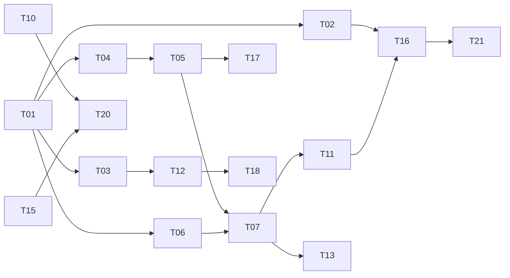

# Reddit_VOC 改进执行 todo

日期：2026-10-14。对应 [审查报告](report.md)。状态全部为 **未实施**；本次只审查和新增文档。工作量为一名熟悉 Python/SQLite/运维的工程师人日范围，包含必要测试，不包含等待、人工历史数据修复及真实外部调用费用。

## 执行规则与建议顺序

先完成“数据不会被再破坏、失败不会冒充空结果、公开面不会绕过投影”，再处理运行合同与业务闭环。已有 immutable outbox、unknown 不自动重发、primary/secondary 独立 ledger、精确 authority/CAS 校验继续保留。

建议执行图：



图只表示主要链；完整依赖以每项为准。可独立的本地实现可并行，但不得对共享 production current/DB 同时写入。任何未来生产写入、真实 Provider 或机器人发送，都应使用已有独立授权流程；本文件不是执行授权。

## P0：最小可行修复的核心

### T01 · 冻结审查基线、确认生产事实与恢复点

- **对应发现**：F11、F19；阶段 A，建议平台/运维负责。
- **具体范围**：本地记录 HEAD、dirty diff 文件哈希、两条 release 链的已知锁和历史时间。将“最近已验证生产”与“当前本地候选”分列。后续经既有只读运维通道收集生产 current、authority chain、自然周期终态和磁盘/inode；写操作前准备可验证恢复点。
- **依赖**：无。生产事实核验需要可用的运维访问，但本地冻结不依赖远端。
- **工作量**：0.5–1 人日。
- **验收标准**：有时间戳、source commit、dirty 文件 SHA、production observation 截止时间的基线；不覆盖 17 个现有修改和 3 个计划文档；旧 G6 操作标注已消费、禁止重复。生产不可访问时明确标未知，不改锁假装一致。

### T02 · 收拢公开 HTTP 边界与负向验收

- **对应发现**：F01、F12、F13；阶段 A，后端/运维。
- **具体范围**：`webapp/app.py` 的 dashboard/artifacts handler、公开 Nginx、两套 Compose。公开站关闭动态 `/api` 与任意 `/artifacts` 转发；如确需公开 API，只从批准的最小化 projection 读取。内部控制台独立保护。附件 ID 对应 immutable manifest 中的文件，禁止任意根内寻址；修正实际可达的 private deny 规则。
- **依赖**：T01。先定义公开附件的业务清单。
- **工作量**：1.5–2.5 人日。
- **验收标准**：在临时 root 中放入真实 private marker、未登记 txt/JSON/HTML 和祖先 symlink，匿名 HTTP 均 404/403；允许的报告按固定 MIME 正常下载；API 响应不含 author_hash、raw ID、DB 路径；所有拒绝测试必须验证“文件确实存在”，不能只测不存在路径。现网是否修复以未来 postflight 为准。

### T03 · 修正 empty/partial/failed 和截断状态合同

- **对应发现**：F05、F16；阶段 A，采集/报告。
- **具体范围**：`collector.py::_derive_status`、`tikhub.py::_derive_provider_status`、`models.py` summary、`report_source_state.py` 及 prepared source-state 的生成/读取。增加 required lane outcomes、deferred 数量、cap reached、unresolved cursor/reason；错误优先于空判断。
- **依赖**：T01；source-state schema 改动必须同时升级 producer/consumer，并明确旧 bundle 的兼容策略。
- **工作量**：1–1.5 人日。
- **验收标准**：全部必需 lane 成功且 0 相关结果才 empty_success；一条 listing 失败 + 一条非相关结果不得正常空发送；2 candidate/1 完成必为 partial；unknown/failed 在渲染、凭据读取和外呼之前阻断。覆盖 all-empty、mixed-success、cap、解析失败、0 post/有 comment 等组合。

### T04 · 防止同 run 重采破坏已有结果

- **对应发现**：F04；阶段 A，存储/采集。
- **具体范围**：`tikhub.py:148`、CLI run 入口、`storage.py::clear_collected_data_for_run`、wrapper。短期禁止已完成/已投递 run 原地重采，使用独立 attempt/staging；成功准入后短事务提交 snapshot，失败保留旧版本。
- **依赖**：T01；T03 确定准入状态。不得在网络请求期间持有数据库写锁。
- **工作量**：1–2 人日。
- **验收标准**：已有成功 run 发生 timeout、4xx、解析错误、SIGKILL/写盘失败后，旧 snapshot/hash 和 count 不变；失败 attempt 有诊断但不变 current；并发两个 attempt 只有一个可 CAS 提升；已送达 outbox 和 ledger 均不变。无需实际 Provider 即能验证。

### T05 · 固定 run observation，恢复历史可重放性

- **对应发现**：F02、F08 的历史覆盖部分；阶段 A，数据工程。
- **具体范围**：`storage.py`、source batch、日报 reader、analysis identity 以及 schema migration。设计 canonical entity + content revision + run occurrence，尽量复用 V2 center 的既有结构；历史 run 查询绑定固定 observation。提供兼容迁移和只读差异报告。
- **依赖**：T01、T04；T06 可先行完成。迁移前必须有逐字节/行级验证过的恢复副本。
- **工作量**：2.5–4 人日。
- **验收标准**：A/B 重复观察同帖后，A 的帖子/评论/analysis/原文 hash 均不变，B 可独立查询；同实体多内容 revision 可追溯；旧 frozen source-state 不被最新观察隐式改变；孤儿引用/重复 occurrence 为 0 或显式 quarantine；无法恢复的旧关联有 debt 清单和数量，禁止伪补。新旧 reader 在迁移样本上有守恒对照。

## P1：阶段 A 收尾与运行可靠性

### T06 · 修正 raw capture 身份与重复观察幂等

- **对应发现**：F03；阶段 A，采集/存储。
- **具体范围**：`adapters.py::build_raw_capture`、`storage.py::insert_raw_capture`、raw-index/source batch 引用。blob identity 和 observation identity 分开，明确 capture timestamp 的幂等语义；旧 ID 建映射。
- **依赖**：T01；与 T05 的 schema 约定对齐。
- **工作量**：0.5–1 人日。
- **验收标准**：同 payload 跨 run、跨 source URL、同 run 重试均不会误碰撞；相同 observation 可无副作用重放；不同来源仍各自有完整 capture 证据；真实内容冲突仍拒绝，不能靠 INSERT IGNORE 掩盖。

### T07 · 收敛候选、版本锁和唯一当前状态

- **对应发现**：F11；阶段 A，release owner。
- **具体范围**：`config/production-version-lock.json`、`PROJECT_STATUS.md`、README、版本验证器与 release 构建回执。建立机器可读 current snapshot 与候选 snapshot，摘要由它们生成；给旧记录加明确历史标识。
- **依赖**：T01、T03–T06；生产 successor 提升是后续独立授权动作。
- **工作量**：0.5–1 人日，不含发布等待。
- **验收标准**：本地候选连续两次构建 SHA 相同；在复制到仓库外的 release 上完成 import closure 和 network-none smoke；文档不再同时声称 parent absent/已修复。只有确认生产 postflight 后才更新 production lock；最终本地源码、clean Git 与批准的生产 release 一致，版本检查通过。候选阶段仍可明确报告 mismatch，不能改 gate 取巧。

### T08 · 为所有 spreadsheet 出口实现不可信文本安全编码

- **对应发现**：F06；阶段 B，报告/导出。
- **具体范围**：`daily_report.py` 的 prepared/legacy XLSX、CSV，`exporter.py`，UI CSV 生成出口的同类审查。统一 text-cell/CSV encoder；JSONL 原文保留。
- **依赖**：无需等待发布，基于 T01 的冻结分支即可；格式变化与 report manifest 版本一起处理。
- **工作量**：0.5–1 人日。
- **验收标准**：输入 `=1+1`、`+SUM(...)`、`@...`、tab/CR/空白前缀和普通多行中文，XLSX 文本单元格均不为 f，CSV 经目标表格程序安全策略验证；ID、数值指标和 JSONL 原文不被错误转换。无需执行危险公式。

### T09 · 隔离旧媒体下载的网络和内存边界

- **对应发现**：F07；阶段 B，安全/报告。
- **具体范围**：`daily_report.py::_normalize_media_url/_download_media_to_file`、旧 report media fallback、可能触发浏览器截图的外链。采用统一安全 downloader，或停用旧网络媒体功能。
- **依赖**：T02 明确公开/内部入口，确认真实业务允许的媒体域。
- **工作量**：1–2 人日。
- **验收标准**：loopback、RFC1918、链路本地、IPv6、本地域解析、重定向内网、环境代理都在连接前拒绝；读取总字节不超过 cap+1，慢流受总 deadline 约束；下载失败不在浏览器再次无控制地请求原始 URL。使用 fake DNS/transport，不触碰真实内网。

### T10 · 统一分析 provenance、失败语义和 Provider 预算

- **对应发现**：F08；阶段 B，分析/存储。
- **具体范围**：`analyzer.py::analyze_batch_with_deepseek`、`collector.py::_reanalyze_run_with_deepseek`、`storage.py::insert_analysis`、reanalyze CLI。引入明确 provider/model/prompt/source/attempt 字段和 analysis revision；复用新 client/ledger 或明确封存旧路径。
- **依赖**：T05 的 revision/occurrence 设计；沿用现有授权边界。
- **工作量**：1–2 人日。
- **验收标准**：fake DeepSeek 结果持久化为 provider=true 和真实版本；规则结果仍可区分；失败/空输入/不存在 run/部分更新有不同 status 和退出码；每次真实 attempt 可从持久账本追踪，未知状态禁止跨进程盲重试；旧 revision 不丢失。

### T11 · 建立锁依赖、Linux runtime 和最小可提交 fixture 的 CI

- **对应发现**：F14、F20、F21；阶段 B，平台/测试。
- **具体范围**：`pyproject.toml/uv.lock`、CI、Web Dockerfile、runtime smoke、`config/ci/test-lanes.json` 和关键本地制品测试。锁住 Python/dev/browser 版本，增加生产目标 Linux/Python 合同；保留 macOS lane 覆盖 BSD shell 差异。给 legacy authority fixture 注入测试时钟，覆盖子进程和父进程，不再随真实日历过期。
- **依赖**：T07；先审清本地制品脱敏与版权边界，再制作合成 fixture。
- **工作量**：2–3 人日。
- **验收标准**：干净 checkout 用锁可离线或受控镜像复现安装；Python 支持版本与目标 Linux 上核心 suites 通过；root-owned 0444 authority、0777 symlink→安全 target、SQLite 可写父目录/sidecar、send-only import closure 均由真实 reader/launcher 验证；测试分别模拟到期前/边界/到期后，正确保留生产 expiry 拒绝，且调度 suites 在任意真实日期可重复；明确记录 144/38 模块覆盖差异并为关键业务合同消除无意 skip。供应链扫描报告绑定精确 lock/image，不能只看版本范围。

### T12 · 以端到端成功定义运行 SLO 与告警

- **对应发现**：F09、F19；阶段 B，运维/后端。
- **具体范围**：`ops.py`、`webapp/app.py` readiness、`observe_reddit_data_release.py`、scheduled-cycle 观察器/状态展示。分别暴露 liveness、数据源 freshness、公开 release freshness、翻译阻断、primary/secondary delivery、projection lag、unknown backlog。
- **依赖**：T03、T07；告警发送仍走独立授权。
- **工作量**：1.5–2.5 人日。
- **验收标准**：仅 failed run 不再 covered-success；SQL read error 不是 empty；07:00 缺 run、08:00 未完成、单目标成功、unknown、磁盘不足各产生可机器读取告警状态；每条状态关联同一 run/bundle/release，不把手工补推当自然成功；HTTP health 的含义和 dashboard 一致。建议先以本地 replay 覆盖，再在未来七个自然周期验收。

### T13 · 备份、容量阈值和隔离恢复演练

- **对应发现**：F19、F04；阶段 B，运维/数据。
- **具体范围**：SQLite 一致性快照、raw/source batch、release/authority/Provider/delivery ledger 的备份和恢复 runbook；磁盘/inode/备份年龄监测；retention 与 prune allowlist。复用现有 schema migration/release rollback 工具，补全系统级流程。
- **依赖**：T01、T07、T12；清理前与 T14 的保留策略对齐。
- **工作量**：1–2 人日。
- **验收标准**：在全新临时目录恢复一组备份，integrity_check、关键行/hash 与 immutable manifests 一致；送达账本不被重置，恢复后无自动重发；给出实测恢复耗时和备份年龄。业务先确认 RPO/RTO，建议初始目标 RPO≤24h、RTO≤4h；容量阈值须基于峰值 staging/rollback 大小校准，不以未执行清理的估算值宣称关闭。

### T14 · 定义并落实隐私和凭据生命周期

- **对应发现**：F15、F01；阶段 B，安全/业务 owner。
- **具体范围**：raw/private/public 字段矩阵、作者关联需求、作者伪名、旧 release/备份的撤回传播、Webhook 配置页面/持久化。公开站去除真实凭据配置；内部 webhook URL 和 secret 都在服务端安全管理。
- **依赖**：T02、T05；需业务确认保留期限和必要字段，不能由工程师随意删除历史证据。
- **工作量**：2–3 人日，不含大规模旧数据清理。
- **验收标准**：合成 webhook URL token 不落 localStorage、导出、日志或公开产物；raw 仍私有；作者标识不进入公开投影；撤回一条合成内容后生成 successor public release，并能枚举旧版本/缓存/备份的处理结果；清理策略有审计和恢复边界。报告中不将无盐 hash 视作匿名。

### T15 · 将分页、截断和评论关联债务变成可恢复队列

- **对应发现**：F16；阶段 B，数据工程。
- **具体范围**：daily collector、comment refresh、backfill checkpoint、source-batch coverage。保存必需 cursor/after/deferred 候选，按优先级和预算生成补采计划，明确 discovery、hydration、parent-link debt 三类计数。
- **依赖**：T03、T05、T06；真实外呼需已有精确预算和授权，不因本 todo 自动执行。
- **工作量**：1–2 人日。
- **验收标准**：超过 listing/detail/comments cap 时仍有 checkpoint/debt 且状态 partial；进程中断可从最后已提交页继续、不双计；400 不重试、429/5xx 的重试遵守预算/deadline；评论无法关联时保留 quarantine/debt，不静默丢弃或记为完整。用多页 fixture 和伪 Provider 完成验收。

### T16 · 将部署安全验收移到真实目标拓扑

- **对应发现**：F12、F13、F14；阶段 B，平台/安全。
- **具体范围**：唯一规范 Compose、Nginx config、build-release 打包和 security receipt。自动校验 upstream service/network 闭包，绑定配置和 image digest；隔离的本地 HTTP/容器门禁。
- **依赖**：T02、T11；只使用隔离资源，禁止借用生产 network/volume。
- **工作量**：1–1.5 人日。
- **验收标准**：从零网络和空环境启动被打包的 exact 配置，nginx -t、health、刷新深链、合法公开文件均通过；private marker、未登记目录、symlink、编码路径全拒绝；停止/回滚不会影响其他容器；测试结束无本任务容器/网络残留。回执绑定 compose/nginx/image/source SHA。

## P2：性能、产品闭环和可维护性

### T17 · 基于真实查询模式优化 SQLite 与 API 读取

- **对应发现**：F10；阶段 C，后端/数据。
- **具体范围**：run occurrence/analysis/comment 查询索引、API 分页和 SQL scope 下推、CSV translation 缓存、附件流式输出、并发限制。缓存 key 必须含 release/source hash。
- **依赖**：T02、T05；先固定基准数据量和查询 workload。
- **工作量**：2–3 人日。
- **验收标准**：用固定 1 万帖/10 万评论合成库记录前后 query plan、P95、RSS 和写入耗时；run 查询使用目标索引；建议单用户分页 P95≤500ms、受控 5 并发 P95≤1s、RSS≤约定容器预算。数值是拟定验收目标，需以目标机器校准；不以压测生产替代本地基准。

### T18 · 前端短暂失败恢复与一致版本刷新

- **对应发现**：F17、F09；阶段 C，前端。
- **具体范围**：`release.ts` promise 生命周期、加载 hooks、刷新交互及 freshness 显示。失败清缓存，有界重试；TTL/显式刷新获取新 pointer；manifest 校验后一次性替换。
- **依赖**：T12；保持现有 hash 验证和导出禁用门禁。
- **工作量**：0.5–1 人日。
- **验收标准**：首请求 503、第二次成功无需整页重载可恢复；快速切换周期不串数据；新 release 准入前页面/导出保持旧完整版本或明确 loading；hash 错误显示失败且禁止导出；freshness 不把当前时钟当数据日期。

### T19 · 补齐行动账本与周报反馈

- **对应发现**：F18；阶段 C，产品/后端。
- **具体范围**：action ID、owner、due_at、status、evidence、关联 insight、append-only 事件及周报 projection；定义谁能变更和如何审核。
- **依赖**：业务先确认 owner/status/效果口径；T05 的来源引用可复用，内部写入入口依赖 T02 的保护边界。
- **工作量**：2–3 人日，仅最小账本，不含第三方工单集成。
- **验收标准**：一条合成 action 从 open→doing→done 的历史可追溯；done 必有证据；周报完成率分母/排除口径固定可重算；无账本时继续 unavailable；公开 projection 不泄露内部责任人或业务细节。

### T20 · 给指标和翻译建立独立质量评估

- **对应发现**：F08、F15、F16 及合理语义风险；阶段 C，数据/业务。
- **具体范围**：本地规则误判、产品实体混淆、原文/译文实体与否定、重复内容、营销/organic、低样本时间比较；构建脱敏 golden set，冻结 prompt/terms/metric policy 版本。
- **依赖**：T10、T14、T15；需要独立业务审核样本。
- **工作量**：1.5–3 人日，不含真实 Provider 费用及长周期人工标注。
- **验收标准**：至少覆盖 100 条分层 post/comment，其中含否定/数字/型号/健康术语/删除内容；报告逐类错误率及分歧处理，阈值由业务确认；样本不足/观察窗口不完整时指标不作总体推断。不能以固定 confidence=0.9 充当准确率。

### T21 · 在合同保护下拆分控制运行时并封存历史入口

- **对应发现**：F20、F11；阶段 C，架构/维护者。
- **具体范围**：`report_control.py` 的 authority reader/policy/cycle/commit 独立模块；launcher shell 缩成调度/权限边界；长期运行代码与一次性 G6 gate 分目录。迁移版本和 release 文件清单明确管理。
- **依赖**：T07、T11、T16，且 P0 已验收。不得为了文件行数改写已消费 gate。
- **工作量**：1–2 人日为首批边界提取，后续大规模重构另估。
- **验收标准**：行为合同、deterministic hash 规则、独立 import closure、unknown/no-replay、primary/secondary projection 与崩溃矩阵不退化；删除旧入口前有调用清单和回滚策略；源码不再依赖临时 overlay；AGENTS 行数目标服务于边界，而不是纯拆文件。

## 里程碑、验收命令与剩余风险

- **MVP / 阶段 A**：T01–T07，约 8–13 人日。P0 未关前不扩大真实自动化或公开 API 面。
- **阶段 B**：T08–T16，约 12–19 人日。完成生产同构的离线/隔离验收后，再单独计划授权发布和自然周期观察。
- **阶段 C**：T17–T21，约 7–12 人日。以数据质量、用户体验和维护成本为驱动。

下列是已有入口，执行时在隔离副本使用锁依赖和合成 fixture；不要在本 dirty 工作区盲目 materialize/提升制品：

```bash
python scripts/run_backend_test_lane.py repository --list
python scripts/run_backend_test_lane.py repository
python scripts/run_backend_test_lane.py local-artifact
python scripts/verify_version_consistency.py
```

前端在 `ref/UI/momcozy-reddit-workbench` 中运行 `npm test`、`npm run lint` 和 `npm run build`，正式制品继续走受控 release builder 与 dist audit。新增的 regression test 名称由实现 PR 决定；当前 [reproduce.py](reproduce.py) 仅是安全诊断证据，不能替代完整正式测试。

未完成的历史关联、Provider 当前可用性、未知投递人工核对、真实翻译质量、生产容量和备份状态仍需单独验收。即使全部本地任务完成，也必须区分“代码已修”“候选已验证”“生产已部署”和“自然周期已成功”四个状态。
