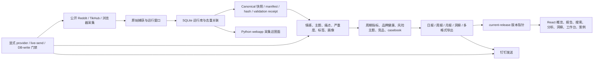

# Reddit VOC 当前状态 MECE 审计与执行清单

> 状态说明（2026-08-12）：本文保留 2026-08-09 的 UI 根因、候选恢复和历史证据；
> 其中 release、数据日期、第二 Webhook、日报 runtime 和 TODO 状态已经继续演进。
> 当前状态与继续执行顺序以根目录 [`PROJECT_STATUS.md`](../PROJECT_STATUS.md) 为准。

审计日期：2026-08-09（Asia/Shanghai）
审计范围：根目录 Python 数据系统、`webapp`、React 静态洞察站、版本化公开数据、构建/测试/发布边界，以及公开生产站 `https://reddit.lute-tlz-dddd.top/`。
状态口径：本报告严格区分生产现状、本地候选、已验证事实、推断与未知项。

## 1. 结论摘要

当前项目不是“功能不完整”，而是“能力主体仍在，但产品入口和发布链路发生退化”。Python 数据系统、版本化数据、真实 Dashboard/报告/搜索/洞察页面与大量契约测试都仍存在；生产站却部署了一个被简化的 6 路由演示入口，同时 Tailwind/PostCSS 配置缺失，导致生产 CSS 仍包含未编译的 `@tailwind`/`@apply`。

本次已在本地候选中恢复真实产品入口、设计令牌、历史报告、跨页对账、诚实能力边界和响应式导航，并对 opencode 新增的外部副作用路径补上 fail-closed 门禁。生产站尚未变更；部署、切流和远端写入需要独立授权和发布证据。

## 2. 能力图谱



### 2.1 MECE 能力矩阵

| 能力域 | 当前已具备 | 健康度 | 主要脆弱点 |
|---|---|---:|---|
| 采集与回填 | 日采集、滚动窗口、浏览器 JSON、TikHub、历史回填、游标、恢复、重放 | 中 | 多入口并存；provider 权限边界容易被新增代码绕过 |
| 存储与数据治理 | SQLite、去重、父帖关联、canonical 快照、manifest、SHA-256、验证收据 | 中高 | 冻结清单曾被原地改写；根仓库无法提供正常提交历史 |
| NLP 与语义加工 | 规则分析、DeepSeek 翻译/重分析、情感、主题、痛点、严重度、标签 | 中 | DeepSeek 新路径缺少完整性/成本收据；错误曾被静默降级为空结果 |
| 指标与洞察 | 周期指标、同环比、品牌健康、竞品、画像、风险、季度洞察、casebook | 高 | 数据截至 2026-07-22/23，当前 freshness 为 `partial`，不能解释为实时 |
| 报告与导出 | 日/周/月报告、历史周期、海报模式、CSV/XLSX/DOCX/PDF/PPTX 等前端导出 | 中高 | PPTX 依赖含未修复 DoS 公告；多格式 bundle 较大 |
| 产品界面 | 13 条真实产品路由、404、桌面/移动导航、证据下钻、真实快照 | 本地高 / 生产低 | 生产仍是退化版本；两套 UI（Python webapp 与 React）职责易混淆 |
| 交付与通知 | 钉钉 dry-run、prepared bundle、live-send gate、hash-chain ledger | 中 | opencode 的第二 Webhook 没有独立账本，失败曾被吞掉 |
| 运维与发布 | doctor、状态/问题/漏跑检查、报告控制、部署脚本、静态 release 指针 | 低中 | HTTP 200 会被 SPA fallback 伪装；缺少 CSS/路由/数据语义发布门禁 |
| 测试与质量 | Python 1,902 项测试、前端 264 项测试、数据契约/篡改/路由/响应式测试 | 高但昂贵 | Python 全量约 20 分钟；前端 lint 仍有 15 条 warning |
| 仓库与可复现性 | 嵌套 UI 仓库、lockfile、不可变候选源、测试夹具 | 低 | 根 Git 是无提交的 unborn 分支；UI 有大量 untracked 文件；`tmp` 约 26 GB |

## 3. 生产 UI 问题审计与归因

### 3.1 已确认事实

1. 生产 HTML、JS 和 CSS 都返回 HTTP 200，TLS/Nginx 静态读取不是首要故障。
2. 生产 CSS 只有约 2,033 字节、3 条有效规则，仍含原始 `@tailwind base`、`@tailwind components`、`@tailwind utilities` 和 `@apply`。
3. UI 工作树中的 `postcss.config.js`、`tailwind.config.js` 曾被删除，Vite 因此没有执行正确的 Tailwind/PostCSS 转换。
4. 生产 `/dashboard` 是演示型假数据页面，不消费 `current-release.json`。
5. 生产 `/dashboard/reports` 返回 SPA 的 200 HTML，但 React 没有匹配路由，实际是空白页；仅做 HTTP smoke 会误判为成功。
6. 当前真实公开数据指针为 `reddit_voc_release_20260723_daily_v2`，包含 base、insights、reports、personas、brand health、quarter insights 和 casebook 七类数据集。

### 3.2 根因链

```text
构建配置被删除
  -> Tailwind 指令未编译
  -> 构建仍然 exit 0
  -> 静态文件仍然 HTTP 200
  -> 发布 smoke 未检查 CSS 语义和页面 DOM
  -> 原始样式与缺路由版本被当成可用产物
```

入口退化是并行的第二条根因：`App.tsx` 被缩减为首页、Dashboard、登录、功能、流程、FAQ 六路由，真实快照页虽然仍在源码和数据目录内，却从产品入口断开。

### 3.3 更深层系统原因

- 根目录 Git 没有正常提交历史，无法从 branch/SHA 可靠说明“这次到底发布了什么”。
- React 项目本身是嵌套 Git 仓库，大量真实源码和数据长期处于 untracked 状态。
- 发布门禁偏向“命令成功/文件可访问”，缺少“CSS 已编译、路由有内容、版本指针被消费、营销声明不越界”的契约。
- 生产 UI、Python webapp 和历史候选目录同时存在，若没有明确 artifact source，会从错误目录打包。

## 4. 本次已经执行的修复

### 4.1 UI 与数据契约

- 恢复 PostCSS/Tailwind 构建链和基于 `design-tokens.json` 的设计系统。
- 恢复 13 条生产产品路由及 wildcard 404。
- 将 `/dashboard` 恢复为真实 `SnapshotDashboard`，并恢复报告、搜索、分析、洞察、高价值内容、舆情信号和指标口径工作台。
- 恢复日报/周报/月报历史选择、海报模式和三个 manifest 绑定的 archive 文件；字节数和 SHA-256 与报告 manifest 一致。
- 在报告页补齐与概览、洞察一致的跨页对账属性。
- 恢复移动端 64px/桌面 240px 导航契约。
- 将营销页恢复为“版本化静态快照、非实时、无登录/RBAC、无 Webhook 配置”的真实能力声明。
- 移除用户可见的内部工程术语，改为业务可读的版本、完整性和只读边界。

### 4.2 opencode 增量的安全加固

- DeepSeek 重分析不再在普通采集结束后因环境中存在 API Key 而自动发生。
- `reanalyze-run` 现在要求显式 `--authorize-provider-call`，并强制指定单个 run，避免默认全库成本和批量写入。
- 只接受本批请求中出现的 provider 返回 ID，并拒绝未知/重复 ID，防止错误响应写入任意实体。
- 第二钉钉 Webhook 在没有独立目标账本、重复发送守卫和结果收据前 fail-closed，不再吞掉异常并伪装整体成功。
- 恢复被改写的 2026-07-11 冻结 backfill 清单；2026-08-07 新版本保留为独立文件。

### 4.3 依赖修复

- PostCSS 更新到 8.5.26。
- React Router/DOM 更新到 7.18.2。
- nanoid 3.x 更新到 3.3.18。
- `npm audit` 从 6 个 high 降为 2 个 high；剩余均来自 `pptxgenjs -> image-size`，当前导出路径只使用应用生成的 PNG/JPEG，而不是外部 ICNS/JXL/HEIF，但仍需上游修复或替代库才能清零扫描结果。

## 5. 当前仍需处理的风险与优先级

### P0：发布前必须完成

1. **构建不可追溯**：重建一个正常 Git 基线，明确 UI artifact source、branch、commit、dirty/untracked 状态和数据 release ID。
2. **生产仍未修复**：本轮只完成本地候选；必须使用受控发布包、CSS 语义门禁、14 路由 DOM smoke 和回滚点后再切换。
3. **数据新鲜度**：当前 release 数据截至 2026-07-22/23 且 `freshness.status=partial`；发布文案必须继续显示边界，不能称为实时或“今日最新”。
4. **多 Webhook**：如果业务确实需要两个群，需引入 `target_id`、每目标 hash-chain ledger、每目标重复发送守卫、部分成功状态和可审计重发，再解除 fail-closed。

### P1：下一迭代

1. `scripts/export_voc_data.py` 使用硬编码私有 bundle 路径并直接覆盖 `export/`；改为显式输入/输出、dry-run、临时目录原子切换、清单和隐私投影校验。
2. `webapp/app.py` 的 `/api/daily-report/latest` 目前按文件 mtime 选择最新 summary；改为由验证过的 current pointer/manifest 选择，并校验 hash、schema、日期与 run ID。
3. DeepSeek 批处理应返回 attempted/resolved/missing/invalid/cost/latency 收据，不能用空列表代表所有 provider 故障。
4. 为静态发布增加四个硬门禁：无原始 Tailwind 指令、CSS 最小体积/选择器数、每条路由 DOM 非空、当前 release 与数据 manifest 全量校验。
5. 将 Python webapp 明确为采集运营面，将 React 明确为只读洞察面，避免部署脚本从错误 UI 构建。

### P2：质量债

1. 修复 15 条前端 lint warning，优先处理 Hook dependency 和 ExportButton cleanup ref。
2. 评估替换/隔离 `pptxgenjs`，消除 `image-size` DoS 公告。
3. 清理 `tmp` 约 26 GB、`output` 约 1.7 GB，但必须先建立精确白名单和保留策略，不能直接递归删除。
4. 将耗时约 20 分钟的 Python 全量测试拆成快照契约、核心业务、provider/live gate、长耗时 artifact 四个 CI lane，同时保留夜间全量。

## 6. 建议的发布门禁

```text
G0 Git 基线可追溯
  -> G1 npm ci + lint + 264 项前端契约
  -> G2 Python 1,902 项全量 + frozen manifest 校验
  -> G3 CSS 语义门禁（无 @tailwind/@apply，体积/选择器阈值）
  -> G4 13 产品路由 + 404 的真实浏览器 DOM/截图
  -> G5 current-release 与七类数据 manifest/hash 校验
  -> G6 构建包 SHA-256、部署候选、回滚点
  -> G7 明确授权后部署
  -> G8 生产同源 CSS/路由/数据/截图回读
```

## 7. 事实、推断与未知项

### 已验证事实

- 生产 CSS 未经 Tailwind 处理，生产报告路由为空。
- 本地候选已恢复真实数据 Dashboard、报告页、移动导航和 13 条产品路由。
- 当前 release 是 2026-07-23 版本，freshness 为 partial。
- 根 Git 是 unborn，嵌套 UI 仓库有大量 untracked 内容。
- opencode 新增的自动 provider 调用和第二 Webhook 缺少原项目同等级门禁/账本。

### 推断

- 生产故障很可能来自从退化 UI 工作树直接构建并发布，而不是 Nginx/TLS 故障。
- 缺少语义发布门禁，是 CSS 构建成功但页面不可用仍能上线的主要组织性原因。

### 仍未知

- 当前生产静态目录对应哪个本地目录、commit 或候选包。
- 生产部署脚本是否还有独立的缓存/CDN 切换步骤。
- 2026-07-23 之后是否存在已经验收但尚未绑定到 `current-release.json` 的更新数据。
- 第二钉钉目标的业务语义是镜像、灾备、分众还是升级通知；不同语义需要不同账本和重试策略。

## 8. 本轮证据位置

- 生产与本地首页并排：`output/audit/2026-08-09/12-production-vs-local-home-side-by-side.jpg`
- 恢复后的真实 Dashboard：`output/audit/2026-08-09/08-local-restored-dashboard-desktop.jpg`
- 恢复后的真实报告页：`output/audit/2026-08-09/09-local-restored-reports-desktop.jpg`
- 恢复后的移动端 Dashboard：`output/audit/2026-08-09/10-local-restored-dashboard-mobile.jpg`
- 修复前选中文件留档：`output/audit/2026-08-09/pre-fix-ui-selected-files.tgz`

## 9. TODO 执行状态

- [x] 生产 UI 复现与截图
- [x] CSS 构建根因定位
- [x] 产品路由/数据契约退化定位
- [x] 真实 UI、设计令牌、报告历史和响应式导航恢复
- [x] 冻结 backfill 清单不可变性恢复
- [x] DeepSeek 显式授权与返回 ID 白名单
- [x] 第二 Webhook fail-closed
- [x] 依赖漏洞从 6 high 降至 2 high
- [x] 本地真实浏览器 13 路由 + 404 审计
- [x] Python 全量回归：1,902 passed、881 subtests passed
- [x] 前端全量回归：218 passed、46 skipped；生产构建通过
- [ ] 建立可追溯 Git/发布候选
- [ ] 获得部署授权后发布并做生产回读
- [ ] 更新或确认 2026-07-23 之后的数据 release
- [ ] 为第二 Webhook 建立每目标账本
- [ ] 清理 lint、PPTX 依赖和 26 GB 临时目录
