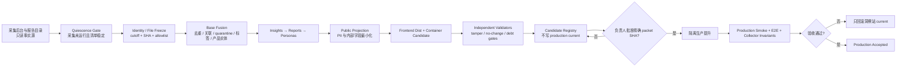

# Reddit VOC 增量候选接入、提升与自动化 TODO

## 1. 当前结论

RC3 已完成“最新数据盘点 → 不可变冻结 → Base → Insights → Reports → Personas →
公开投影 → 前端 dist → 本地容器制品 → 完整候选门禁 → 隔离生产提升 → 公网/浏览器验收”。
当前生产已接入该静态版本，但不能宣称 Reddit 数据已经完整水合。

本计划把两个动作严格分开：

1. **候选生成可以自动化。** 只读盘点、冻结、构建、验证、制品与候选登记可以无人值守。
2. **生产提升暂不自动化。** 前两个周期必须由负责人同时批准精确 promotion packet SHA
   与 release SHA；只有远端部署、
   生产 smoke、浏览器验收和采集器不变性证明都通过，才可记为 production accepted。

当前生产 release 为
`9e0d23131824c9d5e195ef9e0950d62e1c89893a40bafa1ec72c53fab330d650`，pointer 为
`reddit_voc_release_20260715_a900e6ce7b63`。精确 packet/release 授权已经消费；执行仅上传、
load 并替换洞察站容器/current。采集器、cron、共享 Nginx、TLS、DNS 和其他 Docker 未修改。

## 2. 已核实的数据事实

### 2.1 增量身份与内容

- 服务器 task2600–2603 选择集：66 个 allowlisted 文件，749,898 bytes。
- 相对生产 V2：23 个净新增帖子，139 条已关联评论；137 条评论进入 VOC 指标。
- 本增量片段还有 7 个未消费 reply cursor；它不是全局覆盖债务。
- task14014 只有 plan，不是内容事实源，继续排除。
- 新增帖子事件时间：2025-09-16 至 2026-02-26；新增评论还延伸到 2026-03-02。
- 按月份：2025-09 为 `10 帖 / 59 评论`，2026-02 为 `13 帖 / 77 评论`，
  2026-03 为 `0 帖 / 3 评论`。

### 2.2 当前 RC3 版本与业务影响

- RC3 input freeze SHA：
  `44c2b85be53b11e92a818267a4afa75e521d1fcee5024840c2c3be775e8d93f4`。
- Production pointer：`reddit_voc_release_20260715_a900e6ce7b63`。
- Production Base：1,322 帖、12,986 stored comments、12,976 linked comments、
  10 quarantine、12,825 VOC comments。
- 产品绑定保持 `708 bindings / 633 bound records / 205 exact-SPU`；本增量净变化为 0。
- 品类保持：吸奶器 616、洗奶瓶机 82、婴儿监视器 10。
- 当前日报、周报、月报及归档索引计数不变，因为新增事件不在当前闭合窗口。
- 2026-02 Momcozy 评论观测数 `27 → 28`；负向证据占比
  `11.11% → 10.71%`；方向结论仍为 unsupported。
- 画像分配 `233 → 234`；画像仍是带合成头像的内容证据分组，不是真实用户画像。
- 案例广场继续保持 `38 精选 + 12 待核验 + 0 已验证增量`。

### 2.3 必须保留的覆盖债务

- 883 个 discovery target 中：517 个当前抓取未观察到 more node，348 个 partial thread，
  18 个 lineage gap。
- cursor outstanding 367，page pagination outstanding 339。
- `thread_complete` 仅是当前抓取观察状态，不是 Reddit 绝对完整。
- 因此：

```text
latest_collection_integrated=true       # current production static release
latest_collection_fully_hydrated=false
completion_claim_supported=false
market_share_supported=false
production_promotion_executed=true
```

## 3. 第一性数据流



关键原则：采集后台是输入事实源，不是网站运行时依赖；候选站和生产站都只读取不可变静态
投影。自动任务没有权力直接跨过候选登记与精确 promotion packet SHA 批准门。

## 4. 已完成 TODO

- [x] 远端只读盘点并生成 66 文件 allowlist；没有远端写入或采集任务控制动作。
- [x] 将 allowlist 内容复制到本地私有 union，生成文件数/bytes/SHA manifest。
- [x] 冻结 RC3 全部数据、配置、标签字典、产品 ledger、构建器、validator 与前端发布源码。
- [x] 相同 RC3 freeze 命令得到 `created → no_change`，SHA 不变。
- [x] 生成 Base、Insights、Reports、Personas、public bundle 与动态 current pointer。
- [x] 独立验证 Base/Analytics/Personas；旧 V1 validator 不认识 V2 schema 的失败保留为历史
  证据，最终使用 V2 validator，不把旧失败改写成通过。
- [x] 完整候选 gate 绑定 RC3、四层 manifest、独立 receipts、public data、frontend dist 和
  release metadata；真实执行得到 `created → no_change`。
- [x] 对输入漂移、输出碰撞、缺文件、symlink、状态伪造和 container/deploy 完成声明做
  fail-closed 测试。
- [x] 构建本地 linux/amd64 容器候选，验证 UID 101、labels、release marker 和 55/55 dist；
  image 未 load，容器未创建或启动。
- [x] 13 路由 × desktop/mobile 浏览器 E2E 通过；无登录、外部自动请求、浏览器错误或溢出。
- [x] Python 回归 `98 passed + 9 subtests`；frontend `135/135`；lint 0 errors；新增增量
  validator/materializer Pyright 0 errors。
- [x] 生成并执行可复现 notebook；生成老板可读 HTML 报告，artifact validation、package、
  desktop/mobile browser verification 和来源弹窗键盘交互均通过。
- [x] `2026-07-15T07:03:31Z` 只读公网复核：`/healthz=ok`、首页 HTTP 200、current
  仍为 `reddit_voc_release_20260715_v2` 且绑定四个 V2 dataset；RC3 未被误提升。
- [x] 独立收尾审计发现“浏览器回执与传输制品未被同一授权对象绑定”的缺口；已重新对
  精确候选 dist 执行 13 路由 × desktop/mobile，26/26 HTTP 200，且 A/B/C、产品三层、
  6 个报告状态、画像、案例和采集后台安全链接合同全部通过。独立 receipt SHA 为
  `5666fbdb0f27c736215a8c68c36cde0f20afeeff7f586bdbc44d797a4fd06fe5`。
- [x] 生成 promotion packet，绑定 freeze、candidate gate、browser E2E、release manifest、
  SHA 列表、TGZ 与 linux/amd64 image tar 共 8 份证据；packet SHA 为
  `7d429a8354be451b90f04e7609845e4b49a350256d7c48ee5cfd5b64eda64f11`，
  checksum 与包内全部 path/bytes/SHA 复核通过。
- [x] 在授权范围内完成远端只读门禁、18339 隔离候选 smoke、正式 18338 洞察站切换、
  公网 HTTP、生产浏览器 E2E、CSV/DOCX 和部署后不变性验收。
- [x] 固化 production acceptance receipt，SHA
  `deee7ec9b827d73a902b359f4e11caaec77e0c039973582b4dc075f0a3b787cc`；保留完整覆盖债务、
  `/.env` SPA fallback 加固债务以及 PDF/PPT 未下载验证状态。

## 5. 自动候选链 TODO

### 5.1 触发与静稳门禁

- [ ] 优先消费采集后台的明确 terminal completion marker；若后台没有可靠 marker，再使用
  保守静稳探针，不以固定时钟直接开始构建。
- [ ] 静稳探针同时满足：无 `reddit_voc_site_app-run-*` one-shot 容器、采集服务 health 正常、
  restart count 不变、报告文件清单/bytes/mtime 在两个观测点稳定、没有未结束 task 状态。
- [ ] 任一条件不满足时返回 `no_candidate_collection_not_quiescent`，不重启采集器、不等待到
  超时后强行构建。
- [ ] 对每日 job 设置 singleton lock；重复触发只返回既有 run receipt。

### 5.2 冻结与融合

- [ ] 以 production current Base identity set 为基线，每次重新计算净新增，不依赖固定 task
  号或上次人工数字。
- [ ] 只复制 allowlist 内文件；拒绝 symlink、special file、越界路径、cutoff 后文件和 source
  drift。
- [ ] 冻结 source cutoff、远端选择 manifest、私有报告 union manifest、identity freeze、raw
  snapshot、标签字典、产品 ledger 和全部执行代码 SHA。
- [ ] 如果净新增为 0，生成 `no_change` receipt 并退出；不得为了“每天有版本”制造新 release。
- [ ] 如果仍有覆盖债务，允许构建 candidate，但必须保留 exact debt，不做零填充。

### 5.3 候选生成与注册

- [ ] 按固定顺序生成 Base → Insights → Reports → Personas → public projection → frontend
  dist → container artifact。
- [ ] 每层使用版本目录 + atomic rename；同内容返回 no-change，不覆盖已存在但内容不同的目录。
- [ ] 运行独立 validator、全候选 gate、tamper/no-change 回归与浏览器 E2E。
- [ ] 只在全部候选门禁通过后写 candidate registry；registry 记录 release SHA、input freeze SHA、
  数据版本、coverage debt、business delta、测试回执和过期时间。
- [ ] 自动链固定：`deploy=false`、`remote_write=false`、`schedule_change=false`、
  `database_write=false`、`provider_call=false`、`live_send=false`。

### 5.4 推荐调度策略

- [ ] 自动 job 可在报告任务正常结束后的保守窗口启动，但仍必须以 quiescence gate 为准；
  “到点”不是“采集完成”的证据。
- [ ] 前两个成功候选周期仅发送本地/内部候选摘要，不自动 production promotion。
- [ ] 两个周期都满足 no-change、tamper、回滚和采集器不变性后，再单独评估是否扩大权限；
  本计划不预授权自动 promotion。

## 6. RC3 生产提升（已按精确授权完成）

### 6.1 提升前只读门禁

- [x] 重新读取生产 current/release marker、洞察站容器 ID/health/restart count、采集容器与
  LibreTranslate 状态、网络成员、Nginx SHA、cron SHA 和采集后台 health。
- [x] 确认不在采集/报告活跃窗口，且无 one-shot 采集容器或文件持续变化。
- [x] 核对本地 RC3 freeze、candidate receipt、release manifest、TGZ 和 image tar 精确 SHA。
- [x] 授权对象同时是 promotion packet
  `7d429a8354be451b90f04e7609845e4b49a350256d7c48ee5cfd5b64eda64f11`
  与 release `9e0d23131824c9d5e195ef9e0950d62e1c89893a40bafa1ec72c53fab330d650`；
  packet 内任一源文件、回执或传输制品漂移都使授权失效。

### 6.2 隔离上传与切换

- [x] 只上传到隔离临时目录并发布到 `/opt/reddit-voc-insights-site/releases/<release_sha>/`；
  不写采集或报告目录，验收后删除临时目录。
- [x] 远端先验证 TGZ/SHA256SUMS，再加载候选 image；未 prune、重建或停止其他镜像/容器。
- [x] 只操作 Compose project `reddit_voc_insights` / container
  `reddit_voc_insights_web` / network `reddit_voc_insights_net`。
- [x] 先在 18339 独立验证候选的 health、release marker、四层 pointer 和公开 allowlist，
  清理候选后再用既有 18338 入口替换正式洞察容器并更新 current；不冒充蓝绿零停机。
- [x] 未修改共享 Nginx、TLS、DNS 或采集 cron。

### 6.3 生产验收

- [x] `/healthz`、首页、13 个 SPA 路由、current release、四层 manifests、公开数据和私有路径
  404 全部通过。
- [x] 桌面/移动浏览器验收 A 主线、B 报告分册、C 受控模块、产品三层、竞品同样本、两张
  合成头像、6 个报告状态、案例 38+12+0 和采集后台安全外链。
- [x] 下载验收覆盖 CSV、DOCX；PDF/PPT 继续保留未验证状态。
- [x] 对比提升前后采集器 ID/restart count、cron SHA、网络成员、后台 health 和活跃任务；
  全部不变，无需回滚。
- [x] 远端运行态 + 公网 HTTP + 生产浏览器验收通过后写入 production acceptance receipt。

### 6.4 回滚预案（未触发）

- [x] 提升前验证上一 release `f7a4c67...cf5e`、SHA 清单与 L4 证据仍可用；回滚命令只允许
  恢复上一洞察站 current/release，不回滚或重启采集后台。
- [x] 本次生产验收通过，`rollback_executed=false`；失败的部分传输和首轮候选 smoke 均保留
  事实记录，未伪装成未发生。
- [ ] 显式生产故障注入与回滚演练仍未授权、未执行。

## 7. 数据继续采集的优先级

1. 消化 cursor/page debt 与 18 lineage gaps；这是扩大趋势可信度的最高优先级。
2. 继续提高 Momcozy 与 Top 6 竞品在同一检索策略、同一事件窗口下的覆盖，而不是单独追求
   某品牌帖子数。
3. 对 Momcozy 品类、product family、exact-SPU 维持 ledger 审批；无绑定是合法结果，不做
   全局品类插补。
4. 保存日/周/月闭合窗口的连续 observation coverage，达到门禁后再开放方向性趋势、异常和
   速度；同比/环比继续显示 denominator 与 coverage status。
5. 案例广场只接收来源可追溯、离线审核通过的 approved delta；存量 38+12 不删除。

## 8. 已完成决策与下一独立决策

| 决策 | 推荐 | 影响 |
| --- | --- | --- |
| RC3 是否先提升生产 | **已选择并完成：先提升，明确显示 partial hydration** | 最新已合并数据已供查看；产品/SPU 主线稳定，风险由显式 debt 控制 |
| 是否先清完全部债务再提升 | **已决定不作为本次阻断** | 367 cursor / 339 page / 18 gap 继续进入采集优先级，不能据此声称完整 |
| 自动化权限 | **候选自动、production 手工** | 不干扰采集任务；前两周期用精确 promotion packet SHA 人工批准积累证据 |
| “完整”口径 | **不以 debt=0 作为唯一词义，建立来源级覆盖合同** | Reddit 绝对完整不可证明；应使用观察状态与可审计 coverage ledger |

上述精确 packet/release 授权已按原边界执行并验收。下一项独立决策仅是是否开发并启用
candidate-only 自动任务；本次提升不构成自动调度或自动 production promotion 的授权。

## 9. 证据入口

- RC3 freeze：`tmp/reddit-voc-incremental-input-freeze-20260715-3.json`
- Candidate receipt：
  `tmp/reddit-voc-incremental-candidate-20260715/candidate-validation-receipt-rc3.json`
- Browser E2E receipt：
  `tmp/reddit-voc-incremental-candidate-20260715/frontend/browser-e2e-receipt-rc3.json`
- Promotion packet 与 checksum：
  `tmp/reddit-voc-incremental-candidate-20260715/promotion-packet-rc3.json`、
  `tmp/reddit-voc-incremental-candidate-20260715/promotion-packet-rc3.sha256`
- Container release：
  `tmp/reddit-voc-incremental-candidate-20260715/frontend/container-release/9e0d23131824c9d5e195ef9e0950d62e1c89893a40bafa1ec72c53fab330d650/`
- Remote candidate smoke receipt：
  `tmp/reddit-voc-incremental-candidate-20260715/remote-candidate-smoke-receipt-rc3.json`
- Remote container evidence：
  `tmp/reddit-voc-incremental-candidate-20260715/remote-container-deploy-evidence-rc3.txt`
- Remote post-deploy receipt：
  `tmp/reddit-voc-incremental-candidate-20260715/remote-postdeploy-acceptance-receipt-rc3.json`
- Production browser receipt：
  `tmp/reddit-voc-incremental-candidate-20260715/production-browser-e2e-receipt-rc3.json`
- Production acceptance receipt 与 checksum：
  `tmp/reddit-voc-incremental-candidate-20260715/production-acceptance-receipt-rc3.json`、
  `tmp/reddit-voc-incremental-candidate-20260715/production-acceptance-receipt-rc3.json.sha256`
- 可复现 notebook：
  `output/reddit-voc-incremental-impact-20260715/reddit-voc-incremental-impact.ipynb`
- 管理层 HTML 报告：`output/reddit-voc-incremental-impact-20260715/report.html`
- 报告聚合源与审计笔记：
  `output/reddit-voc-incremental-impact-20260715/impact-summary.json`、
  `report-source.sqlite3`、`source-notes.json`

## 10. 当前边界

```text
production_accepted_with_explicit_coverage_debt
deploy=true
remote_write=true
schedule_change=false
provider_call=false
database_write=false
live_send=false
candidate_release_ready=true
production_latest_collection_integrated=true
production_latest_collection_fully_hydrated=false
production_completion_claim_supported=false
partial_threads=348
cursor_outstanding=367
page_pagination_outstanding=339
lineage_gaps=18
production_promotion_executed=true
collector_changed=false
cron_changed=false
shared_nginx_changed=false
tls_changed=false
dns_changed=false
other_docker_changed=false
incremental_automation_implemented=false
incremental_automation_enabled=false
```
