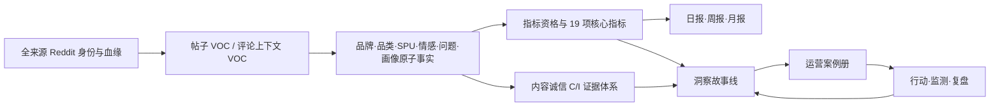

# Reddit VOC V3 完整数据、品牌健康、内容诚信与案例闭环设计

## 1. 已确认决策

Owner 于 2026-07-16 确认方案 A。本规格冻结以下产品和数据决策：

1. 所有已置于项目范围内的 Reddit 帖子、评论先按 Reddit canonical identity 去重，完整进入
   身份与来源血缘池；不得按情感、严重度、互动量或人工案例筛掉原始实体。
2. “进入身份池”“可形成 VOC”“可进入某项经营指标分母”是三个不同状态。数据完整纳入不代表
   每条记录无条件进入每项指标。
3. 帖子独立形成 `post_voc`；每一条评论与其根帖组成一条 `comment_context_voc`。帖子不是评论
   的附属字段，评论也不得脱离根帖上下文冒充完整 VOC。
4. Momcozy 是分析主干；品类、产品族、SPU、问题、场景、画像和风险均先在 Momcozy 内形成
   经营故事，再将其他品牌作为对照方。
5. 当前品牌指数中的“帖子样本能见度”和“评论样本能见度”移出总分，放入竞品比较面板；没有
   对称 query profile 时不计算跨品牌能见度或份额。
6. 新主指标为 `Momcozy 观察样本品牌健康指数`，版本 `brand_health_index_v2`，由口碑健康、
   产品体验、推荐信任、风险韧性四维等权计算。
7. 内容真实性、疑似非自然传播、机器人和社区治理证据进入独立的“内容诚信与社区信任”模块。
   I1/I2 信号不直接扣减品牌健康指数；版主和用户对此的真实负向 VOC 仍自然进入口碑和风险。
8. 只有 `C3+I4` 的人工确认实体才从 `qualified_organic` 自然口碑口径剥离；它们继续保留在
   `raw_observed`、canonical 实体和内容诚信审计导出中。页面只展示 raw 与 qualified 的敏感性
   差异，不新增未定义的第三套经营口径，也不删除原始事实。
9. 案例广场保留 38 条 seed 和 12 条 legacy 原内容；默认结果只展示通过门禁的参考案例。
   “洞察→证据→行动→监测→复盘”作为独立运营案例册，不改写参考案例本体。
10. 现有 UI 调性、路由、卡片、报告组件和导航优先复用。只有分析维度变化时增加适配组件，
    不进行无关视觉重构。
11. 网站不启用登录；继续保留进入 Reddit 采集后台的功能按钮。
12. 本规格不授权采集器、cron、共享 Nginx、TLS、DNS、其他 Docker、生产数据库或生产站点变更。

方案 A 相比两个备选项的取舍已经冻结：不采用“把疑似诚信风险直接混入品牌分数”的方案 B，
因为它会把用户对事件的负向 VOC 与同一事件的治理信号重复扣分；不采用“完全取消综合指数”的
方案 C，因为老板阅览需要一个可解释的执行摘要。方案 A 保留可复算的品牌健康总分，同时把内容
诚信作为独立、可升级也可撤回的治理结论。

在本规格获批前，V2 仍是当前书面基线；获批后，V3 只替代 V2 中与来源资格、品牌指数、指标门槛、
内容诚信和案例闭环冲突的条款。V2 中已冻结的 formatter、指标卡无障碍交互、82 原子画像 matcher
与 8 cohort bridge 细节按上述 SHA 继续继承；实现计划必须把继承项和 V3 修改项同时列入验收，
不能把“未重复抄写”解释为删除功能。

| V2 合同域 | V3 决策 | 生效规则 |
|---|---|---|
| hour/day/week/month formatter；instant/hour 的 Asia/Shanghai 显示 | 完整继承 | V3 补 floating-date 字面日期规则，不删除 formatter |
| `?` 键盘/移动端无障碍与 sparkline 缺失处理 | 完整继承 | V2 SHA 为精确交互基线 |
| 82 persona matcher、8 cohort bridge、assignment 稳定化 | 完整继承 | V3 只补指数/诚信所需证据边界 |
| 案例网络验证参数 | 完整继承 | 最多 5 次重定向、连接 10s、总超时 20s、仅 2xx；content-type allowlist、captcha/5xx/网络受限 fail closed |
| 来源资格、品牌健康指数、指标门槛、内容诚信、运营案例册 | V3 替代 | 只消费本规格定义，不混用旧公式或状态 |
| 删除项 | 无 | V3 没有以“未复述”为由删除 V2 已验收能力 |

案例网络验证中的 V2 `review_required` 结果映射为 CaseReference
`verification_status=pending` + 版本化 `review_reason`；它不是第五种 verification status。

## 2. 业务目标

V3 的目标不是做一个“帖子数量看板”，而是建立一条可审计的 Momcozy Reddit 经营分析链：



业务输出必须回答六个问题：

1. Momcozy 在当前观察范围内发生了什么？
2. 哪个品类、产品族或 SPU 驱动变化？
3. 帖子与评论分别表达了什么，二者是否出现线程放大？
4. 相比上一周期、去年同期和可比竞品，变化是否真实可比？
5. 哪些内容是自然口碑、披露商业内容、疑似协同传播或已确认违规干预？
6. 哪个洞察已经进入行动、由谁跟进、用什么指标验收、何时复盘？

产品组合沿用既有冻结的 A/B/C 结构：A 是概览、洞察、分析与搜索证据回跳组成的经营主线；
B 是日报、周报、月报三类报告分册；C 是只读的数据可信度与 release 状态控制面，实际
Freeze→Admit→Enrich→Build→Validate→Release→Deploy→Accept→Rollback 继续在离线流水线执行。
内容诚信和运营案例册是受治理的业务模块，分别进入 A/B 与案例页，不重新占用 C；其证据、人工
复核和发布仍有独立 gate，不能因 A/B 页面可用而自动发布高风险归属结论。

## 3. 非目标与禁止主张

- 不把 Reddit 观察样本解释为市场份额、销售额、转化率或总体消费者渗透率。
- 不把显式推荐率称为 NPS。
- 不把内容实体数量称为独立用户人数。
- 不把帖子作者画像继承给评论作者，也不把父帖情感、问题或画像复制到每条评论。
- 不把 affiliate、sponsored、coupon 或品牌大使内容自动判为违规。
- 不把文本相似、AI 文风、低 karma 或新账号单信号直接认定为机器人或品牌雇员。
- 不把 subreddit 版主处置冒充 Reddit 公司级平台裁定。
- 不把缺失作者、互动、小时级时间或账号历史的数据用模型补成事实。
- 不把 814 行负向筛选工作簿用于总体声量、总体情感、品牌健康指数或跨期趋势分母。
- 不恢复旧模拟评分、固定行业基准、虚拟同比环比或前端即时拼算指标。
- 不在浏览器运行时搜索案例、修改案例状态或写入审核结果。

## 4. 已核实数据基线

### 4.1 输入资产

| 资产 | 冻结事实 | 用途 |
|---|---|---|
| 当前私有 Base A2 | 1,322 posts；16,591 stored comments；16,581 linked；10 quarantined | 现有 governed canonical anchor |
| `reddit-舆情数据_20260715222622510.xlsx` | 12,720 行；2,094 posts；10,626 comments；SHA `136bbfc56d27bdcb9dde7a34894e722c09abba13209e357d615711bebd00eabb` | Owner 确认的未按结果筛选完整范围导出 |
| `舆情数据_20260715223255129.xlsx` | 814 行；132 posts；682 comments；全负向；SHA `331f1dce592b622854359cb9a5ed8329913cb77d94b66fd2c5ac3c8372f7a5b5` | 负向证据与遗漏召回，不进入总体分母 |
| `dim_tag_v6.3_final.csv` | 2,346 tags；28 fields；SHA `22664c9c446ddfa17446852079f507ab75b5af3d4dde6e4e3f3e44c195582e14` | 标签闭集 reference |
| `dim_persona_v1.csv` | 82 persona tags；SHA `279b313509141eb0f7432040818e261178fd9f75ec67a947a0cb9e6211799b1e` | 画像原子标签 reference |
| `indicator_tag_mapping.csv` | 8,854 relationships；26 codes；SHA `ebb6ee922e7fc190484d23808566c8a68241d493631ec7e16cb5d7d3f09a9270` | legacy 映射 reference |
| `voc-indicator-registry-stable.csv` | 43 indicators；29 stable / 14 review；SHA `7a8b0fef91f9668ab9457b1ee22e4b1289d84772aabd214feb4243bb12734bac` | legacy 指标 registry reference |
| `indicator_storyline_matrix.csv` | 43 rows；33 indicator codes；SHA `c017e7f3e4c7ace7c10cb65890078a32e02b944fe5417167a5f1cef23d33eac5` | legacy 故事线 reference |
| `13_voc_insight_storylines.md` | SHA `0c7702a4987529eb65ab75e6811d7aad4bdbbbe85a3f5a8dfd5d296ca1962fd2` | 六段式洞察方法 reference |

`dim_tag_v6.3_final.csv` 已位于当前项目。其余 `ai_nlp_voc` reference 仍位于来源项目，当前尚未
成为 Reddit VOC 运行时依赖；实施包 4 必须按上述 SHA 复制成项目内版本化资产并生成 manifest，
不得用绝对路径或 symlink 让生产站点依赖另一个工作区。

两份 Excel 合计 13,534 源行：2,226 帖子行、11,308 评论行。按 Reddit ID 去重后为
2,226 posts、11,305 comments，其中 3 行评论重复。与 Base 重合 54 posts、738 comments，
净新增身份候选为 2,172 posts、10,567 comments。

设计级合并目标为 3,494 posts、27,158 stored comments。这个数字是 importer/validator 的
守恒目标，不是当前生产事实；只有新候选独立复算通过后才能升级为发布事实。

### 4.2 文本与父帖完整性

- 净新增帖子：2,105 条正文可用，67 条缺 source post text。
- 净新增评论：10,500 条正文可用，67 条缺正文。
- 3,624 条净新增评论可解析根帖身份，其中 3,582 条同时具备评论正文和根帖 title/body 上下文。
- 42 条评论已知根帖身份，但根帖上下文为空。
- 6,943 条评论指向 3,859 个尚未进入 canonical posts 的根帖。
- 当前源行守恒：

```text
13,534 = 3 duplicate
       + 792 Base overlap
       + 5,687 text-ready
       + 6,943 unresolved-parent
       + 109 incomplete
```

这五类按上述顺序形成互斥终态桶：先判 duplicate，再判 Base overlap；净新实体中，可形成完整
`post_voc/comment_context_voc` 的进入 text-ready；缺 canonical 根帖的评论进入 unresolved-parent，
即使它同时缺评论正文也不重复进入 incomplete；最后 109 条 incomplete 是 67 条缺正文帖子与
42 条已知根帖但当前无法形成完整上下文的评论。Validator 必须同时验证逐桶明细与并集守恒。

### 4.3 时间与互动边界

- 两份工作簿的时间精度只有自然日，统一标记 `event_time_precision=day`、
  `source_timezone=unknown`。
- 日精度数据可以进入日、周、月窗口，不进入小时趋势桶。
- 大工作簿作者全部为空；浏览量、转赞评数量、粉丝数量全部为 0。这些字段只能作为 source audit
  事实，不得解释为 Reddit 原生 score、reach 或账号网络证据。

日精度且 timezone unknown 的记录必须物化为 `source_calendar_date=YYYY-MM-DD` floating date，
不得附加 `Z`、UTC offset 或浏览器本地时区。日报按字面日期、周报按该字面日期所属 ISO week、
月报按该字面日期的 `YYYY-MM` 分桶，禁止先转 UTC/Asia/Shanghai 再取日期。`Asia/Shanghai` 只用于
真实 `instant/hour` 且 source timezone 可解析的记录；两类时间在 artifact 中必须保留不同精度。

### 4.4 当前 release 与覆盖债务

必须同时保留两个不同证据层，禁止把本地候选写成生产现状：

- 当前已验收生产 promotion release 为
  `a5fa1e0a0a224969669d7e6ad79a9415b69f2ba4646b6e2bbca9030ff3d460f3`；生产验收时为
  1,322 posts、12,986 stored comments、12,976 linked、10 quarantine，且
  `latest_collection_integrated=true`、`latest_collection_fully_hydrated=false`、
  `completion_claim_supported=false`。
- 本规格使用的 1,322 posts、16,591 stored comments、16,581 linked、10 quarantined 是后续本地
  governed Base A2 设计 anchor，不代表已经再次提升生产。

Base A2 仍有 1,179 个 open coverage work items 和 18 条 pending lineage；`unaccounted_total=0`
只证明身份/账本守恒，不能关闭历史评论覆盖债务。Task2600–2603 的 23 个帖子和 139 条 linked
comments 已进入上一生产增量边界，后续完整合并必须按 canonical identity 只增加 provenance，
不得再次计为净新增；该切片剩余的 7 个 cursor 只是更大覆盖债务的子集，不得冒充总量。

若设计级合并目标通过，评论身份状态向量必须精确为：

```text
27,158 stored comments
= 20,205 linked-to-canonical-post identities
+ 6,943 unresolved-parent identities
+ 10 quarantined identities
```

其中 linked 只表示身份父链成立；42 条根帖上下文为空的评论仍不能形成 analysis-ready
`comment_context_voc`。上述任何债务只能由新 source evidence 和独立 validator 关闭，不能因
`add_data` 文件存在或前端已展示而清零。

## 5. 三层数据状态与来源资格

### 5.1 状态定义

| 层 | 状态 | 定义 |
|---|---|---|
| 身份层 | `canonical_identity` | Reddit ID 可解析；所有来源和冲突均保留 |
| VOC 层 | `analysis_ready` | 目标字段文本可用；评论上下文已关联真实根帖 |
| 指标层 | `metric_eligible` | 通过 source selection、字段质量、时间、品牌/产品和指标族专属门禁 |

任何重复记录只增加 provenance，不增加实体数、VOC 数或指标分母。

### 5.2 来源决策

| 来源类别 | 身份池 | 闭集打标 | Momcozy 内部指标 | 跨品牌能见度 | 趋势 |
|---|---:|---:|---:|---:|---:|
| governed Base anchor | 是 | 是 | 是 | query profile 对称时是 | 覆盖窗口完整时是 |
| 12,720 完整范围导出 | 是 | 是 | source manifest 通过后是 | query profile 对称前否 | 逐期 retrieval/coverage profile 相同后是 |
| 814 负向筛选导出 | 是 | 是 | 否；Base 独立 anchor 重合项除外 | 否 | 否 |
| 独立公开根帖 hydration | 是 | 是 | 依自身 source manifest | 否 | 仅补缺，不回写历史伪时间 |

12,720 的 Owner 声明解决“是否按结果筛选”，但 source manifest 仍必须绑定：文件 SHA、导出时间、
时间范围、query profile、分页或导出完成性、字段定义、行数、Reddit ID 解析结果和 metric-family
资格。缺少竞品对称 query profile 不影响 Momcozy 内部经营指标，但会关闭跨品牌能见度。

若原导出工具无法回溯精确 query terms，manifest 允许记录
`query_profile_status=owner_attested_unknown`，同时保存 Owner 的“完整范围、未按结果筛选”声明、
文件冻结、观察到的最小/最大事件日期和 ID/行数守恒。该状态可以进入 Momcozy 内部品牌健康指标。

Owner 于 `2026-07-16` 进一步确认当前合并历史采集完整性为 `100%`，并明确允许环比、同比和趋势
分析。系统必须把该确认保存为独立、不可变、hash-bound 的
`data_owner_declaration` coverage attestation，精确绑定当前 `source_snapshot_id`、scope、观察窗口和
comparison uses；不得只在前端把门禁布尔值改为 true。绑定通过后，同一 snapshot 内且三类 profile
hash、metric policy、scope、voc_type、时间精度和单位完全一致的 Momcozy 历史周期可参与环比、
同比、sparkline 和 RV-IN-05。缺少基期、指标不可用、数量基期为 0 或任一合同漂移时仍显示 `—`。
该完整性确认不自动证明竞品 query profile 对称，因此不自动开放跨品牌能见度、SOV、市场份额或
未知口径竞品差值；这些能力继续保持独立门禁。

### 5.3 增量接入合同

增量接入与现有采集器解耦。V3 不修改采集器的任务、cron 或数据库，只消费采集完成后形成的
不可变输出或受控导出：

```text
collector completed output
→ immutable source freeze
→ source manifest + cutoff/watermark
→ canonical dedupe + lineage append
→ candidate snapshot
→ independent validation
→ current-release candidate
```

每次增量运行必须绑定：

```text
incremental_run_id
source_dataset_id
source_cutoff_value
source_cutoff_precision
source_timezone_status
previous_release_sha256
input_manifest_sha256
canonical_delta_counts
duplicate_counts
unresolved_parent_counts
metric_eligibility_counts
candidate_release_sha256
validation_receipt_sha256
```

- watermark 只记录已验证 source cutoff，不按本地处理时间猜测；只有 `precision=instant/hour` 且
  timezone 已知时才派生 UTC，日精度且 timezone unknown 的导出不得伪造 `source_cutoff_utc`。
- 同一输入和上一 release 重跑必须产生相同 canonical delta 和 candidate identity。
- 新数据先进入 candidate，不自动切换生产 pointer。
- 增量失败保留上一 release，不允许部分更新 public 数据。
- 定时触发、生产提升和采集器接口变更属于独立授权层，不由本规格自动开启。

## 6. Canonical identity 与去重合同

### 6.1 身份键

- 帖子：`post_id=<base36>`，canonical fullname `t3_<post_id>`。
- 评论：`comment_id=<base36>`，canonical fullname `t1_<comment_id>`。
- 评论上下文：`comment_context_id=<post_id>:<comment_id>`。
- 线程：`thread_id=<post_id>`。

URL、permalink、`t3_` parent 与导出链接解析出的根帖 ID 必须一致；冲突时 fail closed，写入
`identity_conflict_ledger`，不得按任意优先级静默选择。

### 6.2 去重层次

1. 身份去重：相同 `t3/t1` 合并为一个 canonical entity。
2. 来源去重：相同实体的多份 capture 保存全部 provenance 和字段 hash。
3. 文本冲突：同一实体不同正文进入 conflict ledger；existing governed capture 优先用于经营事实，
   新来源只能补缺，不得无审覆盖。
4. campaign 聚类：URL-stripped hash、MinHash、SimHash 只用于识别疑似模板传播，不用于删除不同
   Reddit ID 的实体。
5. 统计去重：每个指标明确 distinct key，禁止标签 explode 后把一个实体重复计数。

## 7. 双粒度 VOC 合同

### 7.1 `post_voc`

```text
voc_id             = post:<post_id>
voc_type           = post_voc
analysis_fields    = post_title, post_body
author_scope       = post author only
metric_distinct_key= post_id
```

帖子独立参与帖子声量、帖子情感、帖子问题、帖子画像和帖子品牌健康子分。

### 7.2 `comment_context_voc`

```text
voc_id             = comment:<comment_id>
voc_type           = comment_context_voc
context_fields     = root_post_title, root_post_body
analysis_field     = current_comment_body
author_scope       = current comment author only
metric_distinct_key= comment_id
```

根帖上下文只允许帮助品牌、品类、产品族、SPU、topic 和指代消解。情感、问题、严重度、推荐和
画像事实必须有当前评论正文 span。内容诚信事实可以使用当前评论自身的 body、canonical URL、
当前作者公开元数据、当前实体行为观测或外部治理证据，但必须保存 evidence kind 与观察时间，
且不得只凭父帖内容继承；父帖独有事实不得复制到 N 条评论。

### 7.3 未关联评论

未关联评论进入 `canonical_identity` 和 `unresolved_parent_ledger`，但不形成
`comment_context_voc`，不进入品牌指数、评论画像、评论情感或线程放大指标。补到真实根帖后按
同一 comment ID 可重入，禁止伪造根帖正文。

## 8. 自动打标与原子事实体系

### 8.1 处理链

```text
source manifest
→ canonical entity + immutable lineage
→ fielded post_voc/comment_context_voc
→ brand/category/SPU routing
→ closed-set candidate selection
→ rule/evidence validation
→ entity atomic facts
→ metric-family eligibility
→ aggregate/derived indicators
→ calibrated storyline + evidence packet
```

第一版保持 `provider_call=false`，采用 deterministic provider-free 规则和人工审核账。模型不得替代
source lineage、父帖关联、分母资格或人工品牌归属。未来如启用模型，必须使用独立授权的闭集
输出合同，并继续通过同一 evidence validator。

### 8.2 `ai_nlp_voc` 复用边界

| 类别 | 资产/机制 | V3 规则 |
|---|---|---|
| 直接复用 | 字典 manifest、canonical ID、SHA、状态、可见性、重复 ID 拒绝 | 保持字节级版本化 |
| 直接复用 | HMAC 稳定 ID、input hash、checkpoint/idempotency | 适配 Reddit 字段化输入 |
| 直接复用 | 闭集、orphan=0、confidence、人工审核、fail-closed gate | 增加 grain/source/evidence gate |
| 直接复用 | Signal→Root Cause→Counter-intuitive→Impact→Action→Monitoring | 只消费已注册且可回链指标 |
| 适配 | candidate selector | 改为 token boundary + field + entity + grain + product scope |
| 适配 | evidence | 保存 field、start/end、normalizer version、substring hash、claim role |
| 适配 | indicator mapping/storyline | 只用显式 alias bridge，不做后缀猜测 |
| 禁止 | 扁平全文裸子串与 `min_keep` 补回 | 低证据候选进入 held，不自动补足数量 |
| 禁止 | 旧 `mv_atomic_indicators_v1` 直接作为 Reddit 原子事实 | 旧表是周聚合，不是 entity fact |
| 禁止 | Reddit 来源直接推断 AIPL=A | 来源不是旅程阶段证据 |
| 禁止 | AIPL prior 反推画像 | 无内容证据时不得生成 persona fact |
| 禁止 | 旧 NPS、ROI、销量、SLA、复购/流失公式 | 当前 Reddit 数据不支持 |

### 8.3 原子事实对象

每个原子事实至少包含：

```text
fact_id
canonical_entity_id
voc_id
voc_type
fact_type
canonical_value
evidence_field
evidence_start
evidence_end
evidence_text_sha256
decision_status = promoted | held | rejected
reason_codes[]
dictionary_release_id
matcher_version
source_snapshot_id
created_at
```

V3 必须生成以下事实表：

- `entity_brand_fact`
- `entity_product_fact`
- `entity_sentiment_fact`
- `entity_problem_fact`
- `entity_tag_fact`
- `persona_atomic_fact`
- `community_governance_fact`
- `commercial_relation_fact`
- `integrity_signal_fact`

### 8.4 P0 语义回归样本

`post:1kkvihg` 中 “keep coming back” 的主语是被指控的推广账号，不是消费者复购。该帖子不得
命中正向推荐或复购事实；根帖自身只产生 `integrity_allegation`、`moderation_warning` 等与其
正文相符的事实，不产生 `consumer_trust_impact`。信任与购买影响由当前评论正文产生，固定回归
评论至少包含 `t1_mrxlcx3`、`t1_mrxqx1g`、`t1_mrxu2ve`，并分别保存 comment-body span。
以下五条根帖组成固定回归集：

- [`1kkvihg`](https://www.reddit.com/r/ExclusivelyPumping/comments/1kkvihg/) — 2025-05 `Momcozy warning`
- [`1l2aofi`](https://www.reddit.com/r/ExclusivelyPumping/comments/1l2aofi/) — 2025-06 `Momcozy is back at it`
- [`1n2q1do`](https://www.reddit.com/r/ExclusivelyPumping/comments/1n2q1do/) — 2025-08 `Announcement regarding rules`
- [`1o1pqox`](https://www.reddit.com/r/ExclusivelyPumping/comments/1o1pqox/) — 2025-10 `Momcozy paying creators to lie`
- [`1u2gvn4`](https://www.reddit.com/r/ExclusivelyPumping/comments/1u2gvn4/) — 2026-06 `Momcozy is at it again`

## 9. 品类、产品族与 SPU

产品路由必须输出三个独立层级：

```text
category_id → product_family_id → spu_id
```

- 品牌明确但产品不明确：只进入品牌层。
- 品类明确但型号不明确：进入 category，不强制生成 SPU。
- 只有明确型号、字典 alias 或可审计上下文消歧才能生成 `spu_id`。
- 评论可借根帖消歧 product scope，但事实保存 `evidence_scope=cross_context`；评论自己的产品体验、
  问题和情感仍要求 current comment span。
- 所有报告和洞察都以 Momcozy category/product family/SPU 为主干，竞品在相同 product scope
  下比较；不得把不同品类的品牌提及直接比较。

## 10. 画像与标签推理

### 10.1 定义

画像是“内容证据群组”，不是人口统计用户画像，也不是独立用户人数。一个实体可命中多个原子画像，
但每个 group 内按 canonical entity 去重。

### 10.2 证据范围

- `post_voc`：只读 post title/body。
- `comment_context_voc`：画像只读 current comment body。
- 根帖可帮助品牌/SPU/topic 消歧，不得把阶段、偏好、身份、使用场景或情绪继承给评论作者。
- token boundary、Unicode NFKC、offset map、共享词冲突和 TECH 互斥必须版本化。
- 弱单词、模板词、跨画像共享词或证据冲突进入 held。

### 10.3 输出层

- 82 个原子 persona tag 保持 reference ID。
- 通过显式 many-to-many bridge 聚合为 8 个运营 cohort。
- cohort 卡展示证据量、帖子/评论拆分、产品 scope、代表证据和数据状态。
- 每个 cohort 使用项目治理的合成头像；必须标注“合成画像，不代表真实 Reddit 用户”。
- AIPL、决策阶段、场景和 persona 是不同维度，禁止相互无证据推断。

八个 cohort ID 与业务名保持稳定：

| cohort_id | 业务名 |
|---|---|
| `purchase_decision` | 选购决策者 |
| `product_evaluator` | 产品评估者 |
| `competitor_comparer` | 竞品比较者 |
| `operations_troubleshooter` | 操作与故障求助者 |
| `fit_output_optimizer` | 舒适适配与产出关注者 |
| `scenario_adapter` | 工作与家庭场景适配者 |
| `service_support_seeker` | 服务支持需求者 |
| `recommendation_expression` | 推荐表达群 |

bridge 的 `PER-*` 精确范围、晋级条件和 assignment 稳定 ID 继承第 1 节冻结的 V2 SHA；V3 不新增
“忠诚/复购人群”。单群组合格实体 `n>=30` 才允许比较和排名，`10<=n<30` 只显示方向性样本，
`n<10` 显示 `—`。每个 cohort 使用本地 512×512 合成头像；不得引用 Reddit 用户图片或外部热链，
`alt` 必须包含“非真实用户”，资源失败时使用本地中性 fallback。

## 11. 内容诚信与社区信任治理

### 11.1 官方规则映射

规则 reference：

- Reddit Spam：<https://support.reddithelp.com/hc/en-us/articles/360043504051-Spam>
- Reddit Disrupting Communities：<https://support.reddithelp.com/hc/en-us/articles/360043066412-Disrupting-Communities>
- Reddit Rules：<https://redditinc.com/policies/reddit-rules>

系统只映射公开规则与外部可观测信号，不代替 Reddit 内部执法。

### 11.2 商业关系轴

| 等级 | 定义 | 可发布称谓 |
|---|---|---|
| C0 | 无证据或不可观测 | 商业关系未知 |
| C1 | 未验证 lexical candidate：单条披露、优惠码、affiliate、sponsored；否认关系只作反证线索 | 商业内容线索 |
| C2 | 作者、链接、模板、时间、社区形成可重复传播模式 | 疑似商业传播模式 |
| C3 | 可回放的自披露或 affiliate registry 已绑定具体实体与品牌，或品牌确认等可审计归属 | 已确认商业关联 |

否认商业关系不能晋级 C3，也不能单独证明 C0；它只作为与其他证据共同复核的 counter-evidence。

### 11.3 完整性轴

| 等级 | 定义 | 可发布称谓 |
|---|---|---|
| I0 | 无有效证据或不可观测 | 无可用完整性结论 |
| I1 | 单一异常、普通用户指控或低证据词典命中 | 待复核信号 |
| I2 | 内容、行为、链接三类中至少两类独立信号成立 | 疑似非自然传播 |
| I3 | subreddit 版主处置、Reddit 公开动作或其他平台治理证据 | 外部社区治理事件 |
| I4 | 人工审计确认具体规则违规及品牌归属 | 已确认不当干预 |

I3 必须保存 `governance_authority=subreddit_moderator|reddit_platform|other_platform`；三者不能在
页面上互换称谓。当前 Momcozy 事件链的 authority 为 `subreddit_moderator`。

### 11.4 已核实 Momcozy 事件链

r/ExclusivelyPumping 的 2025-05 至 2026-06 公开帖子形成多次版主公告和处置叙述。当前可以确认：

- 版主身份自述和社区公告 flair 存在；
- 发帖者描述封禁账号、重复发生、曾逐条审核 Momcozy 帖子和评论；
- 社区用户表达对推荐真实性、购买决策和品牌信任的负向影响。

当前不能确认：

- 涉事账号完整清单；
- 账号与 Momcozy 的雇佣、控制或付款关系；
- Reddit 公司级平台裁定；
- Momcozy 对该事件的公开确认或反证。

因此事件链冻结为 `C2+I3`，不是 `C3+I4`。系统必须提供
`unanswered|disputed|confirmed|retracted` 回应生命周期，未找到回应不等于默认承认。

本地覆盖也必须显式呈现：Base 已有 `1kkvihg/1l2aofi/1o1pqox` 三条根帖；12,720 完整范围
工作簿提供 `1n2q1do`；814 负向工作簿只提供 `1u2gvn4` 下的 16 条评论且缺根帖。后者在补到
真实公开根帖前只作为 evidence-only 评论身份，禁止用评论内容伪造父帖。

### 11.5 检测与误报控制

第一阶段只生成可解释复核队列：

1. 抽取 disclosure、denial、affiliate、coupon、representative、moderator action 的字段化 span。
2. 生成 raw hash、URL-stripped hash、MinHash、SimHash 和版本。
3. 按稳定私有 pseudonym、canonical target URL、时间窗、subreddit 聚类。
4. Deal/coupon、普通育儿、品牌官方和产品讨论社区使用不同基线。
5. AutoModerator、显式通用 bot、删除文本、引用块、FAQ 模板和正常转发单独分类。
6. “not sponsored”只作为反证线索；公开 sponsor/affiliate 不自动判违规。
7. 同一规则同时应用 Momcozy 与竞品。
8. I2 以上进入人工分层抽样，记录 precision、误报原因和复核一致率。
9. campaign 按 cluster 计数；模板账号不能用几十条重复内容放大自然声量。

显式 AutoModerator/通用 bot/template automation 的确定性排除属于进入任何品牌指标之前的基础
metric-eligibility gate，而不是高级归属判断：实体继续保留在 canonical 与审计导出，但从 organic
VOC 和品牌健康分母排除，写入 `excluded_reason=explicit_automation`。该规则不能被解释为 Momcozy
商业关联证据，且必须在包 4 冻结、包 5 计算指数前通过。

当前本地 pointer 的 Base `reddit_voc_site_snapshot_20260715_candidate_a2`（public manifest SHA
`2d387bb4eaa6ca4108da4969fc2f42ba8eb7a1b9e07009326176abd33aa38b1b`，comments SHA
`a93a2522333a63d48c555a8e7e0bd09e44da93ab8f21605e7aadf942cec4638b`）按
`explicit_bot_disclosure_regex_audit_v1=(?i)\bi am a bot\b|\bthis action was performed automatically\b`
只读复算为 540 条显式 bot 自述：112 条已排除，428 条仍为 `is_bot=null` 且进入 VOC 分母。
这是绑定 snapshot 与 matcher 的审计基线，不是跨 release 常量。V3 必须先修复显式 bot/template
排除，再评估复杂协同传播；每次 release 都由 validator 重算，禁止复制这三个数。

### 11.6 后续采集字段

内容诚信审计需要补充以下公开或治理字段；缺失时降级结论，不做推断填充：

- 账号创建时间、link/comment karma、账号状态、公开 employee/mod 标识及 `observed_at_utc`。
- `domain`、真实 outbound URL、重定向目标、query 参数键和 affiliate/referral code 的 hash。
- `edited`、crosspost parent、is_original_content、author flair、distinguished、stickied。
- 公开 removed/moderation 状态、处置时间和公开 reason。
- score、upvote_ratio、num_comments 的多时间点快照及观察时间。
- title/body/URL-stripped text 的 normalized hash、MinHash、SimHash 和算法版本。
- 商业披露类型、披露品牌、证据 span、否定/引用/转述状态。
- 官方账号、官方社区、授权 affiliate code/domain 的人工治理 registry。
- rule/model/review version、reason codes、复核状态、复核时间和再评估期限。

禁止采集 IP、设备指纹或尝试识别真实个人。

## 12. Momcozy 观察样本品牌健康指数 V2

### 12.1 名称与窗口

- 标题：`Momcozy 观察样本品牌健康指数`
- 副标题：`近30个完整自然日 · Reddit 已观察样本（非市场份额/NPS）`
- 版本：`brand_health_index_v2`
- 时区：真实 instant/hour 的展示时区为 `Asia/Shanghai`；day/week/month floating date 不做时区转换。
- 窗口：最近 30 个已闭合自然日，左闭右开。
- 总分：0–100，四个未取整维度等权平均，最后 `round_half_up` 一次。

### 12.2 四维公式

每个维度先分别计算 `post_voc` 和 `comment_context_voc` 子分，再 50/50 平均，避免评论量级
压过帖子。每个实体在同一 grain、scope、period 内只计一次。

#### 口碑健康

对 sentiment-classified eligible entity 定义：正向 `s=1`、中性 `s=0`、负向 `s=-1`。

```text
reputation_score_g = 50 + 50 × sum(s_e) / distinct classified entities_g
```

#### 产品体验

候选全集为 Momcozy product-bound eligible entity，实际计分分母只包含
`problem_classification_status=complete` 的实体：存在至少一个 promoted negative product problem
fact 时 `problem_e=1`；已完整分类且明确无此事实时才为 0。`held|unprocessed|failed` 不得按 0，
它们排除于计分分母并进入数据健康覆盖率。

```text
product_experience_score_g = 100 × (
  1 - sum(problem_e) / distinct problem-classified product-bound entities_g
)
```

该 numerator/denominator 与同 grain、同 scope 的 RV-PS-02 成员集合完全一致，只做 100 分反向变换。

#### 推荐信任

候选全集为 Momcozy brand-eligible entity，实际计分分母只包含
`recommendation_classification_status=complete` 的实体：仅有明确推荐 `a=1`；仅有不信任/避免购买
`a=-1`；二者并存，或已完整分类且二者均无时 `a=0`。`held|unprocessed|failed` 不得按 0。
推荐必须是 promoted evidence，不是字典裸命中。

```text
recommendation_trust_score_g = 50 + 50 × sum(a_e)
  / distinct recommendation-classified brand-eligible entities_g
```

#### 风险韧性

候选全集为 Momcozy brand-eligible entity，实际计分分母只包含
`priority_classification_status=complete` 的实体。每个实体只取最高 promoted priority weight：
none=0、P2=.3、P1=.7、P0=1；none 仅表示完整分类后确认无优先级事实，不能代表未运行。
工作簿源字段中的 P3 不直接参与；必须先经 governed severity/tag 规则映射或进入 held。

```text
RV-IN-01_g = 100 × sum(priority_weight_e)
  / distinct priority-classified brand-eligible entities_g
risk_resilience_score_g = 100 - RV-IN-01_g
```

#### 维度与总分

```text
dimension_score = mean(post_score, comment_context_score)
brand_health_index_v2 = round_half_up(mean(
  reputation_dimension,
  product_experience_dimension,
  recommendation_trust_dimension,
  risk_resilience_dimension
))
```

### 12.3 样本门槛

- 每个维度、每个 grain 先计算 `classified_or_complete / candidate_eligible` 覆盖率：`>=90%`
  available，`80%<=coverage<90%` provisional，`<80%` unavailable；held/unprocessed 数量同时进入 RV-DH。
- grain 子分分母 `n>=30`：`available`。
- `10<=n<30`：`provisional`，显示数值和样本提示。
- `n<10`：`unavailable`，显示 `—`。
- 一个维度任一 grain unavailable：该维度和总分均显示 `—`。
- 任一 grain provisional：总分可以显示，但状态必须为 `provisional`，不得展示优秀/良好等级。
- 缺失不能补零，不能重分配权重。

### 12.4 raw 与 qualified organic

- `raw_observed`：消费全部 metric-eligible entity。
- `qualified_organic`：只排除人工确认的 `C3+I4` 商业关联违规实体。
- I1/I2 不排除、不扣分。
- C2/I3 的版主公告、普通用户讨论和信任影响仍是自然 VOC；它们按自身情感与风险进入分数。
- 页面显示 raw、qualified 和差值；没有 C3/I4 时 qualified 显示与 raw 相同，并解释原因。

### 12.5 竞品位置

竞品不进入 Momcozy 总分。竞品面板展示相同 product scope 下的观察量、净情感、问题率、
推荐表达和趋势差。只有双方 query profile 对称、来源资格一致、双方分母均 `n>=30` 时发布差值；
否则显示 `—` 和 `?` 口径说明。

## 13. 指标体系

指标链固定为五层，禁止越层推断：实体级原子事实 → 可加总的基础计数/率 → 关系与变化类衍生
指标 → `brand_health_index_v2` 复合指数 → 六段式洞察故事线。`ai_nlp_voc` 的旧聚合表和旧 NPS、
AIPL、ROI 公式只能作为方法参考，不能替代 Reddit 实体级原子事实。

### 13.1 19 项核心 Reddit 指标

| ID | 指标 | 核心公式 |
|---|---|---|
| RV-DH-01 | 根帖关联率 | linked distinct comments / all distinct comments |
| RV-DH-02 | 文本完整率 | text-ready entity / canonical identity，帖子评论分开 |
| RV-DH-03 | 有效标签率 | 至少一个 promoted tag / text-ready VOC |
| RV-DH-04 | SPU 绑定率 | governed product scope / product-relevant VOC |
| RV-DH-05 | 证据完整率 | evidence-complete tagged VOC / tagged VOC |
| RV-BR-01 | 观察量 | side-bound distinct eligible brand VOC count |
| RV-BR-02 | 负向率 | negative / sentiment-classified eligible VOC |
| RV-BR-03 | 净情感 | (positive-negative) / sentiment-classified eligible VOC |
| RV-BR-04 | 推荐表达率 | promoted recommendation expression / brand-eligible VOC；不是 NPS |
| RV-BR-05 | 竞品净情感差 | Momcozy balance - competitor union balance；只在可比门禁后发布 |
| RV-PS-01 | 产品 scope 占比 | scoped eligible VOC / parent-scope eligible VOC |
| RV-PS-02 | 产品问题率 | 同 scope 内具有 >=1 个 promoted negative `product_problem` fact 的 distinct entity / problem-classified product-bound eligible entity |
| RV-PS-03 | 产品问题排行 | 复用 RV-PS-02 分子，按 problem tag 聚合后 count desc、rate desc、tag_id asc |
| RV-PS-04 | 产品竞品问题差 | Momcozy RV-PS-02 - 同 scope 可比竞品 RV-PS-02 |
| RV-IN-01 | 紧急度 | 100×priority-classified 实体最高 weight 的平均值；P0=1、P1=.7、P2=.3、none=0，帖子评论分开 |
| RV-IN-02 | 标签关联 lift | nAB×N/(nA×nB) |
| RV-IN-03 | 画像差 | cohort tag rate - comparable overall tag rate，单位 pp |
| RV-IN-04 | 线程放大 | tagged-thread mean complete comments / eligible-thread mean complete comments |
| RV-IN-05 | 异常加速度 | Δ²log1p(eligible volume)，要求连续完整周期 |

RV-PS-02 是严格 AND 语义：同一实体必须有 promoted、负向、且 fact type 为 `product_problem` 的
事实；“只有负向情感”或“只有非负向产品话题”都不进分子。一个实体即使命中多个问题 fact，在
PS-02 分子仍只计一次；PS-03 与 PS-04 必须消费同一个冻结成员集合。

### 13.2 7 项受控内容诚信指标

| ID | 指标 | 规则 |
|---|---|---|
| RV-CI-01 | 显式 bot/template 排除率 | excluded explicit bot/template / detected explicit bot/template |
| RV-CI-02 | 商业披露率 | disclosed commercial entity / C1+ commercial candidates |
| RV-CI-03 | 疑似传播 cluster 数 | distinct C2/I2+ clusters，不按内容行放大 |
| RV-CI-04 | 外部治理事件数 | distinct I3+ event dossiers |
| RV-CI-05 | 已确认不当干预数 | distinct C3+I4 entities/clusters |
| RV-CI-06 | raw-qualified 敏感性差 | `target_metric_id` 的 raw - qualified；单位与 output shape 继承目标指标 |
| RV-CI-07 | 归属复核积压 | unresolved C2/I2+ review items by age bucket |

内容诚信指标不与 19 项核心指标混成一个黑盒总分。

### 13.3 可用性与样本门槛

| 指标族 | grain / scope | 数值可用门槛 | 差值、趋势或故事线门槛 |
|---|---|---|---|
| RV-DH | post、comment 分开；source/snapshot | 分母大于 0 即显示审计率，否则 `—` | 只有同一 source policy 与完整 snapshot 才比较 |
| RV-BR-01..04 | voc_type × brand × period | `n>=30` available；`10<=n<30` provisional；`n<10` `—` | 同口径连续完整周期；方向故事只消费 available/provisional |
| RV-BR-05 | product scope × Momcozy/竞品 | 双方均 `n>=30` 且 query/source 对称 | 不满足任一条件即 `—` |
| RV-PS-01..03 | voc_type × category/family/SPU | 比率沿用 30/10 门槛；计数可展示但小样本不下方向结论 | 排行同时展示 n、rate 和状态 |
| RV-PS-04 | 同 product scope 的品牌对 | 双方均 `n>=30` 且 query/source 对称 | 不满足任一条件即 `—` |
| RV-IN-01 | voc_type × brand/product scope | 沿用 30/10 门槛 | 比较要求同 priority policy |
| RV-IN-02/03 | tag/cohort pair × scope | `N>=30` 且相关边际计数均 `>=10` | 不满足即 `—`，不发布 lift/画像差方向结论 |
| RV-IN-04 | complete thread × tag/scope | tagged 与 eligible thread 各 `>=10` | 评论覆盖不完整或 thread 定义变化即 `—` |
| RV-IN-05 | scope × period | 至少 3 个连续、同口径、完整周期且每期 `n>=10` | 缺一周期即 `—` |
| RV-CI | entity/cluster/event/review ledger | count 可显示真实值和覆盖状态；rate 分母为 0 时 `—` | 趋势要求同 detection/review policy；不自动进入品牌健康总分 |

### 13.4 指标资格合同

主键为
`metric_member_type × metric_member_id × reddit_indicator_id × comparison_side × period × scope × voc_type`，
其中 `metric_member_type=canonical_entity|thread|cluster|event_dossier|review_item`，实体指标的
`metric_member_id` 必须是 canonical Reddit identity，线程/cluster/event 不得伪装成内容实体；
`comparison_side=raw_observed|qualified_organic|momcozy|competitor_union|current|baseline|not_applicable`。
`metric_family` 仅作分组，不能替代 `reddit_indicator_id`。每行保存：

```text
eligible | excluded
anchor_source
reason_codes[]
policy_version
denominator_member = true | false
numerator_member = true | false | not_applicable
membership_role
```

独立 validator 必须证明：

```text
numerator_ids ⊆ denominator_ids ⊆ metric_eligible_ids
```

RV-CI-06 只允许 `target_metric_id` 指向有明确定义单位与 raw/qualified 双口径的指数、比例或率；
不允许指向计数、排行或对象列表。目标是指数时单位为 score points，目标是比例/率时单位为 pp，
输出状态、样本门槛和不可用原因全部继承目标指标。

## 14. 日报、周报、月报

### 14.1 唯一业务入口

页面只保留 `最新完整周期` 作为默认入口。历史归档继续作为同比、环比和审计基期，不再用
“当前闭合期/闭合归档期”等工程称谓。

### 14.2 报告结构

每份报告保持同一故事顺序：

1. 执行摘要与数据状态。
2. Momcozy 品牌健康指数及四维变化。
3. 帖子与评论观察量、情感和趋势分拆。
4. 品类、产品族、SPU 的声量、问题、推荐和趋势。
5. 可比竞品差异。
6. 风险、严重度、线程放大和异常变化。
7. 内容诚信与社区信任。
8. 画像证据群组。
9. 高价值证据与运营案例。
10. 建议动作、owner、监测指标和下一复核日。

### 14.3 环比、同比与趋势

| 报告 | 环比 | 同比 |
|---|---|---|
| 日报 | 上一个完整自然日 | 上一自然年同月同日；不存在则 `—` |
| 周报 | 上一个完整 ISO week | 上一自然年相同 ISO week；不存在则 `—` |
| 月报 | 上一个完整自然月 | 上一自然年同月；不存在则 `—` |

- 比较只消费相同 metric policy、scope、voc_type、时间精度，以及逐期精确一致的
  `source_selection_profile_hash/coverage_profile_hash/retrieval_contract_hash`。只有相同状态名但
  hash 不同仍然不可比；`provisional_source_profile` 在未证明逐期合同一致前只展示单期描述值。
- 当前值和基期任一不可用时显示 `—`。
- 指标卡右上角使用 `?` 解释窗口、分母、覆盖和不可比原因。
- 卡片内 sparkline 使用完整历史观察值；上升红线、下降绿线，颜色只表示方向，不表示业务好坏。
- formatter 必须接收显式 `seriesGrain`：hour=`HH:mm`、day=`MM-DD`、week=周起始 `MM-DD`
  （tooltip 显示完整起止日期）、month=`YYYY-MM`。instant/hour 标题和 tooltip 使用
  `Asia/Shanghai`；day/week/month 直接格式化 `source_calendar_date`，不得做时区转换。
- 日精度数据不得显示为 `00:00` 小时桶；日报小时图只统计 `instant/hour` 实体，并单列
  `时间未提供 N 条`，与当日总量守恒。
- 趋势结论要求至少 3 个连续完整周期；异常加速度使用 RV-IN-05 的更严格完整性门禁。

卡片比较值只消费报告 artifact 的预计算结果，前端不得重建基期。数量基期为 0 时相对变化显示
`—`；占比变化用百分点，基期为 0 仍可计算。Sparkline 少于两个有限值时显示灰色短横线；中间
缺失必须断线。`?` 必须可键盘聚焦，以 Enter/Space 打开、Esc 关闭并恢复焦点，移动端触达区不小于
44×44 px。

## 15. 洞察故事线

每条洞察必须包含六段：

1. `Signal`：发生了什么，精确指标、周期、scope、帖子/评论 grain。
2. `Root Cause`：由哪些标签、SPU、社区或线程证据支持；无证据时写“根因未确认”。
3. `Counter-intuitive`：与总体、竞品或历史的反直觉差异；不可比时省略该段结论并说明原因。
4. `Impact`：对口碑、产品、信任或运营优先级的观察样本影响，不写销售因果。
5. `Action`：建议动作、owner role、优先级、审批状态。
6. `Monitoring`：指标、基线、目标、复核周期、停止或升级条件。

故事线只消费 `available/provisional` 指标和可回链 evidence ID；`unavailable` 不得触发方向结论。
Root Cause 是证据支持的解释，不是模型自动生成的事实。

## 16. 案例广场与运营案例册

### 16.1 当前资产冻结

当前 manifest：

- 38 seed，content SHA `372fa672767ed2585300cd1d47141b6189d3d6784b98c4bc8a69074db5ba48a7`
- 12 legacy unverified，content SHA `9d09b10949eb3790b34507d13dcbddcaf5fcd6e9f81e96dddd7e12ef86691de2`
- approved delta 0，content SHA `4f53cda18c2baa0c0354bb5f9a3ecbe5ed12ab4d8e11ba873c2f11161202b945`
- manifest SHA `6a233c0ef7fb207c9d3cd62b5920730686149911cfae3ad8af2a1d7fead6b969`

38+12 原内容、ID 和顺序保持不变。新 ledger 决定默认可见性，不靠修改 seed 删除问题链接。
最近一次 V2 盘点中 38 seed 有 37 条自动请求返回 2xx，Apple Podcasts 条目返回 500；该结果是
有时间点的核验基线，不是永久资格。Apple 条目继续保留但在 canonical link 重新通过前
`default_eligible=false`。

### 16.2 三对象模型

#### `CaseReference`

```text
reference_id
source_kind = curated_seed | legacy_unverified | approved_delta
verification_status
review_reason
verification_policy_version
default_eligible
canonical_url
content_hash
last_verified_at
provenance
```

`verification_status` 固定为 `verified|pending|rejected|stale`；只有 `verified` 且未超过核验 TTL、
主题与三键去重均通过时，`default_eligible=true`。

#### `CaseDossier`

```text
case_id
case_identity_key
case_version
business_question
lifecycle_status
brand_scope
product_scope
event_or_risk_theme_id
period_policy
insight_ref
snapshot_sha256
evidence_refs[]
reference_case_ids[]
created_at
review_due_at
```

#### `ActionMonitoringLedger`

```text
case_id
action_id
action_plan
owner_role
approval_status
metric_id
formula_version
baseline_window
baseline_value
target_definition
comparison_status
cadence
review_result
reviewer_role
reviewed_at
evidence_sha256
outcome_evidence_refs[]
provenance
```

### 16.3 生命周期

```text
observed → candidate → review_required → approved → monitoring → review_due → closed
              └──────────────→ rejected
closed → reopened → review_required
```

只有离线审核账本能推进状态。前端只读，不能用 localStorage 生成“执行中”或“已完成”。没有
ActionMonitoringLedger 时只显示“建议方案”。只有 `candidate|review_required` 可转 `rejected`；
`approved` 必须经 `monitoring→review_due` 才可 `closed`；`closed` 遇到新证据只能先转
`reopened`，再回到 `review_required`，不得直接覆盖历史结论。

通用 dossier 业务去重键固定为
`brand_scope + event_or_risk_theme_id + product_scope + period_policy`。同一键在版本化冷却期内只更新
原 dossier 的 `case_version`，不创建第二个业务案例；冷却期配置和旧版本都写入 manifest。外部
`reference_case_ids` 只提供背景方法或行业参考，不能自动成为 Reddit evidence；`evidence_refs[]`
必须解析到同一 snapshot 的 Reddit 事实或受治理外部事件证据。

### 16.4 默认搜索与增量

- 默认参考案例只消费 `default_eligible=true` 的 seed 和 verified approved delta。
- 12 legacy 永久保留在审核集合，默认不展示。
- approved delta 必须通过 HTTPS canonical URL、最多 5 次重定向、2xx、主题一致、provenance、
  核验时间、内容 hash 和 `id+canonical_url+content_hash` 三键去重。
- `last_verified_at` 超过 30 天即令 `verification_status=stale` 并进入待复核集合，不继续默认展示；
  `review_required` 只用于 CaseDossier 生命周期，不作为 CaseReference verification status。
- 增量失败时只回退 verified seed 子集，不回退全部 38 条。
- 当前四个发布校验器对 `approved_delta_count=0` 的硬编码必须在实现中移除，并用非空 delta
  正反测试替代。

### 16.5 首个高价值运营案例

首个 dossier 固定为：`Momcozy 社区信任与疑似非自然推广治理事件`。

当前它绑定第 8.4 节四个已进入 canonical 的根帖、`1u2gvn4` 的 external public reference、该帖
在 814 工作簿中的 16 条 evidence-only 评论、C2/I3 证据等级、Reddit 规则 reference、当前误分类
证据、品牌健康影响、建议行动和复核机制。`1u2gvn4` 真实根帖 hydration 并通过 source gate 后，
才可从 external reference 晋级为 canonical root。该案例不得使用“已确认品牌机器人项目”作为标题。
初始 `lifecycle_status=review_required`，没有 ActionMonitoringLedger 时所有动作只显示“建议方案”。
“品牌健康影响”只能回链评论/帖子自身的情感、推荐或风险事实；C2/I3 诚信等级本身不得再次扣分。

## 17. 页面与交互

### 17.1 概览页

首屏顺序：

1. 页面标题、数据版本、覆盖状态。
2. 已确认的 Momcozy 品牌使命横幅。
3. `brand_health_index_v2` 总分和四维雷达。
4. 核心数量/结构指标卡及卡内趋势。
5. 竞品比较面板。
6. 品类/SPU、风险和内容诚信模块。

当前雷达、环形分数、白卡、粉色主色和 Recharts 组件继续复用。删除两个能见度轴，不恢复旧
模拟六维分数。正常 partial/provisional/unavailable 状态不用感叹号作为系统错误提示。

品牌使命横幅继续使用 Owner 已确认的 2,064×386 PNG，SHA
`c59ebf5583dc703269f663e02144618ec7add70c063d75558bcef2c78e40beed`。桌面完整显示，移动端以
装饰裁切图加等价 HTML 文案保证可访问性，不叠加重复桌面文案。

### 17.2 报告页

- 保留日报、周报、月报路由和现有组件。
- 统一 `最新完整周期` 入口。
- 同环比卡显示真实值或 `—`，右上 `?`，卡内 sparkline。
- 增加 Momcozy 品类/SPU 与内容诚信段落，不改变其余已验证布局。

### 17.3 分析、搜索与画像

- `/dashboard/analytics` 保留情感、主题、subreddit、Momcozy 品类/SPU 和同口径竞品分析，并消费
  与报告相同的预计算指标 artifact，不继续读取 mock 数据。
- `/dashboard/search` 是统一证据落点；洞察、报告、画像和运营案例必须用 canonical post/comment
  ID 回跳并定位对应证据，同时携带来源页面、release 和 snapshot 供返回与审计。
- 画像继续作为分析/洞察中的证据模块，不为“用户人数”另建误导性页面；8 cohort、82 原子引用、
  合成头像、帖子/评论拆分和证据 scope 均可钻取到搜索页。

### 17.4 洞察页

故事线顺序为：品牌健康总览 → 产品/SPU → 风险 → 社区信任 → 画像 → 行动案例。
每张洞察卡必须能跳转证据帖子/评论、对应报告版本和运营案例。

### 17.5 案例页

保持现有卡片视觉，增加三个业务视图：

- `参考案例`
- `运营闭环`
- `待复核`

运营案例点击后打开内部详情抽屉，以“洞察→证据→行动→监测→复盘”五步轨道展示。参考案例
继续外链，运营案例不跳出站点。

### 17.6 C 控制面只读状态

`/dashboard` 与 `/dashboard/insights` 末端保留只读可信度卡，不新增主导航和写操作。至少展示：
release ID、source snapshot、验证状态、覆盖状态、open coverage、pending lineage、
`latest_collection_fully_hydrated`、指标/字典版本和最近验收时间。artifact 失败时 fail closed，
不得用旧状态或前端计算替代；卡片不能触发构建、审核、发布或回滚。

### 17.7 采集后台按钮

网站继续提供进入采集后台的明确功能按钮，目标固定为
<https://reddit.brand.lute-tlz-dddd.top/>。使用新窗口打开并设置 `noopener noreferrer`；洞察站
不代理后台、不共享登录态、不向后台写数据。该按钮不改变新洞察站“无需登录”的产品决策。

## 18. 完整范围导出

默认完整导出不得按情感、严重度、互动量或人工案例筛选，至少提供四份版本化制品：

1. `reddit-entities-full`：去重后的全部 posts/comments、source provenance、数据状态和排除原因。
2. `reddit-voc-facts`：post_voc/comment_context_voc 及品牌、产品、情感、标签、画像、治理事实。
3. `reddit-metrics-reporting`：日报/周报/月报指标、分子分母、比较值、状态和公式版本。
4. `reddit-governance-casebook`：C/I 证据、人工复核、参考案例、运营案例和行动监测账。

四份制品必须由同一个 `reddit_voc_export_bundle_manifest_v1` 绑定，不允许按目录扫描拼接：

```text
export_bundle_id
release_id
source_snapshot_id
source_cutoff_value
source_cutoff_precision
source_timezone_status
schema_version
dictionary_sha256
indicator_registry_sha256
eligibility_policy_sha256
builder_code_sha256
validator_code_sha256
artifacts[{name,path,sha256,byte_count,row_count}]
cross_reference_counts
candidate_release_sha256
validation_receipt_sha256
```

四制品的 `release_id/source_snapshot_id`、交叉引用和总量守恒必须一致；任一 SHA、row count 或
引用解析失败，整个 bundle 保持 candidate，不允许三新一旧。公开与私有 bundle 可分开生成，
但必须绑定同一 release。只有独立 validator 通过后才可原子切换 current export pointer。

公开导出不得包含真实作者名、私有 pseudonym、PII、审核人身份或内部操作备注。私有审计导出可
使用稳定 pseudonym，但不得尝试还原真实身份。

## 19. 错误处理与 fail-closed

- 文件 SHA、schema、行数或 manifest 不匹配：整批拒绝，不做部分静默晋级。
- canonical ID 冲突：进入 conflict ledger，相关实体不进指标。
- 父帖缺失：评论保留身份，不形成 comment-context 指标。
- evidence span 不可回放：事实 held，不能 promoted。
- 指标 formula、alias 或 eligibility 版本不一致：对应指标和故事线显示 `—`。
- Insights、Reports、Personas、Cases 各自拥有独立 artifact gate；一个模块失败不允许回退模拟数据。
- 非空 approved delta 校验失败：保留 verified seed，增量 fail closed。
- 内容诚信模型或聚类失败：保留 raw VOC，不产生新的机器人/违规结论。

## 20. 测试与对抗验收

### 20.1 数据守恒

- 13,534 源行守恒式精确成立。
- 3 条重复评论只增加 duplicate ledger，不增加 canonical count。
- Base overlap 54/738 只计一次并保留双来源 provenance。
- 设计目标 3,494/27,158 由 importer 和独立 validator 双重重算。
- source-row terminal disposition 与 canonical identity state 分开验收：13,534 个源行按
  duplicate→Base overlap→text-ready→unresolved-parent→incomplete 的互斥顺序各出现一次；
  duplicate/overlap 是 provenance disposition，不是第二个 canonical entity state。
- canonical 评论状态精确验证
  `27,158 stored = 20,205 linked + 6,943 unresolved-parent + 10 quarantined`；linked 中再拆
  analysis-ready 与 42 条上下文 incomplete，禁止混用“已关联”和“可分析”。
- 每个 source row 与 canonical identity 均能回链到对应 disposition/state ledger，且两个层次分别
  `unaccounted_total=0`。
- 相同 previous release、source cutoff 和输入 manifest 重跑时，增量 delta、账本和 candidate
  identity 必须字节稳定；cutoff 回退或输入漂移时 fail closed。
- 日精度/timezone-unknown 输入只保存 cutoff value/precision/status，不得派生伪 UTC。
- floating `source_calendar_date` 在 UTC 与 Asia/Shanghai 环境下产生完全相同的日/ISO 周/月桶。
- 四份导出只要 release/snapshot、SHA、row count 或交叉引用任一错配，整个 bundle validator 失败，
  current export pointer 不切换。

### 20.2 双粒度与标签

- 一个根帖有 N 条评论时只产生 1 post_voc + N comment_context_voc。
- 父帖独有负向、问题或 persona 不得复制到评论事实。
- 82 persona 字典 token boundary、shared keyword、held 和 TECH 互斥回归通过。
- `1kkvihg` 不再因 “keep coming back” 标为正向推荐。
- `1kkvihg` 根帖不产生 consumer-trust-impact；三个固定评论 ID 只从自身 comment-body span 产生。
- 五帖治理回归集全部产生正确 speaker/target/claim/moderation evidence。
- 当前 Base fixture 对显式 bot matcher 精确复算 540/112/428；所有显式 automation 在包 5 前写入
  `excluded_reason=explicit_automation`，但不自动生成 Momcozy 商业关联事实。

### 20.3 指标与指数

- 四维分别从明细实体独立复算，前端不得即时拼算。
- post/comment 50/50 权重、round-half-up、门槛和 `—` 行为通过边界测试。
- problem/recommendation/priority 的 held、unprocessed、failed 不得按 0；classification coverage
  和 n 门槛分别通过 79.99/80/89.99/90 边界测试。
- RV-PS-02 的 negative-only、nonnegative-product-topic 均不进分子；只有 promoted negative
  product-problem 进入，且 PS-03/04 与产品体验复用同一成员集合。
- I1/I2 对 raw 品牌健康指数无额外扣分。
- C3/I4 测试实体只从 qualified organic 剥离，raw、canonical 和内容诚信审计导出继续保留。
- 不对称 query profile 时跨品牌能见度和差值显示 `—`。
- 每个 `reddit_indicator_id × comparison_side` 的 numerator/denominator 子集关系由 tamper test
  验证；RV-CI-06 对 rate/index 继承正确单位，对 count/rank target fail closed。

### 20.4 报告与趋势

- daily/hour/day formatter 矩阵防止自然日全部显示 `00:00`。
- UI formatter 在不同时区环境下对同一 floating day/week/month 产生相同标签；只有 instant/hour
  使用 Asia/Shanghai 转换。
- 环比、同比可比时精确复算；缺基期、口径变化或覆盖不足时显示 `—`。
- 任一 source-selection/coverage/retrieval profile hash 不一致时同比、环比、趋势和 RV-IN-05 均为 `—`。
- 上升红、下降绿；颜色不替代业务好坏解释。
- 日报/周报/月报三类页面对应的 current/archive 共六个底层 artifact 与同一 snapshot 对账；UI
  每类只保留一个 `最新完整周期` 业务入口，archive 仅作比较和审计基线。

### 20.5 案例

- 38 seed 和 12 legacy 的内容 SHA 保持不变。
- 12 legacy 和过期 reference 不进入默认搜索。
- Apple Podcasts 条目在重新验证前保留但默认排除；30 天 TTL 与四态 verification enum 通过边界测试。
- pending CaseReference 的 `review_reason/verification_policy_version` 可稳定序列化、回读并通过 schema
  tamper test，不能丢成未定义字段。
- 非空 approved delta 可贯穿 manifest、closure、public projection 和 current release。
- 索引失败只回退 verified seed 子集。
- 运营案例 evidence ID 可解析到 snapshot；行动完成状态必须有 ledger provenance。
- 前端不能从标签字典直接发布 owner、执行状态或完成结果。

### 20.6 UI、E2E 与安全

- 13 条既有路由继续可用；无登录。
- 概览、三类报告、分析、洞察、画像、案例、搜索和采集后台按钮通过桌面/移动端 E2E。
- 洞察/报告/画像/运营案例可按 canonical ID 回跳搜索证据；C 可信度卡只读并准确显示 release 与
  open/pending/fully-hydrated 状态。
- 无运行时外网案例搜索、无浏览器写数据、无 secrets、无私有作者 pseudonym 泄露。
- 正常覆盖提示无 error 感叹号；真实 artifact 失败继续 fail closed。
- build、typecheck、lint、unit、integration、data validator、same-dist E2E 和 container smoke 全绿，
  才能生成本地候选。

## 21. 安全、隐私与审计

- 不读取、输出或提交 `.env`、私钥、token 和原始凭证。
- 不采集 IP、设备指纹或真实身份。
- 作者网络分析只使用私有稳定 pseudonym 和公开账号元数据，并受 source coverage 降级规则约束。
- 公开站点始终去除作者 pseudonym。
- 所有人工复核保存 policy version、review status、reason code、时间和证据 hash，不保存无关 PII。
- 内容诚信结论支持撤回、争议和重评；历史版本不可覆写。

## 22. 实施分解与依赖顺序

本规格需要拆为九个可独立验收的实施包；详细文件级计划在 Owner 完成书面规格复核后生成：

1. Source manifest 与完整范围导入合同。
2. Canonical identity、三层状态、去重和守恒账。
3. 根帖补链与双粒度 VOC 物化。
4. 闭集自动打标、原子事实、画像、显式 bot/template 基础排除 gate 与证据 validator。
5. 19 项核心指标、品牌健康指数、日/周/月比较和故事线。
6. 高阶内容诚信 C/I 聚类、商业归属、人工复核账与敏感性分析。
7. 参考案例增量准入、运营案例册和行动监测账。
8. 概览、报告、洞察、画像、案例和导出的前端适配。
9. 全链回归、same-dist E2E、本地候选、独立验收和另行授权的生产提升。

依赖关系固定为 `1→2→3→4→5/6→7→8→9`。第 5 与第 6 可在共同原子事实冻结后并行，
第 7 只能消费通过 evidence gate 的洞察，第 8 不能在数据合同未冻结前自行定义指标。

## 23. 发布与生产边界

规格批准、实现完成、本地测试通过、容器 smoke、生产部署和生产验收是不同证据层级。

当前状态：

```text
design_spec_only=true
provider_call=false
database_write=false
remote_write=false
deploy=false
live_send=false
production unchanged
```

旧 promotion packet 已消费，不得复用。未来生产提升必须生成新的 immutable release、独立验证
receipt 和精确 promotion packet，并由 Owner 另行授权。提升仍只允许切换 Reddit VOC 洞察站，
不得修改采集器、cron、共享 Nginx、TLS、DNS 或其他 Docker 环境。

## 24. 规格验收条件

本规格只有同时满足以下条件才可进入详细实施计划：

1. Owner 书面确认方案 A 的指数、内容诚信和案例边界。
2. 规格不存在未定义字段、冲突公式或隐含的跨品牌对称假设。
3. 五条 Momcozy 治理帖子被明确区分为“版主公开处置证据”与“品牌归属未最终确认”。
4. 12,720、814、Base、unresolved parent 和案例存量都存在唯一处理路径。
5. 19 项核心指标与 7 项治理指标均有 grain、scope、分母、门槛和不可用规则。
6. 品牌健康指数不使用竞品能见度，不因 I1/I2 额外扣分。
7. 案例广场存量内容保持不变，增量与运营闭环各自有独立账本。
8. 测试、隐私、fail-closed 和生产隔离要求可被自动化验证。
